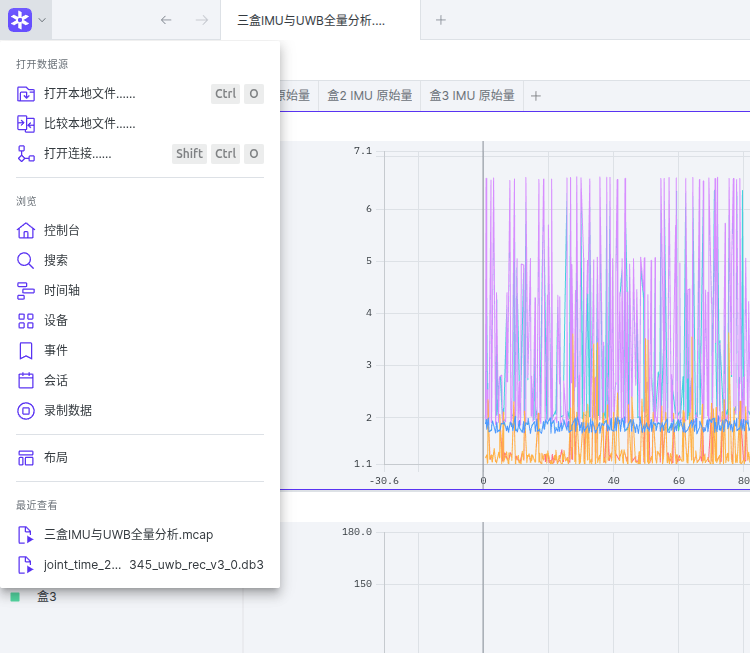
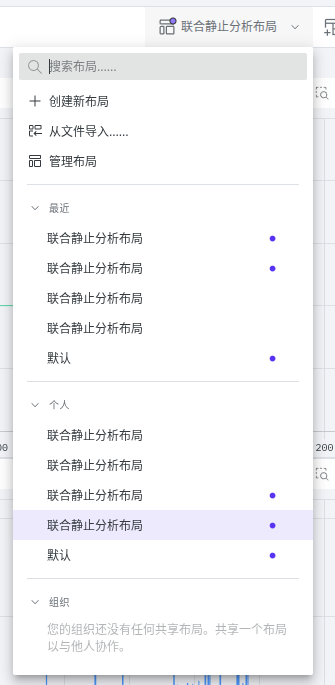
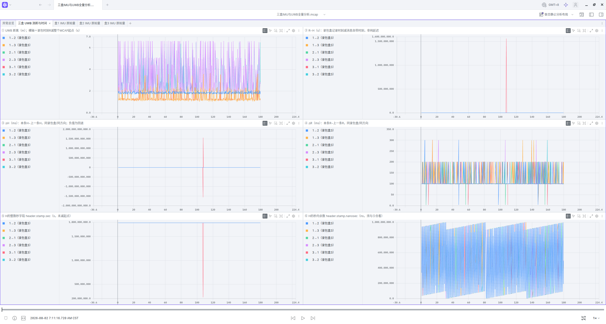
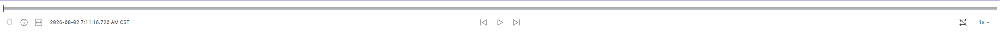
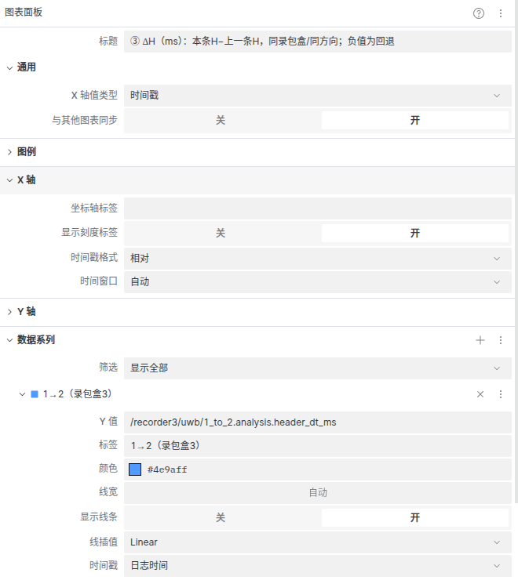
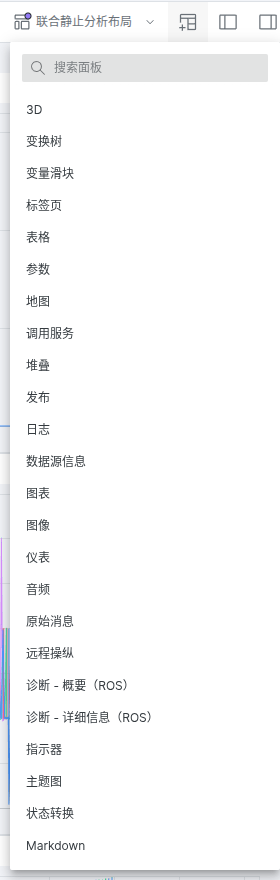
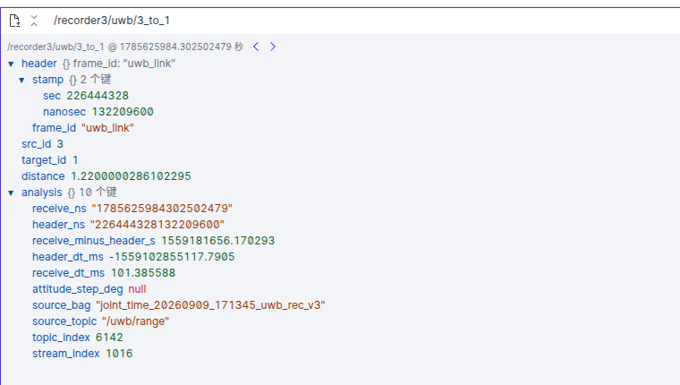

# 34 Foxglove 联合录包显示与分析

本文记录这次从“自定义消息类型无法识别”到显示中文曲线的完整操作，可用于后续新包。

- 只看本轮现成结果：执行第1节的两步。
- 不熟悉软件操作：接着看第1.3节，从打开文件到截图反馈按顺序操作。
- 自己转换下一轮：依次执行第4节；不需要再做现场录包。
- 理解缺失类型怎么解决：先看下面的原理说明。

## 0. 自定义消息类型缺失，是怎么解决的

### 0.1 缺的不是数据，而是 Foxglove 侧的字段定义

这次 Foxglove 直接打开 UWB `.db3` 时提示不支持：

```text
cooperative_interfaces/msg/UwbRange
cooperative_interfaces/msg/Identity
```

包内有 Topic、类型名称和序列化的二进制消息，但这批 `.db3` 没有内嵌完整消息定义。仅知道类型名称，Foxglove 不能推断每个字段的类型、顺序和嵌套结构。官方也建议把这类旧式 ROS 2 `.db3` 转成包含定义的 MCAP 后查看：[Foxglove 本地数据说明](https://docs.foxglove.dev/docs/visualization/connecting/local-data)。

**定义并不是我根据数据猜出来的。** 工程里已经有上交适配消息包：

[UwbRange.msg](../ros2/cooperative_interfaces/msg/UwbRange.msg)：

```text
std_msgs/Header header
uint32 src_id
uint32 target_id
float32 distance
```

[Identity.msg](../ros2/cooperative_interfaces/msg/Identity.msg)：

```text
uint32 node_id
uint16 uwb_id
```

IMU 使用标准类型 `sensor_msgs/msg/Imu`，`Header` 和 `Time` 也是标准 ROS 类型。自定义 `.msg` 必须与录包时盒端的定义一致，尤其是字段顺序和类型；以后上交改协议，要取得对应版本并重新构建，不能只凭同名就继续解码。

### 0.2 实际采用的转换流程

```text
工程中的 .msg 定义 → 构建得到 Python ROS 消息类型
                               ↓ 用于解码
原始 .db3 的 CDR 二进制 → Python 消息对象 → 字段字典
                                             ↓ 加入离线差分字段
                              JSON 消息 + JSON Schema
                                             ↓ 同时写入
                                 自包含的 .mcap 文件
                                             ↓
                              Foxglove 直接解析并画图
```

转换程序 [export_joint_foxglove.py](../tools/export_joint_foxglove.py) 做了以下几件事：

1. `rosbag2_py.SequentialReader` 只读打开原包。
2. `get_message(type_name)` 从已加载的 ROS 安装环境取得消息类；不是运行时直接读取源码 `.msg`。
3. `deserialize_message(raw, message_type)` 按对应类型解码 CDR；`message_to_ordereddict` 提取字段值。
4. 保留原始字段，另加 `analysis` 时间间隔、姿态差分等字段。
5. `register_schema(..., "jsonschema", ...)` 把字段结构写入 MCAP；`register_channel(..., "json", schema_id)` 把该定义与 Topic 关联；`add_message` 写入 JSON 消息。参见 [MCAP Writer 接口](https://mcap.dev/docs/python/mcap-apidoc/mcap.writer)。

所以，**转换端需要 ROS 和自定义消息包，查看端不再需要它们**。我没有修改 Foxglove 程序，也没有安装上交类型插件到 Foxglove，更没有改盒端驱动。

### 0.3 两个 JSON 不要混淆

| 内容          | 存在哪里                        | 作用                                                   |
| ------------- | ------------------------------- | ------------------------------------------------------ |
| JSON Schema   | 内嵌在`.mcap` 中              | 告诉 Foxglove 消息有哪些字段、字段是什么类型           |
| 中文布局 JSON | 单独的`联合静止分析布局.json` | 告诉 Foxglove 开哪些面板、画哪些字段、用什么标题和颜色 |

**导入布局不能解决消息解码问题。** 先打开带 Schema 的 MCAP，才有可供布局绘制的数据。

本次生成的是 **JSON 编码的可视化分析副本**，不是保持 ROS 2 CDR 类型的原生 MCAP。不要拿它直接替代原始包执行 `ros2 bag play` 并接入算法；算法回放继续使用原始 `.db3` 包。文件扩展名同为 `.mcap`，内部编码也可能不同。

## 1. 这轮直接打开

本轮数据：`data/joint_time_20260909_171345`。已生成以下文件，无需重新录包或启动 ROS 节点：

- [三盒IMU与UWB全量分析.mcap](../data/joint_time_20260909_171345/Foxglove/三盒IMU与UWB全量分析.mcap)：全部原始消息字段及离线差分量。
- [联合静止分析布局.json](../data/joint_time_20260909_171345/Foxglove/联合静止分析布局.json)：中文曲线布局。
- [导出核对.json](../data/joint_time_20260909_171345/Foxglove/导出核对.json)：逐流数量、接收时间范围、回退和姿态突变次数。

操作只有两步：

1. Foxglove 中按 `Ctrl+O`，选择上面的 `.mcap`。
2. 右上角布局菜单 → **从文件导入** → 选择上面的布局 `.json`。

默认显示“异常总览”，点击“三盒 UWB 测距与时间”查看独立 UWB 页面，点击“盒1/2/3 IMU 原始量”切换到各盒的陀螺、加速度、四元数和时间曲线。使用播放按钮或拖动底部时间条；在曲线内框选或缩放查看局部，图例可开关对应曲线。

**已经打开过旧版布局的，也要重新导入新版布局 JSON。** 本次新增 UWB 页只用现有 MCAP 的字段，不需要重新录包或转换 MCAP。

### 1.1 页面可以自己设置，不由消息类型固定

消息定义决定“有哪些数据字段”，布局决定“开哪些页面、每页画什么”。UWB 可以独占一个标签页，也可以按盒号、方向拆页，或与 IMU 共用一个页面。用“添加面板”添加 Tab（标签页），在其中添加 Plot（曲线），选择消息字段即可；参见 [Foxglove 官方 Tab 说明](https://docs.foxglove.dev/docs/visualization/panels/tab)。

“三盒 UWB 测距与时间”页的六张图已按①～⑥编号，标题注明取值与单位。先看第3节的H、R定义，再按表逐张读；不用把六张图当成六种不同的时钟。图例 `1→2（录包盒3）` 表示消息内容为 `src_id=1, target_id=2`，由盒3录制，不表示消息来自盒3的测距模块。

### 1.2 本轮三盒 UWB 时间比较

已用 `joint_time_20260909_171345` 的10226条UWB消息做了对比：

- [三盒UWB时间对比报告](../data/joint_time_20260909_171345/joint_time_20260909_171345_uwb_rec_v3/UWB时间对比/三盒UWB时间对比.md)
- [三盒UWB时间对比图片](../data/joint_time_20260909_171345/joint_time_20260909_171345_uwb_rec_v3/UWB时间对比/三盒UWB时间对比.png)
- [逐对比较CSV](../data/joint_time_20260909_171345/joint_time_20260909_171345_uwb_rec_v3/UWB时间对比/三盒UWB时间近邻配对.csv)

方法：在同一盒3录包时钟下，分别将1→2与2→1、1→3与3→1、2→3与3→2按接收时间互为最近邻匹配（≤20ms，一对一）。每对中前一个方向为A，后一个为B；H为消息自带时刻，R为录包时刻，定义：

$$
E=(H_B-H_A)-(R_B-R_A).
$$

表内E换算为毫秒。这是**两条不同方向消息的配对比较**，不是UWB页③④的“同方向前后帧间隔”。所有差值用整数纳秒先相减，异常不剔除；没有把每路首帧分别置零。注意其符号与②中的R−H相反：$E=(R_A-H_A)-(R_B-H_B)$。

| 来源组合 | E中位数(ms) | 全量 abs(E) P95(ms) |
| -------- | ----------: | ------------------: |
| 1与2     |      -1.034 |               6.581 |
| 1与3     |      -0.774 |               6.419 |
| 2与3     |      +0.131 |               6.196 |

**这些是消息时间一致性的观测量，不是硬件同步误差。** 相反方向未必是同一测距事件，E还含测距时隙、驱动处理、网络延迟差；消息扎堆到达也可能误配到相邻周期。静止数据不能证明PPS或物理采样同步。

本轮盒3在原UWB CSV序号6142、6143出现错误量级时间戳 `226444328.132209600`，前后正常值约 `1785547183.xxx`，必须保留并反馈。全量统计包含它们，图右侧只缩放到±10ms并注明图外点数。三盒UWB普通段的接收减消息时间均约78800.95秒，仍不能与接收时间/IMU时间直接等同。

以后复算（在工程根目录，输入**单个UWB录包目录**，不是联合实验父目录）：

```bash
python3 tools/compare_uwb_timestamps.py --self-test
python3 tools/compare_uwb_timestamps.py data/joint_time_20260909_171345/joint_time_20260909_171345_uwb_rec_v3
```

程序：[compare_uwb_timestamps.py](../tools/compare_uwb_timestamps.py)。复用既有 `UWB测距数据.csv`，不需要ROS，只需要Python 3和绘图用的Matplotlib；还没有CSV时，先按[31 离线分析步骤](31_联合录包离线分析操作步骤.md)解析原包。输出在该包的 `UWB时间对比/`，重复运行只覆盖这三个派生文件。

本轮实际打开的界面：[异常总览截图](../data/joint_time_20260909_171345/Foxglove/异常总览界面.png)。已回读核对 MCAP 校验和、389986条消息数量及精确接收时间/header，异常次数与原包分析一致。

原 `.db3` 不包含上交自定义消息定义，直接打开会提示不支持 `cooperative_interfaces/msg/UwbRange`。本次 MCAP 内嵌 JSON Schema，查看时不依赖 ROS 或上交消息包；不需要上传数据。参见 [Foxglove 本地文件说明](https://docs.foxglove.dev/docs/visualization/connecting/local-data) 与 [布局说明](https://docs.foxglove.dev/docs/visualization/layouts)。

### 1.3 Foxglove软件操作：从打开文件到反馈异常

以下在**安装Foxglove的电脑桌面**操作，不是在盒子的SSH终端里执行。已有MCAP与布局时，不需要重新录包、启动ROS节点或连接盒子。

步骤以本工程现有中文布局为例，中英文菜单名一起给出。下面7张配图是本机Foxglove的真实整窗或局部截图，使用 `joint_time_20260909_171345` 的转换数据；没有修改截图中的测量值或曲线。Foxglove版本不同，按钮位置、翻译可能变化，按功能名找即可。

在VS Code中按 `Ctrl+Shift+V` 打开Markdown预览看图。把教程发给别人时，请同时带上 `docs/images/foxglove/` 图片目录，保持与本文件的相对路径；只发送MD文件会缺图。

#### 第一步：打开数据文件

1. 打开Foxglove桌面软件。
2. 使用 **打开文件 / Open file**，或按 `Ctrl+O`。
3. 进入本轮 `data/joint_time_20260909_171345/Foxglove/`，选 `三盒IMU与UWB全量分析.mcap`。
4. 等待数据源加载；检查文件名、底部时间条是否出现。默认只有3D网格也不一定是失败，下一步还要加载布局。

这里选的是**数据MCAP**，不是布局JSON，也不是原始压缩包。换到Windows看时，选择复制到那台电脑上的实际路径，不要照抄Linux绝对路径。本流程使用本地文件入口，无需为了查看上传到云端。[官方本地文件说明](https://docs.foxglove.dev/docs/visualization/connecting/local-data)



图1：点击左上角Foxglove图标旁的菜单，选“打开本地文件……”。这里打开的是 `.mcap` 数据文件，不需要选“打开连接”。

#### 第二步：导入新版布局，进入UWB页

1. 找到显示当前布局名称的 **布局 / Layouts** 菜单。
2. 选择 **从文件导入 / Import from file…**，选同目录的 `联合静止分析布局.json`。不要用“打开数据文件”入口打开它。
3. 导入后先看到“异常总览”。点击页面内的 **三盒 UWB 测距与时间** 标签，进入UWB页；“盒1/2/3 IMU 原始量”是另外三个标签。
4. 检查UWB页标题是否带①～⑥，以及H、R等定义。没有这些新标题，通常仍在用旧布局；重新导入并切换到刚导入的布局。

布局导入不会替你打开MCAP，MCAP打开也不会自动更新先前导入的布局。若已有自己调整过的布局，先通过布局菜单 **导出 / Export…** 留一份副本，再导入工程版。[官方布局导入与导出](https://docs.foxglove.dev/docs/visualization/layouts)



图2：展开右上方“联合静止分析布局”旁的菜单，点“从文件导入……”，选择布局JSON。列表中可能有多个同名旧布局，不要仅凭名称判断是否为新版。



图3：上方标签可切换“异常总览”“三盒 UWB 测距与时间”和各盒IMU页。UWB页从左到右、从上到下依次是①距离、②R−H、③ΔH、④ΔR、⑤整数秒、⑥秒内纳秒。②③中的巨大尖峰使正常段看起来几乎贴着水平线，这不代表数据全为0。图较宽，可打开原PNG放大阅读。

#### 第三步：播放、暂停与跳到某段时间

底部播放条控制当前查看位置：点击播放/暂停按钮，拖动进度位置，或选择播放倍速。先用1×浏览，遇到异常暂停再细看；调倍速只影响观看速度，不改变包内时间和测量值。

Plot可以预加载一段甚至整个包的曲线，暂停后仍看到完整曲线是正常的；Raw Messages则主要展示当前播放位置对应的最近一条消息。跳转到某时刻时，不同Topic显示的“最近消息”可能并非同一时刻，不能因为同时出现在屏幕上就把它们当成同一事件。[官方播放与消息加载说明](https://docs.foxglove.dev/docs/visualization/playback)

本工程曲线横轴用相对秒，完整定义见3.2。底部若显示日历日期，而图上显示秒，两者只是显示形式不同；不要把图中的108秒直接当成一天中的00:01:48。



图4：上面细长的进度条用来跳转；下面中间的三角按钮控制播放，右侧“1×”控制倍速。左侧日期是当前播放位置的时间显示，不是实验文件夹名中的日期；两者来源不同，不能混用。

#### 第四步：只留关心的方向，放大异常

六条曲线重叠时，先只保留需要的方向。例如查车3相关消息，保留 `3→1（录包盒3）`、`3→2（录包盒3）`；若查同一条边的双向结果，保留 `1→3` 和 `3→1`。可在图例可见性开关或面板设置的对应数据系列中关闭其他曲线。关闭显示不会删除数据。

常用鼠标操作如下；先选中目标曲线面板，键盘焦点不要停在输入框里：

| 想做什么               | 操作                                          |
| ---------------------- | --------------------------------------------- |
| 平移查看别的时间段     | 在图内拖动                                    |
| 放大时间范围           | 在图内滚动鼠标滚轮                            |
| 框选某个异常区域       | 点工具栏Zoom放大工具，或按`Z` 后框选        |
| 只缩放纵轴             | 按住`Shift` 滚轮，或在纵轴上滚轮            |
| 恢复视图               | 点Reset view，或选中面板按`R`；也可双击图内 |
| 看一个点的值           | 鼠标悬停在实际数据点，读提示值与单位          |
| 把播放位置移到该点附近 | 点击图上的目标点                              |

这些操作与版本有关，以按钮提示为准。[官方Plot操作说明](https://docs.foxglove.dev/docs/visualization/panels/plot)

本轮UWB异常可先从横轴约108秒附近找，具体以该包报告为准。③的纵轴是毫秒，②是秒，⑥是纳秒，截图前务必确认自己看的哪一张。巨大尖峰把正常数据压扁时，先保留一张全范围图，再缩放看正常段；不能只给局部图而省略范围外异常。

#### 第五步：核对曲线设置，避免看错时间轴

选中一张图，通过面板的设置按钮或菜单打开 **Panel settings / 面板设置**。本工程UWB图应保持以下选择；不同版本可能把“Series”叫“Paths/路径”：

| 设置                                  | 本工程应选什么                   | 为什么                                               |
| ------------------------------------- | -------------------------------- | ---------------------------------------------------- |
| X-axis value type / 横轴类型          | Timestamp / 时间戳               | 画量值随时间变化，不是XY轨迹                         |
| Timestamp format / 时间显示           | Relative / 相对                  | 对应3.2的整个MCAP起点                                |
| Series Timestamp / 每条曲线使用的时间 | Receive time；新版可能称Log time | 对应原包记录时刻R，不改用Header stamp                |
| Sync with other plots / 与其他图同步  | 保持开启，便于同范围观察         | **只是图表缩放与时间视窗联动，不是传感器校时** |

设置项名称与用途可对照[官方Plot设置](https://docs.foxglove.dev/docs/visualization/panels/plot)。当前布局JSON使用 `timestampMethod: receiveTime`，转换程序把原包记录时间写入MCAP的 `log_time`；这两处对应同一个R。



图5：这里选中了③ΔH图。中部“时间戳格式＝相对”决定横轴怎样显示，底部数据系列“时间戳＝日志时间”决定横轴用哪个时钟；本工程因此显示的是 `R−T0`，不是 `H−T0`。上方“与其他图表同步＝开”只是方便一起缩放，不是在给三个盒子校时。数据系列中的“显示线条”可用来临时隐藏某个方向。

曲线表达式中Topic与字段是两部分。例如图③的一条线是：

```text
/recorder3/uwb/3_to_1.analysis.header_dt_ms
```

`/recorder3/uwb/3_to_1`是转换后Topic，`.analysis.header_dt_ms`是这条消息中的差分字段。不要为了让曲线“对齐”，把横轴改成H或分别减去各方向首帧。

仅查看现成结果不需要新增Plot；如果想试着改字段，先复制/导出布局副本，在副本上改，随时可以重新导入工程布局恢复。

#### 第六步：查看尖峰对应的原始消息

曲线用来找位置，具体异常反馈最好附一条完整消息，按下面操作：

1. 暂停播放，在图③中定位到异常附近。
2. 通过 **添加面板 / Add panel** 添加 **Raw Messages / 原始消息**。
3. 在路径输入框选择完整Topic，例如 `/recorder3/uwb/3_to_1`，不要只填某个数值字段。
4. 展开 `header → stamp` 和 `analysis`，读取下面列出的字段。
5. 如果版本提供消息时间旁的上一条/下一条按钮，可逐条查看；当前官方快捷键为选中面板后 `Alt+[` / `Alt+]`。这里按该Topic逐条走，不是把全部六方向混成一个序列。
6. 使用 **Copy msg / 复制消息** 保存当前内容。若旧版没有相同入口，可选中复制文本，或截图保留字段。

Raw Messages展示消息树、逐条步进和复制的操作参见[官方Raw Messages说明](https://docs.foxglove.dev/docs/visualization/panels/raw-messages)。



图6：展开“添加面板”菜单，选“原始消息”。添加后，在新面板顶部输入完整Topic；它与UWB曲线页可以并排查看。

| 这次主要读哪些字段                                    | 用途                             |
| ----------------------------------------------------- | -------------------------------- |
| `src_id`、`target_id`、`distance`               | 确认是哪个方向、距离多少         |
| `header.stamp.sec/nanosec`                          | 原始H的两个部分                  |
| `analysis.receive_ns`、`analysis.header_ns`       | 精确R与H，单位纳秒，按字符串保存 |
| `analysis.header_dt_ms`、`analysis.receive_dt_ms` | 同方向相邻帧的ΔH、ΔR           |
| `analysis.topic_index`                              | 回查原UWB CSV的测距序号          |
| `analysis.source_bag`、`analysis.source_topic`    | 追溯哪一包、原Topic是什么        |

注意：本MCAP中的“原始消息”是保留原字段并附加analysis的JSON副本，不是原CDR二进制。Raw Messages停在“最近一条”不一定恰好就是你要的尖峰帧，应用序号和时间确认，必要时前后逐条查看。



图7是本轮实际找到的一条异常，不是演示用的假数：

- 顶部Topic为 `/recorder3/uwb/3_to_1`，表示盒3录到的3→1方向；消息中的 `src_id=3`、`target_id=1` 也能核对。
- 展开的 `header.stamp` 给出 `sec=226444328`、`nanosec=132209600`，所以本条H为 `226444328.132209600 s`。
- `analysis.receive_ns=1785625984302502479`，所以R为 `1785625984.302502479 s`。保留完整整数查证，不要只抄图上四舍五入的横轴数值。
- `header_dt_ms` 为巨大负数，而 `receive_dt_ms≈101.386 ms`：同方向记录的消息时刻发生了异常回退，录包记录间隔仍约0.1秒。它不能被解释成这么长的网络延迟。
- `topic_index=6142` 可回查原 `UWB测距数据.csv` 的测距序号；它不是CSV含表头的物理文件行号。`stream_index=1016` 则是该分流内序号，两者不要混淆。

时间行右侧的左右箭头用于查看这个Topic的上一条、下一条消息。反馈时把这张图连同包名、序号发出，比只截一根尖峰更容易复核。查看完可通过该面板右上角“⋮ → 移除面板”恢复原来的UWB六图布局；这只移除界面面板，不会删除数据。

#### 第七步：保存布局，导出反馈证据

调整面板后，有 **Save changes / 保存更改** 时先保存；要拿到可复制的文件，再从布局菜单选择 **Export… / 导出**。建议另存为 `联合静止分析布局_个人查看版.json`，保留工程原版。软件记住布局不等于自动重写工程目录里的同名JSON。[官方布局保存说明](https://docs.foxglove.dev/docs/visualization/layouts)

反馈一处异常时，准备以下内容就够：

- 一张全范围图：能看到所选方向、面板标题、单位和异常所在位置。
- 一张局部放大图：看清前后变化，保留横纵轴刻度；可用操作系统截图工具。
- 对应消息文本或原导出CSV的行号，并注明本轮包名。

不要只截一根没刻度的尖峰。可以附一句：“在 `joint_time_20260909_171345`，盒3录制的3→1方向，MCAP相对横轴约……秒处，原测距序号……，ΔH为……ms；附件含前后帧。”填实际读数，不照抄示例省略号。

Plot右键菜单在支持的版本里可导出绘制数据为CSV；正式逐帧核查仍优先用工程已经导出的 `UWB测距数据.csv`，其序号与本工具的 `topic_index` 对应。软件显示/导出能力见[官方Plot说明](https://docs.foxglove.dev/docs/visualization/panels/plot)。

#### 第八步：换新实验时，只换这一组文件

按第4节生成新实验的MCAP和布局，然后打开新MCAP、导入它自己的布局。不要只改窗口里的名字仍保留旧数据源；录包盒从3换成2时，Topic前缀也会变成 `/recorder2/...`，旧布局中的 `/recorder3/...` 可能无数据。

快速排查：

| 看到的现象                       | 先检查                                                          |
| -------------------------------- | --------------------------------------------------------------- |
| 只有3D网格                       | 是否已经导入并选中工程布局                                      |
| 没有①～⑥的新标题               | 是否导入了新版JSON，是否切到正确布局                            |
| 图例有路径、曲线为空             | 当前MCAP是否匹配该Topic，曲线是否被关闭，是否缩放到了数据范围外 |
| 很多曲线挤成水平线               | 是否被巨大异常撑大纵轴，不要直接当成数值全0                     |
| 曲线有数据，Raw Messages暂时没有 | 播放位置是否早于该Topic首帧，所选Topic是否正确                  |
| 时间显示差8小时                  | 先核对UTC/本地时区显示，不能直接认定传感器又产生8小时偏差       |
| 重新打开后自己的调整没了         | 是否保存并导出了个人布局，是否又导入了工程原版                  |

第一次练习只需完成一件事：**打开UWB页，找到一处③异常，查到对应Raw Messages并保留截图和序号。** 不必先掌握全部面板，也无需重新做一遍数据转换。

## 2. 看哪些曲线

| 面板               | 本轮重点                                                      |
| ------------------ | ------------------------------------------------------------- |
| 六向 UWB 测距      | 2→3、3→2 距离波动较大；没有卷尺真值，不能把标准差当绝对精度 |
| IMU 消息时间间隔   | 盒2、盒3约 +1001ms 前跳和 −999ms 回退                        |
| 相邻四元数旋转角   | 三盒约133秒处的180°突变，已排除 q 与 −q 的等价变号          |
| IMU 录得接收间隔   | 盒1间隔稀疏不均匀，另两盒通常约1ms；不直接等于硬件采样周期    |
| UWB 消息时间间隔   | 约108秒处源3严重异常；巨大尖峰会压缩正常范围，需局部缩放      |
| UWB 接收减消息时间 | 正常段约78801秒；包含时钟基准差，不是网络延迟                 |

这里的“约133秒/108秒”按合并文件最早接收时刻为零，与各单包分析报告独立置零的横轴略有不同。原始统计与精确帧号见 [本轮联合测试结论](../data/joint_time_20260909_171345/本轮联合测试结论.md)。

## 3. Topic 与时间含义

| Topic                                                   | 含义                                                |
| ------------------------------------------------------- | --------------------------------------------------- |
| `/box1/imu_raw`、`/box2/imu_raw`、`/box3/imu_raw` | 按录包目录的盒号区分 IMU，避免三个`/imu/raw` 混淆 |
| `/recorder3/uwb/1_to_2` 等六条                        | 在盒3录得、消息内容为1→2的测距；录包盒不等于测距源 |
| `/recorder3/node_id`                                  | 原`/node/id` 身份消息                             |

### 3.1 先分清两个时刻：H与R

**H＝这条消息自己携带的时刻。** 取自原始 `/uwb/range` 的 `header.stamp`，也就是上交驱动填进消息里的秒和纳秒。换算成秒：

$$
H_k=\mathrm{sec}_k+\frac{\mathrm{nanosec}_k}{10^9}.
$$

它声称表示哪个测距时刻、由谁授时、采用哪个日期起点，需要上交确认；仅凭字段名不能证明它是真实采样时间，也不能证明它就是 `src_id` 对应盒子的系统时间。整数看起来像Unix时间，也不等于已经验证其UTC日期正确。

**R＝录包程序给这条消息记录的时刻。** 来自原 `.db3` 中的消息记录时间（导出程序的 `read_next()` 返回值）。本轮UWB包在盒3录制，所以六个方向的R都来自同一个盒3录包时间轴；不是Windows电脑接收到下载文件的时刻，不是Foxglove播放到这条消息的实际时刻，也不是无线电信号到达天线的硬件捕获时刻。

下文H、R均用秒表示；若使用精确纳秒整数，要先除以相应单位再读数。**这是两条不同来源的时间，不预先假定它们有同一个零点。**

### 3.2 横轴只有一种：从整个MCAP起点算起的录包时间

$$
x_k=R_k-T_0\quad\text{（秒）}.
$$

$T_0$是这个合并MCAP内最早的记录时刻，包含IMU和身份等消息，**不是每条UWB方向自己的首帧，也不一定是UWB包首帧**。因此某方向第一点不一定在横轴0秒。切换标签页不会重新给该页设零点。

横轴100秒的意思是“这条记录的R比MCAP起点大100秒”，不是“H等于100秒”、不是“消息走了100秒网络”。所有六张UWB图都使用这同一横轴；变化的是纵轴。

三盒IMU包的R分别来自各盒记录时钟，本工具没校准这些系统时钟。因此合并MCAP的共同显示横轴不代表跨盒真实时间已经同步。UWB六方向来自同一个录包盒，比较它们的R不需要混用三台录包机的系统时钟；换成多个录包盒则要重新考虑这个问题。

### 3.3 UWB页六张图：纵轴是什么、怎么算、看什么

这里的“上一条”始终指**同录包盒、同 `src_id`、同 `target_id` 分流中的上一条记录**。例如1→2只和前一条1→2比较，不和插在中间的2→1比较。按原包读取顺序差分，不按H重新排序，以免掩盖回退。

| 图号 / 纵轴               | 数据字段或计算式                                             | 单位 | 看什么，不能当成什么                                                                  |
| ------------------------- | ------------------------------------------------------------ | ---- | ------------------------------------------------------------------------------------- |
| ① 距离                   | 原消息`distance`                                           | m    | 测距值，与时间指标无关；没有距离真值不能判绝对精度                                    |
| ② 录包时刻减消息自带时刻 | $D_k=R_k-H_k$；`analysis.receive_minus_header_s`         | s    | 两种时间读数的差，含基准差、时间戳错误和处理/传输等影响；不是纯延迟，也不是两盒时钟差 |
| ③ 相邻消息自带时刻之差   | $\Delta H_k=1000(H_k-H_{k-1})$；`analysis.header_dt_ms`  | ms   | 驱动给同方向前后两条消息标的时间间隔；负为回退、零为重复，不是车1减车2                |
| ④ 相邻录包时刻之差       | $\Delta R_k=1000(R_k-R_{k-1})$；`analysis.receive_dt_ms` | ms   | 同方向记录的到达间隔；受发布调度、网络和录包等影响，不直接等于UWB硬件测量周期         |
| ⑤ H的整数秒部分          | 原消息`header.stamp.sec`                                   | s    | 原始大数，未减任何起点；不是相对时间，也不是时间差                                    |
| ⑥ H的秒内纳秒部分        | 原消息`header.stamp.nanosec`                               | ns   | 与⑤拼起来才是完整H；不是“纳秒级误差”或“同步精度”                                 |

正常纳秒字段取值为0～999999999，1ms＝1,000,000ns。⑥从较大数变成较小数，同时⑤加1，可能只是正常跨秒；不一定正好落在0。**不能只看⑥的锯齿就说时间倒退，应该看③或完整H。** ③④首帧没有上一条，显示null，不是间隔为0。

②正常段约78801秒，只能说明R和H的读数相差约21小时53分；不能说UWB消息在网络里走了这么久。②几条线接近也不是同步证明，因为不同方向未必对应同一物理测距事件。

### 3.4 用两条假设数据算一遍

以下数字仅用于解释，不是本轮实测。设同一1→2方向两条消息为：

| 记录   | 消息自带H（s） | 录包记录R（s） |
| ------ | -------------: | -------------: |
| 上一条 |        100.000 |        200.000 |
| 本条   |        100.100 |        200.105 |

那么本条在②是 $200.105-100.100=100.005$ 秒；在③是100ms；在④是105ms。⑤显示100，⑥显示100,000,000。

如果整个MCAP的起点 $T_0=199.000$ 秒，本条在所有图中的横轴就是1.105秒，**不是0.105秒**。②比上一条增大5ms，表示录包间隔比消息自带间隔多5ms；这个差可能含调度/传输等变化，不能直接说设备时钟漂移了5ms。

### 3.5 其余字段与显示边界

- `analysis.receive_ns`、`analysis.header_ns`：分别为R、H的精确整数纳秒字符串，避免JavaScript大整数精度损失；不应把字符串值当秒读。
- `attitude_step_deg`：IMU相邻归一化四元数的最短旋转角，不是角速度或绝对姿态误差。
- `topic_index`：原包该Topic内从0开始的序号；UWB对应原CSV测距序号。
- `stream_index`：同一分流内从0开始的序号。
- `source_bag`、`source_topic`：原包与原Topic来源。

MCAP的 `log_time` 保存R；`publish_time` 也使用R占位，因为原包未记录真实发布时间。两者相等是转换方式造成的，不是“发布到接收耗时为0”。原消息H未替换或校正。

若另一个CSV或报告写“消息相对时间”，必须继续看它减的是共同起点还是该流首帧；**本UWB页没有画每方向各自首帧置零的H曲线**，不要与其他报告的横轴混用。

播放器显示的日期来自包内时间，可能与 Windows 生成的 `joint_time_20260909_171345` 目录日期不同；本轮播放器起点约为北京时间8月2日07:11:16，并不是误开旧包。程序没有按目录名强行修改时钟。

全量导出，不做离线降采样、异常剔除、单位换算或坐标转换。首帧没有差分值，显示为 null；JSON 不支持的 NaN/Inf 也转换为 null，原始二进制数据仍以 `.db3` 为准。本轮没有相机或点云，不添加空的图像/3D面板，也不从异常三边生成误导性的编队位置。

## 4. 以后新包的生成命令

### 步骤1：在分析电脑准备原包

以下操作在已有 Ubuntu 22.04、ROS 2 Humble 的开发电脑执行，不在上交盒子的 SSH 终端执行。Foxglove 查看端也可以是 Windows：把生成的 MCAP 和布局 JSON 复制过去即可，不需要在 Windows 安装 ROS。

在 Ubuntu 终端进入工程根目录：

```bash
cd /home/pdq/Code/cooperative_localization_online_demo/cooperative_localization_online_demo
```

新包放在 `data/` 下，保留原始压缩包、日志及备注。转换输入需要已经解压成如下结构：

```text
data/joint_time_20260909_171345/
├── joint_time_20260909_171345_imu_rec_v1/
│   ├── metadata.yaml
│   └── joint_time_20260909_171345_imu_rec_v1_0.db3
├── joint_time_20260909_171345_imu_rec_v2/  # 同样含 metadata.yaml 和 db3
├── joint_time_20260909_171345_imu_rec_v3/
└── joint_time_20260909_171345_uwb_rec_v3/
```

不是把单个 `.db3` 路径传给程序，而是把包含各个包的 **本轮实验目录** 传给程序。`rec_v3` 表示录包盒3，不意味着只有盒3的测距。

### 步骤2：加载 ROS 和已有自定义消息包

在同一个终端执行：

```bash
source /opt/ros/humble/setup.bash
source install/ros2-sjtu-adapter-current/setup.bash
ros2 interface show cooperative_interfaces/msg/UwbRange
ros2 interface show cooperative_interfaces/msg/Identity
```

应能看到第0节列出的字段，`Header` 还会展开 `stamp.sec`、`stamp.nanosec`、`frame_id`。本次就是加载这个已有安装环境完成解码，没有重新编译导航算法。

**如果换电脑且没有上述安装目录**，只构建自定义消息包一次，再加载它：

```bash
source /opt/ros/humble/setup.bash
colcon build --base-paths ros2/cooperative_interfaces --build-base build/offline-analysis --install-base install/offline-analysis
source install/offline-analysis/setup.bash
ros2 interface show cooperative_interfaces/msg/UwbRange
ros2 interface show cooperative_interfaces/msg/Identity
```

新电脑缺少 ROS 分析依赖时，按 [31 离线分析操作步骤](31_联合录包离线分析操作步骤.md) 的环境准备部分安装。每次新开终端需要重新 source；已有环境与新构建环境选用一种即可。

离线转换不需要设置 `ROS_DOMAIN_ID`、SSH 连接、启动传感器、Gazebo或定位节点。

### 步骤3：安装 MCAP 写入库

首次执行；只安装到工程工具依赖目录，不替换系统 ROS 环境。本次验证使用 `mcap 1.4.0`：

```bash
python3 -m pip install --target build/foxglove-python mcap==1.4.0
```

本机已安装，可跳过重复安装。它与 Foxglove 桌面软件是两个东西：这个库负责生成文件，桌面软件负责显示文件。

### 步骤4：自检，然后全量转换

```bash
python3 tools/export_joint_foxglove.py --self-test
PYTHONPATH="$PWD/build/foxglove-python:$PYTHONPATH" python3 tools/export_joint_foxglove.py data/joint_time_20260909_171345
```

自检验证四元数等价变号、180°差分、时间回退及非有限值处理，不代替对实际包的检查。随后等待程序逐个输出“已全量导出”。这轮最后输出 `共 389986 条`，其他实验的条数自然不同。

输出位于该轮的 `Foxglove/`：

```text
Foxglove/
├── 三盒IMU与UWB全量分析.mcap
├── 联合静止分析布局.json
└── 导出核对.json
```

重复执行会覆盖这三个派生文件，不改原始 `.db3`、压缩包或既有分析报告。`异常总览界面.png` 是本次实际打开后另存的截图，不是转换程序自动生成。

本次对照数量：

| 原始流                   | 消息数 |
| ------------------------ | -----: |
| 盒1 IMU                  |  20973 |
| 盒2 IMU                  | 179203 |
| 盒3 IMU                  | 179047 |
| 盒3录得的六方向 UWB 合计 |  10226 |
| 身份消息                 |    537 |
| 总计                     | 389986 |

### 步骤5：打开 MCAP，再导入中文布局

需要逐按钮说明时看第1.3节；这里保留生成新包后的简短操作顺序。

先用界面操作：

1. Foxglove 中按 `Ctrl+O`，选 `三盒IMU与UWB全量分析.mcap`。
2. 右上角布局下拉菜单 → **从文件导入** → 选 `联合静止分析布局.json`。
3. 等待曲线加载。若左侧栏占空间，可点击右上角侧栏切换按钮收起。
4. 默认“异常总览”显示六张曲线；切换“三盒 UWB 测距与时间”看UWB的①～⑥，或切换“盒1/2/3 IMU 原始量”看各盒详细字段。

我本次实际确认了：原来的自定义类型报错消失，六张总览曲线显示，时间及姿态异常尖峰可见，并保存了第1节的截图。没有用空的3D场景代替数据分析。

也可以用 Linux 命令打开 MCAP，然后仍通过菜单导入布局：

```bash
env -u ELECTRON_RUN_AS_NODE foxglove-studio "$PWD/data/joint_time_20260909_171345/Foxglove/三盒IMU与UWB全量分析.mcap"
```

其中取消 `ELECTRON_RUN_AS_NODE` 是为了避免从 VS Code 环境启动时把 MCAP 误当 JavaScript 执行。如果打开时出现 `SyntaxError: Invalid or unexpected token`，并在第一行看到 `MCAP0`，就用这条命令，或者直接在 Foxglove 界面中打开文件。

### 步骤6：按本轮异常位置查看

1. 总览左上：六向距离，先看2→3、3→2的明显波动。
2. 总览左中：约133秒的180°姿态变化；点击图例可分别显示三个盒子，避免重叠曲线相互遮挡。
3. 总览右上：约153～157秒的 IMU 整秒前跳和回退。
4. 总览右中：盒1接收间隔持续稀疏，不能直接据此认定是硬件采样率故障。
5. 总览下排：约108秒的 UWB 时间异常。不要为让图“好看”而删掉尖峰。

精确时间和解释边界见第2～3节。Foxglove“问题”页无报错只说明加载/显示没有报错，不代表这些传感器数据质量合格。

## 5. 我做过的核对，以及你如何复查

本次除了小自检，还全量回读了生成的 MCAP：检查 CRC、实际消息总数、逐流数量、`header.stamp` 与保存的整数纳秒的一致性、MCAP 接收时间与 `analysis.receive_ns` 的一致性，并与已有异常统计对照。

下面是可复制的回读核对命令。它检查导出文件的内部一致性和逐流数量，不是物理时间同步测试；也不是独立的传感器真值验证。

```bash
PYTHONPATH="$PWD/build/foxglove-python:$PYTHONPATH" python3 - <<'PY'
import json
from collections import Counter
from pathlib import Path
from mcap.reader import make_reader

folder = Path('data/joint_time_20260909_171345/Foxglove')
expected = json.loads((folder / '导出核对.json').read_text(encoding='utf-8'))
counts = Counter()
with (folder / '三盒IMU与UWB全量分析.mcap').open('rb') as f:
    reader = make_reader(f, validate_crcs=True)
    for schema, channel, message in reader.iter_messages(log_time_order=False):
        assert channel.message_encoding == 'json'
        assert schema.encoding == 'jsonschema'
        counts[channel.topic] += 1
        data = json.loads(message.data)
        if 'analysis' in data:
            stamp = data['header']['stamp']
            assert str(stamp['sec'] * 10**9 + stamp['nanosec']) == data['analysis']['header_ns']
            assert str(message.log_time) == data['analysis']['receive_ns']
assert dict(counts) == {topic: info['count'] for topic, info in expected.items()}
for topic, count in sorted(counts.items()):
    print(f'{topic}: {count} 条')
print(f'共 {sum(counts.values())} 条，MCAP 回读核对完成')
PY
```

还可分别运行 `ros2 bag info 原始子包目录`，将原始 Topic 数量与 `导出核对.json` 对照。UWB 在 MCAP 中拆成六条方向 Topic，要先把六条数量相加，再与原 `/uwb/range` 数量比较。

## 6. 必要文件与常见问题

自己转换需要：`tools/export_joint_foxglove.py`、匹配盒端版本的 `ros2/cooperative_interfaces/`、已解压原包，以及 ROS/MCAP 环境。只给别人看图和拖动回放，只需发 `.mcap` 和布局 `.json`；保留 `.db3` 用于追溯和算法回放。

| 现象                                             | 处理                                                  |
| ------------------------------------------------ | ----------------------------------------------------- |
| 转换报`No module named cooperative_interfaces` | 按步骤2加载或构建自定义消息包；不需要修改 Foxglove    |
| 转换报`No module named mcap`                   | 执行步骤3，并保留步骤4的`PYTHONPATH` 前缀           |
| Foxglove 仍提示不支持 UwbRange                   | 检查是不是还在旧`.db3` 标签页，切换到新 MCAP 标签页 |
| 有数据但只有默认3D网格                           | 尚未导入中文布局，按步骤5操作                         |
| 巨大时间尖峰让正常部分挤在零附近                 | 按第2节定位并局部缩放；不要误以为其余原始时间全是零   |
| 换一轮新包                                       | 替换转换命令的实验目录，打开新生成的 MCAP 和对应布局  |

本次教程只做离线可视化：未修复上交时间戳、未补偿零偏、未改变坐标系，也未证明三盒已经同步。
