# 基于里程计与 UWB 测距数据融合的相对坐标变换估计

**Relative Transformation Estimation Based on Fusion of Odometry and UWB Ranging Data**

**作者：** Thien Hoang Nguyen（IEEE 学生会员），Lihua Xie（IEEE 会士）  
**出处：** *IEEE Transactions on Robotics*，第 39 卷，第 4 期，2023 年 8 月，第 2861–2877 页。  
**DOI：** 10.1109/TRO.2023.3264946。

> **译本说明**：以本次对话中上传的 17 页正式发表版为底本，完整译出摘要、正文 I–VII 节、算法 1、表 I–III、图 1–14 的图注、附录 A–B、致谢、46 条参考文献及作者简介；保留全部编号公式 (1)–(69)。原图保留，英文图内文字另附中文对照。原文的论断、编号与数学表达按原刊保留，个别疑点集中列于文末“译者核对注”，未以修正后的公式替换作者原式。参考文献保留作者名及刊物名，题名附中文译名。译本用于对照学习，并非出版方授权译本。

## 摘要

本文研究利用机载里程计与机器人之间的距离测量，估计机器人之间四自由度（3 维位置与航向）相对坐标变换的问题。首先，我们给出该问题的理论分析，包括 Cramér–Rao 下界、Fisher 信息矩阵及其行列式的推导和解释。其次，我们提出基于优化的解法，包括二次约束二次规划（QCQP）形式及其半正定规划（SDP）松弛。第三，依据理论结果，我们能够检测奇异构型，并度量每个参数的不确定性。通过大量仿真与真实飞行机器人实验，我们表明，所提出的 QCQP 和 SDP 方法能够优于现有先进方法，尤其是在几何条件较差或测量噪声较大的情况下。总体而言，QCQP 方法以较多计算时间为代价提供最好的结果，而 SDP 方法运行速度快得多，并且在大多数情况下具有足够的精度。

**关键词：** 优化；相对定位；传感器融合；超宽带（UWB）。

**稿件与资助信息：** 稿件于 2022 年 9 月 18 日收到，2023 年 2 月 2 日修订，2023 年 3 月 27 日接受；2023 年 4 月 19 日发表，当前版本日期为 2023 年 8 月 8 日。本研究由新加坡国家研究基金会通过其先进机器人技术创新中型研究中心提供支持。本文经副编辑 M. Chli 和编辑 F. Chaumette 根据审稿意见推荐发表。通信作者：Lihua Xie。

**作者单位：** 新加坡南洋理工大学电气与电子工程学院，50 Nanyang Avenue，Singapore 639798。电子邮箱：e180071@e.ntu.edu.sg；elhxie@ntu.edu.sg。

**补充材料与版权：** 原文 DOI 页面提供作者补充材料和部分图的彩色版本。© 2023 IEEE。允许个人使用；再出版或再分发须取得 IEEE 许可。

## I　引言

多机器人应用近年来日益受到关注，包括搜索与救援、环境监测、协同定位与建图、目标跟踪和娱乐等 [1]–[3]。要成功完成这些任务，各机器人的位姿和传感器测量应当表达在共同的参考坐标系中。因此，获取机器人之间的瞬时相对位姿，或初始相对坐标变换（relative frame transformation，RFT），是一个广受关注的问题。在本文中，我们分别将前一问题称为相对位姿估计（relative pose estimation，RPE），将后一问题称为相对坐标变换估计（relative transformation estimation，RTE）；文献中有时会交替使用这两个术语。

当外部参考系统可用时，例如 GPS 与罗盘、先验已知地图或环境布局、具有已知布设构型的 UWB 锚点，各机器人的自身位姿很容易获得，相对位姿也可直接计算，因此 RPE 和 RTE 问题均得到解决。不过，这种应用受到外部系统覆盖范围的限制。例如，GPS 在室内、地下、水下和森林等环境中可能不可靠；未知环境没有先验地图；利用 UWB 锚点定位则仅适用于已经部署锚点的区域。

为此，已有大量研究尝试通过传感器测量获取相对位姿。根据机器人所携带的外感知传感器类型，例如相机、激光雷达、雷达或 UWB，机器人间的相对测量可以是相对方位、距离、位置、位姿，或这些信息的某种组合 [4]、[5]。然而，其中一个隐含假设是邻近机器人的形状、尺寸、三维模型或标记已知。此外，不同传感器在复杂性和硬件成本方面差异很大，需要予以考虑 [6]。使用相机或激光雷达时，可以借助复杂算法提取邻近机器人和环境的丰富信息 [7]。一般来说，性能会受到以下因素限制 [6]：1）传感器视场（FOV）和探测距离；2）光照、雨、雾等环境条件；3）处理框架的复杂性，包括图像或点云中的目标检测、目标跟踪及随时间的重新识别；4）对错误检测和分类的鲁棒性。本文重点研究仅使用机器人间距离测量和本地自身里程计的相对定位方法，这类方法自然能够克服上述挑战，因而对于协同集群 [8]、领航—跟随控制 [9] 等应用具有吸引力。

在这一意义上，UWB 传感器具有若干关键优势：1）测量具有全向性、厘米级精度和较长距离，最高可达数百米；2）测量不受光照条件影响；3）测距数据的建模和处理较简单；4）可以为每个 UWB 标签以及其所在机器人分配唯一标识，从而避免身份歧义。此外，UWB 还能够提供通信网络 [10]；与激光雷达相比，它是更加经济、小巧、轻便的机器人团队传感器 [7]。另一方面，UWB 可能受非视距或多径条件影响，并且无法提供周围环境的信息。单次测距也无法为 RPE 或 RTE 任务提供足够的信息。因此，设计一个发挥 UWB 和现有定位系统优势、缓解二者缺点的框架，是近年来受到越来越多关注的研究方向 [11]。

本文重点研究四自由度 RTE 问题，即估计局部坐标系之间的三维位置和相对航向，原因如下。第一，如果机器人里程计数据高度准确，则可以通过初始坐标变换与当前局部位姿获得相对位姿，从而将 RPE 和 RTE 问题视为等价。现有先进的同时定位与建图（SLAM）系统在精度方面已取得很大进展 [7]、[12]，而 RTE 的状态向量小得多，因此应优先考虑 RTE。第二，惯性测量单元（IMU）是 SLAM 系统中最常用的传感器之一，因为它与相机、激光雷达、雷达、轮式编码器等传感器具有互补优势 [13]。基于 IMU 的 SLAM 的一项优势是，原则上可以从状态向量中去除横滚角和俯仰角 [14]。因此，位姿估计，以及以里程计为输入的其他问题，例如位姿图优化、地图合并、点云对齐等，均可由六自由度降低为四自由度。四自由度 RTE 研究因而有助于扩展现有的 IMU 辅助 SLAM 流程。第三，四自由度情况便于给出详细的理论分析和解释，而一般六自由度情况下的此类分析较为困难。

本文的主要贡献如下。

1. 给出四自由度 RTE 及相关子问题的理论分析，包括 Cramér–Rao 下界（CRLB）、Fisher 信息矩阵（FIM）及其行列式的推导和解释。
2. 提出四自由度 RTE 的优化解法，即 QCQP 方法及其 SDP 松弛，并通过分析和实验展示其性能与权衡。
3. 提出一种直接计算结果不确定性、检测奇异构型，并确定给定构型中高度歧义参数的方法。
4. 提供全面的评估过程，覆盖影响系统性能的所有主要因素，以获得更具有统计意义的结果，并使发现具有更广泛的适用性。

本文其余部分安排如下。第 II 节回顾 RTE 问题相关研究并说明本文贡献。第 III 节介绍预备知识和问题表述。第 IV 节给出理论分析，第 V 节详细介绍所提出的优化方法。第 VI 节利用仿真和实验验证本文方法相对于现有先进方法的性能，并比较所提方法的优点和缺点。第 VII 节给出结论。

## II　文献回顾

在单机器人情况下，如果可以预先在环境中安装 UWB 锚点，已有许多方法将 UWB 定位与机载定位系统融合，例如 IMU、相机和激光雷达定位，以减少误差与累积漂移 [11]、[15]。近期研究已大幅放宽部署要求，甚至仅需一个位置未知的锚点 [16]、[17]。在没有 UWB 锚点的多机器人情况下，已有研究结合 UWB 和视觉来解决 RPE [16]、[18]。但这些方法仍主要依赖视觉检测和跟踪邻近机器人，因此有限视场和探测距离的限制依然存在。

如果至少一台机器人装备 UWB 天线阵列，RPE 可以被瞬时求解 [10]、[19]–[21]，从而使相机或激光雷达用于其他任务。不过，这类系统需要较大的机器人平台来容纳 UWB 天线构型。另一些方法通过协同控制或运动调度，以时间和能量为代价实现 RPE [8]、[22]、[23]。文献 [8] 也提出了无需协同控制或运动调度的 RPE 方法，但该方法仅适用于二维情况，并假设所有机器人的计算、通信和感知过程同步。相比之下，我们仅需要一条机器人间测距链路，并且不需要机器人之间同步；从实际应用角度，这属于非常一般的假设。我们注意到，加入罗盘也可以简化问题，但罗盘在室内或具有大型金属结构的环境中可能不可靠，例如集装箱港口和机库，因为这些场景可能产生强磁干扰。因此，我们不依赖罗盘，以提高系统抵抗外界干扰的能力。

对于任意组合的距离和方位量测，已有研究给出 RTE 的代数解和解析解 [4]、[24]。存在噪声时，解可能是次优的，需要进一步精修。因此，一种常见策略是先用非迭代方法获得初值，再利用非线性最小二乘（NLS）或其变体进行精修 [25]–[28]。任何方法都可与 NLS 精修步骤配合，因此在使用相同数据时，非迭代方法所提供初值的质量将成为主要影响因素。本文将所提出的方法与不附加 NLS 精修的先前非迭代方法，以及采用良好初值和不采用良好初值的 NLS 方法比较，以更清晰地区分不同方法。

**表 I　使用机载自身运动与机器人间距离测量的 RTE 相关研究**

| 方法 | 估计问题 | 方法类型 |
|---|---|---|
| [29] | 二维平移、旋转、尺度因子 | 基于采样的凸优化 |
| [26] | 二维平移、航向 | SDP |
| [25] | 三维平移、航向 | 线性方法 |
| [30] | 三维平移、航向 | NLS |
| [31] | 三维平移、旋转 | 代数方法 |
| [27] | 三维平移、旋转 | SDP |
| 本文 | 三维平移、航向 | QCQP、SDP |

表中 [25]、[27]、[30]、[31] 的方法纳入本文对比。

主要相关研究见表 I。其中，Shariati 等 [29] 研究二维空间中的三自由度问题；Martel 等 [25] 和 Ziegler 等 [30] 研究与本文相同的四自由度问题；Jiang 等 [27] 和 Trawny 等 [31] 研究完整的六自由度问题。不过，文献 [29] 使用基于采样的求解方式，因而高度依赖样本数量，可扩展性显然较差；文献 [25] 和 [31] 对 UWB 噪声敏感，当距离测量误差标准差达到几十厘米时，其平移误差达到米级；Ziegler 等 [30] 使用多个重叠滑动窗口的 NLS 解法，对距离真实值较近的良好初值有强依赖。在退化或近退化的困难构型中，例如接近直线的运动，文献 [32] 表明，即使给出良好初值，这种 NLS 方法仍可能陷入局部极小值。

文献 [26]、[27] 和本文的方法均遵循相同思路：将原始非凸优化问题重构成 SDP，但各自求解的状态向量不同。[26] 仅处理二维情况，而本文处理四自由度情况；[27] 需要求解一个具有 16 个变量、14 个约束的较大问题，并且忽略首次距离测量 $d_0$。本文方法具有更高的效率和精度。此外，[26] 和 [27] 均未给出问题的理论分析。最后，以往方法在性能评估中仅采用有限的轨迹构型和噪声水平，通常各只有一个。本文直接处理这些问题，改进性能，并使结论与分析不局限于某一特定轨迹形状、初始条件或噪声水平。

## III　系统概述

### A　记号

在坐标系 $\{A\}$ 中，齐次变换矩阵记为

$$
{}^A\mathbf T:=
\begin{bmatrix}{}^A\mathbf R&{}^A\mathbf p\\\mathbf0^\mathsf T&1\end{bmatrix}\in SE(3).
\tag{1}
$$

其中，${}^A\mathbf p\in\mathbb R^3$ 和 ${}^A\mathbf R\in SO(3)$ 分别为坐标系 $\{A\}$ 中的位置向量和旋转矩阵。与 ${}^A\mathbf R$ 对应的四元数记为 ${}^A\mathbf q\in\mathbb H$。用 ${}^A_B\mathbf T$ 和 ${}^A_B\mathbf R$ 分别表示从坐标系 $\{B\}$ 到 $\{A\}$ 的变换与旋转矩阵。带噪测量和估计值分别以上标符号 $\widetilde{(\cdot)}$ 与 $\widehat{(\cdot)}$ 表示。$\mathbb E[\cdot]$ 表示矩阵的期望。为简化记号，$T_{i,j}$ 表示矩阵 $\mathbf T$ 的第 $(i,j)$ 个元素，$x_i$ 表示向量 $\mathbf x$ 的第 $i$ 个元素。位置向量 $\mathbf p\in\mathbb R^3$ 的元素记为 $\mathbf p=[p^x,p^y,p^z]^\mathsf T$。最后，用 $t_k$ 表示最新一条 UWB 距离量测 $d_k$ 的时间戳，$d_0$ 表示两个机器人坐标系原点之间的距离，见图 1(a)，通常取第一次测得的距离。

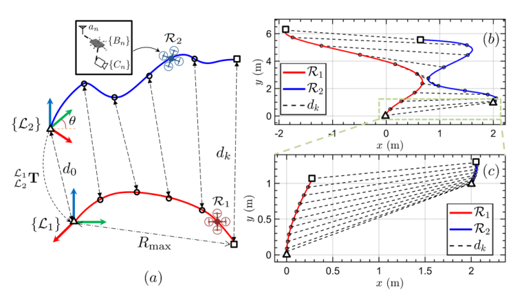

**图 1。** （a）系统概览。目标是估计 ${}^{L_1}_{L_2}\mathbf T$。一般来说，$R_{\max}/d_0$ 越小，问题越困难。（b）“较容易”和（c）“较困难”的轨迹构型示例，其中（c）是（b）的初始部分。本文解法在两种情况下均优于先前方法。图内 $R_1,R_2$ 为两台机器人，$d_k$ 为测距；$x,y,z$ 坐标单位为米。

### B　问题表述

图 1(a) 给出了系统概览。系统由一对机器人 $R_n$，$n\in\{1,2\}$ 构成，每台机器人装备一个 UWB 传感器和一个基于 IMU 的机载里程计系统。由于实验中使用视觉惯性里程计（VIO），本文具体考虑 VIO，但其他 IMU 辅助模态同样适用 [7]。$\{B_n\}$ 和 $\{L_n\}$ 分别表示 IMU 机体系与局部里程计坐标系，$\{L_n\}$ 的 $z$ 轴与重力方向对齐。

运行期间采集两台机器人的里程计和机器人间测距。在时刻 $t_k$，可用的数据集为

$$
\mathcal J_k=
\left\{\left(\widetilde d_i,
{}^{L_1}_{B_1}\widetilde{\mathbf p}_i^\mathsf T,
{}^{L_1}_{B_1}\widetilde{\mathbf q}_i^\mathsf T,
{}^{L_2}_{B_2}\widetilde{\mathbf p}_i^\mathsf T,
{}^{L_2}_{B_2}\widetilde{\mathbf q}_i^\mathsf T\right)\right\}_{i=1,\ldots,k}.
\tag{2}
$$

其中，$\widetilde d_i$ 为机器人间 UWB 距离量测，${}^{L_n}_{B_n}\widetilde{\mathbf p}_i$ 和 ${}^{L_n}_{B_n}\widetilde{\mathbf q}_i$ 为机器人在各自局部坐标系 $\{L_n\}$ 中的位姿。本文采用点对点双向飞行时间 UWB 测距方案，以避免传感器之间复杂的时钟同步 [15]。

不失一般性，指定 $R_1$ 为主机器人，$R_2$ 为目标机器人。目标是在世界坐标系 $\{L_1\}$ 中估计相对坐标变换

$$
{}^{L_1}_{L_2}\mathbf T:=
\begin{bmatrix}{}^{L_1}_{L_2}\mathbf R&{}^{L_1}_{L_2}\mathbf p\\\mathbf0^\mathsf T&1\end{bmatrix}
=\begin{bmatrix}\mathbf C&\mathbf t\\\mathbf0^\mathsf T&1\end{bmatrix}.
\tag{3}
$$

为简化书写，令 ${}^{L_1}_{L_2}\mathbf R:=\mathbf C$、${}^{L_1}_{L_2}\mathbf p:=\mathbf t$。已知 VIO 系统具有四个不可观测方向 [33]，因此 ${}^{L_1}_{L_2}\mathbf T$ 可参数化为

$$
\boldsymbol\Theta:=[\mathbf t^\mathsf T,\theta]^\mathsf T
=[t^x,t^y,t^z,\theta]^\mathsf T.
\tag{4}
$$

$\theta$ 为 $L_1$ 与 $L_2$ 之间的相对偏航角，见图 1(a)。因此，$\mathbf C$ 可写为绕 $z$ 轴旋转角度 $\theta$ 的基本三维旋转矩阵

$$
\mathbf C=
\begin{bmatrix}
\cos\theta&-\sin\theta&0\\
\sin\theta&\cos\theta&0\\
0&0&1
\end{bmatrix}.
\tag{5}
$$

### C　UWB 测量模型

本文采用与先前工作 [12]、[34] 相同的 UWB 测量模型，并考虑：1）UWB 天线在机体系内的空间偏移；2）UWB 与里程计数据之间的时间偏移。用 ${}^{B_n}_{a_n}\mathbf p$ 表示 UWB 天线 $a_n$ 在机体系 $\{B_n\}$ 中的位置，该量通过标定得到。在时刻 $t_k$，天线在局部里程计坐标系中的位置为

$$
{}^{L_n}_{a_n}\mathbf p_k
={}^{L_n}_{B_n}\mathbf p_k+
{}^{L_n}_{B_n}\mathbf R_k\,{}^{B_n}_{a_n}\mathbf p.
\tag{6}
$$

为简洁起见，用 $\mathbf p^{a_1}_{a_2}:={}^{L_1}_{a_2}\mathbf p-{}^{L_1}_{a_1}\mathbf p$ 表示时刻 $t_i$ 两个 UWB 天线在世界坐标系中的相对位置向量。

如果空间偏移可以忽略，即 ${}^{B_n}_{a_n}\mathbf p\approx\mathbf0$，则 UWB 测量模型退化为以往文献中的模型，即 $d_k=\|\mathbf t+\mathbf C{}^{L_2}_{B_2}\mathbf p_k-{}^{L_1}_{B_1}\mathbf p_k\|$。不过，某些应用会将天线安装在机器人平台边缘，以确保运行期间的视距条件，或增大天线基线 [12]、[20]。此时，${}^{B_n}_{a_n}\mathbf p$ 不可忽略，应当纳入模型。

带噪距离量测与状态向量的关系为

$$
\widetilde d_k=d_k+\eta_k
=\left\|\mathbf t+\mathbf C{}^{L_2}_{a_2}\mathbf p_k-{}^{L_1}_{a_1}\mathbf p_k\right\|+\eta_k.
\tag{7}
$$

其中，$d_k=\|\mathbf t+\mathbf C{}^{L_2}_{a_2}\mathbf p_k-{}^{L_1}_{a_1}\mathbf p_k\|$ 为真实机器人间距离。假设距离量测受独立同分布的高斯噪声污染，$\eta_k\sim\mathcal N(0,\sigma_r^2)$。

## IV　理论分析

本节推导第 III-B 节四自由度 RTE 问题对应的 FIM、CRLB 和 FIM 行列式。这些量从不同角度帮助理解该问题，且独立于任何特定估计器。

### A　Fisher 信息矩阵与 Cramér–Rao 下界

无噪声与带噪声的距离向量分别记为

$$
\begin{aligned}
\mathbf f(\boldsymbol\Theta)&=[d_1,d_2,\ldots,d_k]^\mathsf T,\\
\widetilde{\mathbf d}&=[\widetilde d_1,\widetilde d_2,\ldots,\widetilde d_k]^\mathsf T.
\end{aligned}
\tag{8}
$$

$\widetilde{\mathbf d}$ 的概率密度函数为

$$
p(\widetilde{\mathbf d},\boldsymbol\Theta)
=\frac{1}{(2\pi)^{k/2}\sqrt{\det(\boldsymbol\Sigma)}}
\exp\left[-\frac12
(\widetilde{\mathbf d}-\mathbf f(\boldsymbol\Theta))^\mathsf T
\boldsymbol\Sigma^{-1}
(\widetilde{\mathbf d}-\mathbf f(\boldsymbol\Theta))\right].
\tag{9}
$$

其中 $\boldsymbol\Sigma=\sigma_r^2\mathbf I_{k\times k}$。设 $\widehat{\boldsymbol\Theta}$ 是 $\boldsymbol\Theta$ 的估计。CRLB 是无偏估计器误差协方差矩阵的下界，即

$$
\mathbb E\left[(\widehat{\boldsymbol\Theta}-\boldsymbol\Theta)
(\widehat{\boldsymbol\Theta}-\boldsymbol\Theta)^\mathsf T\right]
\geq \mathrm{CRLB}=\mathbf F^{-1}.
\tag{10}
$$

$\mathbf F$ 为 FIM，它刻画这组测量在参数估计中提供的信息量。一般而言，FIM 的第 $(i,j)$ 个元素为

$$
F_{i,j}:=\mathbb E\left[
\frac{\partial}{\partial\Theta_i}\ln p(\widetilde{\mathbf d},\boldsymbol\Theta)
\frac{\partial}{\partial\Theta_j}\ln p(\widetilde{\mathbf d},\boldsymbol\Theta)
\right].
\tag{11}
$$

概率密度的自然对数为

$$
\ln p(\widetilde{\mathbf d},\boldsymbol\Theta)
=-\frac12(\widetilde{\mathbf d}-\mathbf f(\boldsymbol\Theta))^\mathsf T
\boldsymbol\Sigma^{-1}(\widetilde{\mathbf d}-\mathbf f(\boldsymbol\Theta))+c,
\tag{12}
$$

其中 $c$ 为常数标量。在独立同分布、零均值高斯噪声假设下，FIM 可写为 [35]

$$
\mathbf F=
\left[\frac{\partial\mathbf f(\boldsymbol\Theta)}{\partial\boldsymbol\Theta}\right]^\mathsf T
\boldsymbol\Sigma^{-1}
\left[\frac{\partial\mathbf f(\boldsymbol\Theta)}{\partial\boldsymbol\Theta}\right].
\tag{13}
$$

进一步可重写为

$$
\mathbf F=\frac1{\sigma_r^2}\sum_{i=1}^k\mathbf G_i^\mathsf T\mathbf G_i,
\tag{14}
$$

其中

$$
\begin{aligned}
\mathbf G_i&=\left[
\frac{\partial f_i(\boldsymbol\Theta)}{\partial t^x},
\frac{\partial f_i(\boldsymbol\Theta)}{\partial t^y},
\frac{\partial f_i(\boldsymbol\Theta)}{\partial t^z},
\frac{\partial f_i(\boldsymbol\Theta)}{\partial\theta}\right]\\
&=[\partial_x f_i,\partial_y f_i,\partial_z f_i,\partial_\theta f_i].
\end{aligned}
\tag{15}
$$

上述 Jacobian 的推导见附录 A。FIM 可简化为

$$
\begin{aligned}
\mathbf F&=\frac1{\sigma_r^2}\sum_{i=1}^k
\begin{bmatrix}
(\partial_xf_i)^2&\cdots&(\partial_xf_i)(\partial_\theta f_i)\\
\vdots&\ddots&\vdots\\
(\partial_\theta f_i)(\partial_xf_i)&\cdots&(\partial_\theta f_i)^2
\end{bmatrix}\\
&=\frac1{\sigma_r^2}\sum_{i=1}^k\mathbf G_i^\mathsf T\mathbf G_i
=\frac1{\sigma_r^2}\mathbf J^\mathsf T\mathbf J.
\end{aligned}
\tag{16}
$$

$\mathbf J$ 的第 $i$ 行为 $\mathbf G_i$，即 $\mathbf J=[\mathbf G_1^\mathsf T,\ldots,\mathbf G_k^\mathsf T]^\mathsf T$。由式 (16) 可见，FIM 是正定或半正定的；它依赖可用测量数量 $k$、测量精度 $\sigma_r$ 和 Jacobian $\mathbf G_i$。如果 FIM 非奇异，即 $\det(\mathbf F)\ne0$，则 CRLB 可由 FIM 的逆 $\mathbf F^{-1}$ 得到。为便于评估，我们进一步定义平移和航向 CRLB：

$$
\mathrm{CRLB}_{\mathbf t}=\sum_{i=1}^{3}[\mathbf F^{-1}]_{i,i},
\qquad
\mathrm{CRLB}_{\theta}=[\mathbf F^{-1}]_{4,4}.
\tag{17}
$$

$\mathrm{CRLB}_{\mathbf t}$ 与 $\mathrm{CRLB}_{\theta}$ 用于将不同方法的均方误差（MSE）与理论下界比较。

### B　FIM 的行列式

将 Cauchy–Binet 公式应用于 $\mathbf F=\sigma_r^{-2}\mathbf J^\mathsf T\mathbf J$，得到

$$
\det(\mathbf F)=\frac1{\sigma_r^2}
\sum_{1\le j_1<j_2<j_3<j_4\le k}(\det(\boldsymbol\Lambda))^2.
\tag{18}
$$

这里的前置系数按原刊保留，见文末译者核对注 T1。

$\boldsymbol\Lambda$ 是由 $\mathbf J$ 的第 $j_1,j_2,j_3,j_4$ 行组成的 $4\times4$ 矩阵。为清楚起见，下文只讨论由第 1–4 行组成的 $\boldsymbol\Lambda$，分析可推广到任意四行。根据附录 A，可写为

$$
\boldsymbol\Lambda:=
\begin{bmatrix}\mathbf G_1\\\mathbf G_2\\\mathbf G_3\\\mathbf G_4\end{bmatrix}
=
\begin{bmatrix}
\mathbf u_1^\mathsf T&\Phi_1\\
\mathbf u_2^\mathsf T&\Phi_2\\
\mathbf u_3^\mathsf T&\Phi_3\\
\mathbf u_4^\mathsf T&\Phi_4
\end{bmatrix}.
\tag{19}
$$

其中，$\mathbf u_i=\mathbf p^{a_1}_{a_2,i}/d_i$，$i\in\{1,\ldots,4\}$，是与相对位置向量平行的单位向量，并且

$$
\Phi_i=(\mathbf u_z\times\mathbf C{}^{L_2}_{a_2}\mathbf p_i)\cdot\mathbf u_i
=\rho_i\sin\gamma_i.
\tag{20}
$$

$\gamma_i=\pi/2-\angle(\mathbf u_z\times\mathbf C{}^{L_2}_{a_2}\mathbf p_i,\mathbf u_i)$；$\rho_i$ 为 $\mathbf C{}^{L_2}_{a_2}\mathbf p_1$ 在 $\{L_i\}$ 的 $xy$ 平面上投影的长度；$\mathbf u_z=[0,0,1]^\mathsf T$ 为 $z$ 轴单位向量。

沿式 (19) 的最后一列作 Laplace 展开：

$$
\det(\boldsymbol\Lambda)=-\Phi_1T_1+\Phi_2T_2-\Phi_3T_3+\Phi_4T_4,
\tag{21}
$$

其中各余子式为

$$
T_1=\det\begin{bmatrix}\mathbf u_2^\mathsf T\\\mathbf u_3^\mathsf T\\\mathbf u_4^\mathsf T\end{bmatrix},\quad
T_2=\det\begin{bmatrix}\mathbf u_1^\mathsf T\\\mathbf u_3^\mathsf T\\\mathbf u_4^\mathsf T\end{bmatrix},\quad
T_3=\det\begin{bmatrix}\mathbf u_1^\mathsf T\\\mathbf u_2^\mathsf T\\\mathbf u_4^\mathsf T\end{bmatrix},\quad
T_4=\det\begin{bmatrix}\mathbf u_1^\mathsf T\\\mathbf u_2^\mathsf T\\\mathbf u_3^\mathsf T\end{bmatrix}.
\tag{22}
$$

对任意 $\mathbf a,\mathbf b,\mathbf c\in\mathbb R^3$，有

$$
\begin{aligned}
\det\begin{bmatrix}\mathbf a^\mathsf T\\\mathbf b^\mathsf T\\\mathbf c^\mathsf T\end{bmatrix}
&=\det[\mathbf a\ \mathbf b\ \mathbf c]=(\mathbf a\times\mathbf b)\cdot\mathbf c\\
&=\|\mathbf a\|\|\mathbf b\|\|\mathbf c\|
|\sin\angle(\mathbf a,\mathbf b)|\cos\angle(\mathbf a\times\mathbf b,\mathbf c).
\end{aligned}
\tag{23}
$$

因此，$T_1$ 可以写成

$$
\begin{aligned}
T_1&=(\mathbf u_2\times\mathbf u_3)\cdot\mathbf u_4\\
&=\|\mathbf u_2\|\|\mathbf u_3\|\|\mathbf u_4\|
|\sin\angle(\mathbf u_2,\mathbf u_3)|
\cos\angle(\mathbf u_2\times\mathbf u_3,\mathbf u_4)\\
&=|\sin\alpha_1|\sin\beta_1,
\end{aligned}
\tag{24}
$$

其中 $\alpha_1=\angle(\mathbf u_2,\mathbf u_3)$，$\beta_1=\pi/2-\angle(\mathbf u_2\times\mathbf u_3,\mathbf u_4)$。同理，

$$
\begin{aligned}
T_2&=(\mathbf u_1\times\mathbf u_3)\cdot\mathbf u_4=|\sin\alpha_2|\sin\beta_2,\\
T_3&=(\mathbf u_1\times\mathbf u_2)\cdot\mathbf u_4=|\sin\alpha_3|\sin\beta_3,\\
T_4&=(\mathbf u_1\times\mathbf u_2)\cdot\mathbf u_3=|\sin\alpha_4|\sin\beta_4.
\end{aligned}
\tag{25}
$$

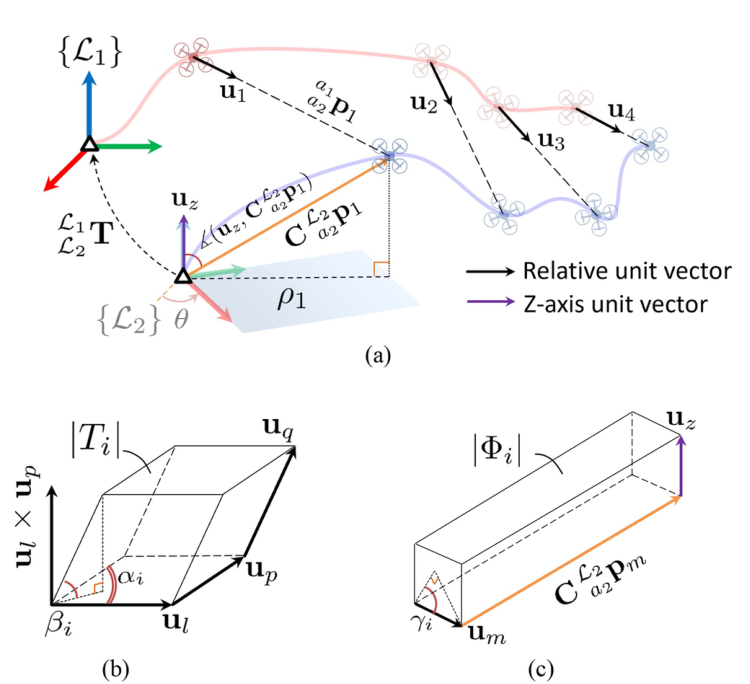

**图 2。** 构成 $\det(\mathbf F)$ 的向量、分别以 $\{\mathbf u_l,\mathbf u_p,\mathbf u_q\}$ 和 $\{\mathbf u_m,\mathbf C{}^{L_2}_{a_2}\mathbf p_m,\mathbf u_z\}$ 为边的平行六面体，以及 $\alpha_i,\beta_i,\gamma_i,\rho_i$ 分量的可视化。（a）用于得到 $T_1$ 和 $\Phi_1$ 的主要向量；（b）$T_i=(\mathbf u_l\times\mathbf u_p)\cdot\mathbf u_q$；（c）$\Phi_i=(\mathbf u_z\times\mathbf C{}^{L_2}_{a_2}\mathbf p_m)\cdot\mathbf u_m$。图例：Relative unit vector＝相对位置单位向量；Z-axis unit vector＝$z$ 轴单位向量。

综合上述关系：

$$
\begin{aligned}
\det(\mathbf F)
&=\frac1{\sigma_r^2}\sum_{S}\left[\sum_{i=1}^{4}(-1)^i\Phi_iT_i\right]^2\\
&=\frac1{\sigma_r^2}\sum_{S}\left[\sum_{i=1}^{4}(-1)^i
\big[(\mathbf u_z\times\mathbf C{}^{L_2}_{a_2}\mathbf p_m)\cdot\mathbf u_m\big]
\big[(\mathbf u_l\times\mathbf u_p)\cdot\mathbf u_q\big]\right]^2\\
&=\frac1{\sigma_r^2}\sum_{S}\left[\sum_{i=1}^{4}(-1)^i
\rho_i|\sin\alpha_i|\sin\beta_i\sin\gamma_i\right]^2.
\end{aligned}
\tag{26}
$$

其中，$S=\{(j_1,j_2,j_3,j_4)\mid1\le j_1<j_2<j_3<j_4\le k\}$，$m=j_i$，$(l,p,q)\in\{j_1,j_2,j_3,j_4\}\setminus\{m\}$，$l<p<q$，且

$$
\begin{aligned}
\alpha_i&=\angle(\mathbf u_l,\mathbf u_p),\\
\beta_i&=\frac\pi2-\angle(\mathbf u_l\times\mathbf u_p,\mathbf u_q),\\
\gamma_i&=\frac\pi2-\angle(\mathbf u_z\times\mathbf C{}^{L_2}_{a_2}\mathbf p_m,\mathbf u_m),\\
\rho_i&=\|\mathbf C{}^{L_2}_{a_2}\mathbf p_m\|
\left|\sin\angle(\mathbf u_z,\mathbf C{}^{L_2}_{a_2}\mathbf p_m)\right|.
\end{aligned}
\tag{27}
$$

图 2 展示了构成 $\det(\mathbf F)$ 的各分量。需要注意，只有当 $\mathbf u_l\times\mathbf u_p\ne\mathbf0$，即两向量不平行时，$\beta_i$ 才有定义。否则 $T_i=0$，$\beta_i$ 不再相关。同理，只有当 $\mathbf u_z\times\mathbf C{}^{L_2}_{a_2}\mathbf p_i\ne\mathbf0$ 时，$\gamma_i$ 才有定义；否则 $\Phi_i=0$，$\gamma_i$ 不再相关。下一小节将详细讨论 $\alpha,\beta,\gamma,\rho$ 的物理意义。

**命题 IV.1。** 从三维且 $\theta$ 未知的一般 RTE 问题，即机器人之间没有公共航向参考的情况，可以得到以下子问题、状态向量和 FIM 行列式。

**1）三维 RTE，$\theta$ 已知：** $\boldsymbol\Theta=[t^x,t^y,t^z]^\mathsf T$，

$$
\det(\mathbf F)=\frac1{\sigma_r^2}\sum_{1\le i<j<l\le k}\sin^2\alpha\sin^2\beta,
\tag{28}
$$

其中 $\alpha=\angle(\mathbf u_i,\mathbf u_j)$，$\beta=\pi/2-\angle(\mathbf u_i\times\mathbf u_j,\mathbf u_l)$。

**2）二维 RTE，$\theta$ 未知：** $\boldsymbol\Theta=[t^x,t^y,\theta]^\mathsf T$，

$$
\det(\mathbf F)=\frac1{\sigma_r^2}\sum_S
\left[\sum_{i=1}^{3}(-1)^{i+1}\rho_i\sin\alpha_i\sin\gamma_i\right]^2.
\tag{29}
$$

这里 $S=\{(j_1,j_2,j_3)\mid1\le j_1<j_2<j_3\le k\}$，

$$
\alpha_i=\operatorname{atan2}([\mathbf u_p\times\mathbf u_q]_z,\mathbf u_p\cdot\mathbf u_q),\qquad
\gamma_i=\frac\pi2-\angle(\mathbf u_z\times\mathbf C{}^{L_2}_{a_2}\mathbf p_l,\mathbf u_l),
$$

其中 $l=j_i$，$(p,q)\in\{j_1,j_2,j_3\}\setminus\{l\}$，$p<q$；$[\cdot]_z$ 表示取三维向量的 $z$ 分量。

**3）二维 RTE，$\theta$ 已知：** $\boldsymbol\Theta=[t^x,t^y]^\mathsf T$，

$$
\det(\mathbf F)=\frac1{\sigma_r^2}\sum_{1\le i<j\le k}\sin^2\alpha,
\tag{30}
$$

其中 $\alpha=\angle(\mathbf u_i,\mathbf u_j)$。

**证明：** 见附录 B。

### C　$\det(\mathbf F)$ 的几何解释

式 (26)、(27) 中组成 $\det(\mathbf F)$ 的各项可以作如下解释。$\mathbf u_m$ 是世界坐标系 $\{L_1\}$ 中与相对位置向量平行的单位向量，见图 2(a)。$\mathbf C{}^{L_2}_{a_2}\mathbf p_m$ 是目标机器人 $R_2$ 的局部位置向量在世界坐标系中的表达。$T_i$ 是以 $\mathbf u_l,\mathbf u_p,\mathbf u_q$ 为三条边的平行六面体的有向体积，见图 2(b)。$\Phi_i$ 是以 $\mathbf C{}^{L_2}_{a_2}\mathbf p_m,\mathbf u_m,\mathbf u_z$ 为三条边的平行六面体的有向体积，见图 2(c)。实质上，对于任意四个时刻 $j_1,\ldots,j_4$ 的测量，$\det(\boldsymbol\Lambda)$ 由 $T_i$ 和 $\Phi_i$ 共同组合而成。最后，$\det(\mathbf F)$ 对所有可能的四测量集合 $S$ 求和。$\det(\mathbf F)$ 越大，不确定性体积越小 [36]。

直观上，$T_i=|\sin\alpha_i|\sin\beta_i$ 表示平移参数 $(t^x,t^y,t^z)$ 的信息增益，与相对位置向量占据的体积直接相关，该体积由 $\alpha_i,\beta_i$ 描述，而不直接依赖绝对位置。因此，要改进 $\mathbf t$ 的估计，应重点增大不同测量方向之间的夹角；这也正是文献 [37] 对静止目标采用的策略。另一方面，$\Phi_i=\rho_i\sin\gamma_i$ 表示相对航向参数 $\theta$ 的信息增益，直接受目标机器人在自身局部坐标系中的水平位移 $\rho_i$，以及相对位置向量 $\mathbf u_m$ 与包含 $\mathbf C{}^{L_2}_{a_2}\mathbf p_m$ 的竖直平面之间垂直程度的影响。该平面的法向量为 $\mathbf C{}^{L_2}_{a_2}\mathbf p_m\times\mathbf u_z$，垂直程度由 $\sin\gamma_i$ 度量。

对于给定构型，如果对整个集合 $S$，均有 $T_i=0$、$\Phi_i=0$，或 $\sum_{i=1}^4(-1)^i\Phi_iT_i=0$，则 $\det(\mathbf F)=0$。此时，相关参数位于 $\mathbf f(\boldsymbol\Theta)$ 的临界点，无论增加多少测量，其不确定性都无法减小。例如：

1. 如果两个机器人平行运动，相对位置向量也平行，即对所有 $i$ 有 $\mathbf u_l\parallel\mathbf u_p$ 或 $\alpha_i=0$，则所有 $T_i=0$，且 $\det(\mathbf F)=0$。此时相对平移 $\mathbf t$ 无法被完全确定，见图 3(a)。
2. 如果机器人轨迹为直线，且处于同一二维平面，则相对位置向量也在该平面内，导致 $(\mathbf u_l\times\mathbf u_p)\perp\mathbf u_q$，等价于所有 $\beta_i=0$。于是所有 $T_i=0$，且 $\det(\mathbf F)=0$。此时可恢复的解存在翻转歧义，见图 3(b)。
3. 如果目标机器人静止，或仅沿 $z$ 轴运动，即 ${}^{L_2}_{a_2}\mathbf p_m=\mathbf0$ 或所有 $\rho_i=0$，则所有 $\Phi_i=0$，且 $\det(\mathbf F)=0$。此时相对航向 $\theta$ 无法被完全确定，见图 3(c)。
4. 如果主机器人静止，则 $\sum_{i=1}^4(-1)^i\Phi_iT_i=0$，且 $\det(\mathbf F)=0$。此时 $\mathbf t$ 和 $\theta$ 均无法被完全确定，因为解对绕主机器人的旋转保持不变，见图 3(d)。

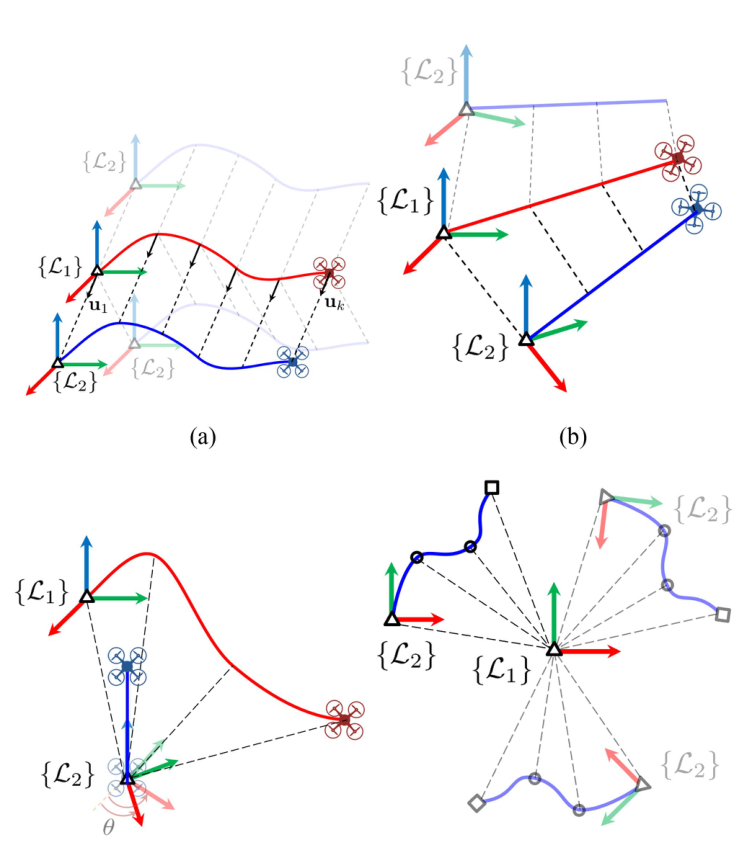

**图 3。** 导致 $\det(\mathbf F)=0$ 的奇异构型示例。实色与半透明图形分别表示真实解与其他可能解。（a）机器人平行运动；（b）机器人在同一二维平面内作直线运动；（c）目标机器人静止或仅沿 $z$ 轴运动；（d）主机器人静止。

这些具有明确物理解释的例子也分别在 [8]、[38] 中指出。第 VI-D 节另外提供仿真结果验证这些观察。除识别退化情况之外，还可以利用 $\det(\mathbf F)$ 研究最优构型和在线轨迹规划。具体地，在给定测量数量下，以有限感知距离及其他运动约束为条件最大化 $\det(\mathbf F)$，等价于最小化不确定性体积，从而求得最优构型。在线轨迹规划也可以使用 D 最优代价 $J=-\ln\det(\mathbf F)$，依据当前估计规划下一个最佳感知位置。

本文系统没有包含轨迹规划或运动调度步骤，这些研究超出本文范围。我们假设轨迹能够提供足够信息以避免退化，并在开始估计前检测当前构型是否退化，同时度量各参数的不确定性，具体见第 V-D 节。

## V　所提出的方法

本节详细介绍所提出的方法。首先简要回顾平方距离加权最小二乘（SD-WLS）问题 [28]，然后将其重构为非凸 QCQP 问题，再进一步构造 SDP 松弛问题。

### A　四自由度平方距离加权最小二乘

时刻 $t_k$ 的真实机器人间距离为

$$
d_k=\|\mathbf w_k\|=\sqrt{\mathbf w_k^\mathsf T\mathbf w_k},
\tag{31}
$$

其中 $\mathbf w_k:=\mathbf t+\mathbf C{}^{L_2}_{a_2}\mathbf p_k-{}^{L_1}_{a_1}\mathbf p_k$。距离误差向量为

$$
\mathbf e_r:=[\|\mathbf w_1\|-\widetilde d_1,
\|\mathbf w_2\|-\widetilde d_2,\ldots,
\|\mathbf w_k\|-\widetilde d_k]^\mathsf T.
\tag{32}
$$

平方距离量测

$$
\widetilde d_k^{\,2}=d_k^2+2d_k\eta_k+\eta_k^2
\tag{33}
$$

中的噪声项为 $\nu_k:=2d_k\eta_k+\eta_k^2$，其分布不属于零均值高斯分布。不过，可以将这一非高斯概率密度近似为高斯分布 [28]：

$$
\begin{aligned}
\widetilde s_k&=d_k^2+\eta'_k=\mathbf w_k^\mathsf T\mathbf w_k+\eta'_k,\\
\widetilde s_k&\simeq\widetilde d_k^{\,2}-\overline\nu_k,
\qquad\overline\nu_k:=\mathbb E[\nu_k]=\Sigma_{k,k},\\
\boldsymbol\eta'&=[\eta'_1,\ldots,\eta'_k]\sim\mathcal N(\boldsymbol\eta';\mathbf0,\mathbf S).
\end{aligned}
\tag{34}
$$

协方差矩阵 $\mathbf S$ 的各元素计算为

$$
\begin{aligned}
S_{i,i}&:=\mathbb E[(\nu_i-\overline\nu_i)^2]
=\Sigma_{i,i}\big(4\widetilde d_i^{\,2}+2\Sigma_{i,i}\big),\\
S_{i,j}&:=\mathbb E[(\nu_i-\overline\nu_i)(\nu_j-\overline\nu_j)]
=\Sigma_{i,j}\big(4\widetilde d_i\widetilde d_j+2\Sigma_{i,j}\big).
\end{aligned}
\tag{35}
$$

四自由度 SD-WLS 问题定义为

$$
\min_{\boldsymbol\Theta}\frac12\mathbf e_s^\mathsf T\mathbf S^{-1}\mathbf e_s,
\tag{36}
$$

其中 $\mathbf e_s$ 为平方距离误差向量：

$$
\mathbf e_s:=[\mathbf w_1^\mathsf T\mathbf w_1-\widetilde s_1,
\mathbf w_2^\mathsf T\mathbf w_2-\widetilde s_2,\ldots,
\mathbf w_k^\mathsf T\mathbf w_k-\widetilde s_k]^\mathsf T.
\tag{37}
$$

原始 SD-WLS [28] 针对二维情况建立，此处将其参数改为四自由度情况。

### B　非凸 QCQP

展开并整理 $\mathbf w_k^\mathsf T\mathbf w_k$，得到

$$
\begin{aligned}
\mathbf w_k^\mathsf T\mathbf w_k
&=(\mathbf t+\mathbf C{}^{L_2}_{a_2}\mathbf p_k-{}^{L_1}_{a_1}\mathbf p_k)^\mathsf T
(\mathbf t+\mathbf C{}^{L_2}_{a_2}\mathbf p_k-{}^{L_1}_{a_1}\mathbf p_k)\\
&=\mathbf t^\mathsf T\mathbf t+
({}^{L_1}_{a_1}\mathbf p_k)^\mathsf T{}^{L_1}_{a_1}\mathbf p_k+
({}^{L_2}_{a_2}\mathbf p_k)^\mathsf T{}^{L_2}_{a_2}\mathbf p_k\\
&\quad+2(\mathbf t-{}^{L_1}_{a_1}\mathbf p_k)^\mathsf T\mathbf C{}^{L_2}_{a_2}\mathbf p_k
-2({}^{L_1}_{a_1}\mathbf p_k)^\mathsf T\mathbf t.
\end{aligned}
\tag{38}
$$

定义状态向量 $\mathbf x=[x_1,x_2,\ldots,x_9]^\mathsf T$：

$$
\begin{aligned}
\mathbf x:=[&t^x,t^y,t^z,\cos\theta,\sin\theta,
 t^x\cos\theta+t^y\sin\theta,\\
&t^y\cos\theta-t^x\sin\theta,
(t^x)^2+(t^y)^2+(t^z)^2,1]^\mathsf T
\in\mathbb R^{9\times1}.
\end{aligned}
\tag{39}
$$

$\mathbf e_s$ 的每一行可整理为 $\mathbf w_i^\mathsf T\mathbf w_i-\widetilde s_i=\mathbf A_i\mathbf x$，其中

$$
\begin{aligned}
\mathbf A_i:=[&-2\varphi_i^x,-2\varphi_i^y,2(o_i^z-\varphi_i^z),
-2(\varphi_i^xo_i^x+\varphi_i^yo_i^y),\\
&2(\varphi_i^xo_i^y-o_i^x\varphi_i^y),2o_i^x,2o_i^y,1,\varepsilon_i]
\in\mathbb R^{1\times9},\\
\varepsilon_i:=&({}^{L_1}_{a_1}\mathbf p_i)^\mathsf T{}^{L_1}_{a_1}\mathbf p_i
+({}^{L_2}_{a_2}\mathbf p_i)^\mathsf T{}^{L_2}_{a_2}\mathbf p_i
-2\varphi_i^zo_i^z-\widetilde s_i.
\end{aligned}
\tag{40}
$$

这里 ${}^{L_1}_{a_1}\mathbf p=[\varphi^x,\varphi^y,\varphi^z]^\mathsf T$、${}^{L_2}_{a_2}\mathbf p=[o^x,o^y,o^z]^\mathsf T$，$i=1,\ldots,k$。于是式 (37) 可简化为

$$
\mathbf e_s=\begin{bmatrix}\mathbf A_1\\\vdots\\\mathbf A_k\end{bmatrix}\mathbf x
=\mathbf B\mathbf x.
\tag{41}
$$

这样，SD-WLS 代价函数 (36) 可重构成二次型：

$$
\frac12\mathbf e_s^\mathsf T\mathbf S^{-1}\mathbf e_s
=\frac12\mathbf x^\mathsf T
\underbrace{\mathbf B^\mathsf T\mathbf S^{-1}\mathbf B}_{\mathbf P_0}
\mathbf x
=\frac12\mathbf x^\mathsf T\mathbf P_0\mathbf x.
\tag{42}
$$

最终，四自由度 SD-WLS 问题重构为非凸 QCQP：

$$
\begin{aligned}
\min_{\mathbf x}\quad&\mathbf x^\mathsf T\mathbf P_0\mathbf x\\
\text{满足}\quad&\mathbf x^\mathsf T\mathbf P_i\mathbf x=r_i,
\qquad i=1,\ldots,5.
\end{aligned}
\tag{43}
$$

约束来自式 (39) 中各参数的关系：

$$
\begin{aligned}
\cos^2\theta+\sin^2\theta=1
&\iff x_4^2+x_5^2=1
\Rightarrow\mathbf x^\mathsf T\mathbf P_1\mathbf x=r_1,\\
t^x\cos\theta+t^y\sin\theta=x_6x_9
&\iff x_1x_4+x_2x_5-x_6x_9=0
\Rightarrow\mathbf x^\mathsf T\mathbf P_2\mathbf x=r_2,\\
t^y\cos\theta-t^x\sin\theta=x_7x_9
&\iff x_2x_4-x_1x_5-x_7x_9=0
\Rightarrow\mathbf x^\mathsf T\mathbf P_3\mathbf x=r_3,\\
(t^x)^2+(t^y)^2+(t^z)^2=x_8x_9
&\iff x_1^2+x_2^2+x_3^2-x_8x_9=0
\Rightarrow\mathbf x^\mathsf T\mathbf P_4\mathbf x=r_4,\\
(t^x)^2+(t^y)^2+(t^z)^2=d_0^2
&\iff x_1^2+x_2^2+x_3^2=\widetilde d_0^{\,2}
\Rightarrow\mathbf x^\mathsf T\mathbf P_5\mathbf x=r_5.
\end{aligned}
\tag{44}
$$

其中

$$
\begin{aligned}
\mathbf P_1&=\operatorname{sparse}([4,5],[4,5],[1,1],9,9),
&&r_1=1,\\
\mathbf P_2&=\operatorname{sparse}([1,2,9],[4,5,6],[1,1,-1],9,9),
&&r_2=0,\\
\mathbf P_3&=\operatorname{sparse}([2,1,9],[4,5,7],[1,-1,-1],9,9),
&&r_3=0,\\
\mathbf P_4&=\operatorname{sparse}([1,2,3,8],[1,2,3,9],[1,1,1,-1],9,9),
&&r_4=0,\\
\mathbf P_5&=\operatorname{sparse}([1,2,3],[1,2,3],[1,1,1],9,9),
&&r_5=\widetilde d_0^{\,2}.
\end{aligned}
\tag{45}
$$

此处使用 MATLAB 的 `sparse` 函数，简洁地构造大部分元素为零的稀疏矩阵。原文脚注给出的文档入口为 `https://www.mathworks.com/help/matlab/ref/sparse.html`。只有当 $\widetilde d_0$ 可用，即存在一条“连接”两个坐标系原点的 UWB 测距时，才加入第 5 个约束；否则将其去除。这使系统更具有一般性，因为某些情况下 $\widetilde d_0$ 可能不存在。例如，一台机器人开始移动时另一台还未准备好，或者两个起点不满足视距条件。

### 算法 1　针对 $N=2$ 台机器人的所提算法

**输入：** 机器人间测距 $\{\widetilde d_i\}_{i=1}^k$；自身里程计测量 $\{{}^{L_1}_{a_1}\widetilde{\mathbf p}_i,{}^{L_2}_{a_2}\widetilde{\mathbf p}_i\}_{i=1}^k$。  
**输出：** 相对坐标变换 $\widehat{\boldsymbol\Theta}$。

```text
根据式 (45) 设置 {Pi, ri}，i = 1,...,5
令 i ← 1
当 i ≤ k 时：
    根据式 (35) 计算 S 的第 i 行
    根据式 (40) 计算 B 的第 i 行
    i ← i + 1
结束循环
P0 ← Bᵀ S⁻¹ B
如果采用 QCQP：
    给定 P0 和 {Pi,ri}，求解式 (43)，得到 x*
否则，如果采用 SDP：
    给定 P0 和 {Pi,ri}，求解式 (48)，得到 X*
    [U,S,V] ← svdsketch(X*)
    如果 rank(X*) == 1：x* ← U
    否则：x* ← √S11 · U1:9,1
结束条件分支
如果 x*9 < 0：x* ← −x*
t̂ ← x*1:3
θ̂ ← atan2(x*5, x*4)
Θ̂ ← [t̂ᵀ, θ̂]ᵀ
```

算法中的秩一恢复语句保留原刊写法，相关尺度问题见文末译者核对注 T3。

### C　SDP 松弛

#### 1）问题重构

参照文献 [39] 的步骤，可由 QCQP 问题 (43) 得到 SDP 松弛形式。首先注意到

$$
\mathbf x^\mathsf T\mathbf P_i\mathbf x
=\operatorname{Tr}(\mathbf x^\mathsf T\mathbf P_i\mathbf x)
=\operatorname{Tr}(\mathbf P_i\mathbf x\mathbf x^\mathsf T).
\tag{46}
$$

令新变量 $\mathbf X=\mathbf x\mathbf x^\mathsf T$，则式 (43) 等价于

$$
\begin{aligned}
\min_{\mathbf X}\quad&\operatorname{Tr}(\mathbf P_0\mathbf X)\\
\text{满足}\quad&\operatorname{Tr}(\mathbf P_i\mathbf X)=r_i,
\quad i=1,\ldots,5,\\
&\mathbf X\succeq0,\qquad\operatorname{rank}(\mathbf X)=1.
\end{aligned}
\tag{47}
$$

$\mathbf X\succeq0$ 表示矩阵为半正定。去掉非凸秩约束后，得到 SDP 松弛：

$$
\begin{aligned}
\min_{\mathbf X}\quad&\operatorname{Tr}(\mathbf P_0\mathbf X)\\
\text{满足}\quad&\operatorname{Tr}(\mathbf P_i\mathbf X)=r_i,
\quad i=1,\ldots,5,\\
&\mathbf X\succeq0.
\end{aligned}
\tag{48}
$$

与原始 NP 难问题 (43)、(47) 相比，SDP 问题 (48) 的优势在于可以在多项式时间内求解。在无噪声或低噪声情况下，可以期待 SDP 松弛是紧的，即求解松弛问题与原问题等价 [39]。文献 [26] 的引理 1 给出了适用于本问题的一种特定解释。

#### 2）恢复原始解

设 $\mathbf x^*$ 和 $\mathbf X^*$ 分别为式 (43)、(48) 的解。若 $\operatorname{rank}(\mathbf X^*)=1$，低秩分解 $\mathbf X^*=\mathbf x^*(\mathbf x^*)^\mathsf T$ 将给出可行且最优的 $\mathbf x^*$。若 $\operatorname{rank}(\mathbf X^*)>1$，可采用文献 [39] 的秩一分解过程提取 $\mathbf x^*$。通过奇异值分解将 $\mathbf X^*$ 写为

$$
\mathbf X^*=\sum_{i=1}^{n}\lambda_i\mathbf q_i\mathbf q_i^\mathsf T,
\qquad\lambda_1\ge\lambda_2\ge\cdots\ge\lambda_n>0,
\tag{49}
$$

其中 $\lambda_i$ 和 $\mathbf q_i$ 分别为对应的特征值和特征向量。最佳秩一近似为

$$
\mathbf X_1^*=\lambda_1\mathbf q_1\mathbf q_1^\mathsf T.
\tag{50}
$$

最后，依据式 (39) 的构造，$x_9$ 应为正，因此若 $x_9^*<0$，则翻转最终解的符号。所提方法汇总于算法 1。

### D　不确定性估计

根据第 IV 节理论分析，本文方法能够检测当前构型是否奇异，并计算每个参数估计的不确定性。这些能力使方法更适合实际应用。此外，我们还考虑传感器之间的时空偏移、UWB 离群量测剔除等现实问题，相关细节参见先前工作 [40]。

#### 1）奇异构型检测

奇异构型是指在给定测量下，至少一个参数具有多个解的情况 [31]。从物理上看，当目标机器人的轨迹可以在世界坐标系中翻转、旋转，或同时进行二者，而距离测量保持相同时，就会出现这种情况 [8]。这与第 IV-C 节对不可观测情况的直观解释一致。表 I 所列先前研究既未提供奇异构型检测方法，也未提供估计不确定性度量。

在无噪声情况下，如果某个参数在给定构型中不可观测，则 FIM 中对应行和列会变为零，因为现有测量无法提供关于该参数的信息增益。因此，奇异构型在无噪声情况下表现为 FIM 秩亏，在有噪声情况下表现为 FIM 条件数趋于无穷。本文采用如下检测方法。首先，在最新估计 $\widehat{\boldsymbol\Theta}_k$ 处，使用式 (16) 的解析公式计算 FIM。然后计算估计 FIM 的条件数 $\kappa(\widehat{\mathbf F})$。如果 $\kappa(\widehat{\mathbf F}_k)$ 大于某个经验设定阈值，则认为构型奇异。

在实践中，第一次优化前检查机器人近期位置的样本方差是否高于阈值；实验中对最近 100 个位置，经验阈值设为 0.05 m，否则跳过优化。这一简单检查保证：1）两台机器人都在运动；2）所有轴向均存在运动。它足以避免一台机器人静止、两台机器人平行运动等简单奇异情况。此外，我们观察到，如果 $x,y$ 方向位姿变化很小，例如四旋翼悬停，即使加入更多新测量，估计也不会改善。因此，在任务期间持续执行这一检查，跳过不必要的更新。

**注 V.1。** 无噪声情况下，奇异构型还表现为式 (43) 中的矩阵 $\mathbf P_0$ 秩亏，因为 QCQP 的最优解不唯一。因此，可通过检查 $\mathbf P_0$ 是否秩亏检测奇异情况，从而避免计算 FIM。不过，真实实验中的噪声通常会使 $\mathbf P_0$ 满秩，即使机器人只发生很小运动。因此，本文未使用这一检测方法。

#### 2）估计不确定性

用估计值 $\widehat{\boldsymbol\Theta}$ 代替真实值计算出的 CRLB 记为 $\widehat{\mathrm{CRLB}}$。根据 [36]，每个参数的 95% 置信区间为

$$
\mathrm{CI}_i=
\left[
\widehat\Theta_i-1.96\sqrt{\widehat{\mathrm{CRLB}}_{i,i}},
\widehat\Theta_i+1.96\sqrt{\widehat{\mathrm{CRLB}}_{i,i}}
\right],\qquad i\in\{1,\ldots,4\}.
\tag{51}
$$

此外，$\widehat{\mathrm{CRLB}}$，或更一般地说观测 Fisher 信息矩阵的逆，可用于最大似然估计器的误差协方差矩阵 [41]。

在时刻 $t_k$，系统报告当前估计 $\widehat{\boldsymbol\Theta}$ 及相应不确定性指标，包括条件数 $\kappa(\widehat{\mathbf F}_k)$ 和各参数标准误差 $\sigma_{\widehat\Theta_i}:=\sqrt{\widehat{\mathrm{CRLB}}_{i,i}}$。如果 $\kappa(\widehat{\mathbf F}_k)$ 和 $\sigma_{\widehat\Theta_i}$ 足够大，则可认定轨迹构型奇异，并将 $\Theta_i$ 识别为不可观测参数。

先前方法，尤其是 NLS，通常在梯度步长小于阈值时停止，而任意参数的局部极小点也可能满足这一条件。本文监测 $\kappa(\widehat{\mathbf F}_k)$ 和 $\sigma_{\widehat\Theta_i}$，仅在所有不确定性估计低于阈值，或达到超时时间后，才停止优化。因此，即使无法彻底消除退化情况，也至少能将存在歧义的参数数目降低到最小，并提高整体精度。

### E　扩展到多机器人场景

虽然本文仅研究两台机器人，但仍有必要讨论一般多机器人情况下的可扩展性。一个简单且有效的方法，是在感知图的每一对机器人之间复制同一估计器，[8]、[42] 已给出验证。然而，每台机器人的计算负担将随相邻机器人数量增长。此外，该方案没有内在机制来保证网络估计的一致性、联合估计以改善整体结果，或支持异步去中心化运行。

因此，使用专为多机器人设计的分布式优化方法 [43] 会更合适。具体而言，可以沿用 [44] 等现有技术，将 SDP 改造成分布式形式：把网络划分为若干簇，每个簇仅使用局部信息并行求解。因此，本文思路具有可扩展性，可以用于一般情形。另一种潜在方案是异步并行交替方向乘子方法 [45]，该方法已在 [30] 中扩展到基于距离的相对定位。不过，如何选择有效滑动窗口大小来降低各机器人的计算需求，仍未得到充分研究。因此，将本文 QCQP 重构为分布式框架、利用问题结构提高性能并降低计算需求，值得进一步研究。

通信方面，文献 [30] 表明，在使用 ROS 的里程计与距离驱动相对编队系统中，两机器人之间的平均通信流量小于 2 kB/s，显著低于先进视觉系统；后者仅关键帧数据就可能需要每台机器人 MB/s 的带宽 [46]。因此，通信并非本文方法的关键问题。利用本文发现，还可以进一步降低通信频率。根据第 IV-C 节，某些运动不会改善部分参数的估计，例如四旋翼悬停、悬停中偏航、上升或下降等。当机器人进行这些运动时，可以停止发送数据而不影响性能。因此，每台机器人能够自行判断是否有必要广播本地数据。

## VI　实验结果

仿真与实验视频的原文地址为 `https://youtu.be/0VeUaPXC8gU`。

### A　实现细节和性能指标

在表 I 的三维方法中，我们纳入代数方法 [31]、线性方法 [25]、NLS [30] 和先前 SDP 方法 [27] 进行比较。这些方法均未提供开源代码；根据我们的经验，实现细节可能显著影响性能。为尽量保证公平，采取以下安排。

1. 对于原本处理完整六自由度的 [27]、[31]，通过将额外参数设为常数并移除或调整相关约束，将其降为与本文相同的四自由度问题。图 4 显示不同版本的估计误差改善，也支持本文选择四自由度问题的设计。
2. 仿真中，所有方法均用 MATLAB 实现，SDP 使用 SeDuMi 求解器。真实实验中均采用 C++：SDP 使用 CSDP，QCQP 使用 Gurobi，代数法与线性法使用 Eigen，NLS 使用 Ceres。
3. 时间对比仅计入求解器寻找最优解的时间，不包括数据处理和准备步骤，例如矩阵构造与求逆。
4. NLS 性能高度依赖初值，因此测试具有良好起始点 $\boldsymbol\Theta_0$ 的 NLS。对真实平移和航向分别加入标准差 $\sigma_{t0}=0.5\ \mathrm m$、$\sigma_{\theta0}=10^\circ$ 的高斯噪声，形成初始猜测。
5. 所有方法使用相同的预处理输入数据，均已检测退化构型、应用离群值剔除并补偿时空偏移。

原文软件脚注：SeDuMi：`https://github.com/sqlp/sedumi`；CSDP：`https://github.com/coin-or/Csdp`；Gurobi：`https://www.gurobi.com/`；Eigen：`https://eigen.tuxfamily.org/`；Ceres：`http://ceres-solver.org/`。

分别评估平移和航向参数，误差定义为 $e_t=\|\widehat{\mathbf t}-\mathbf t\|$、$e_\theta=|\widehat\theta-\theta|$。比较的量包括全部运行的平均误差 $\overline e_t,\overline e_\theta$，均方根误差 $\mathrm{RMSE}_t,\mathrm{RMSE}_\theta$，相对 CRLB 的 MSE，以及求解器耗时。

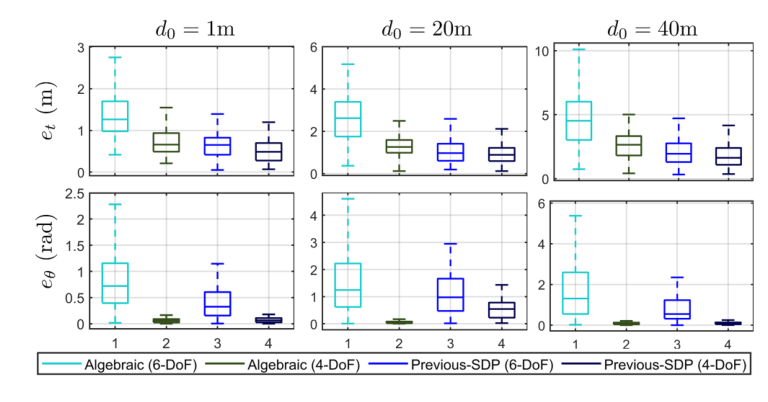

**图 4。** 代数方法 [31] 和先前 SDP [27] 的六自由度、四自由度版本比较。所有仿真均取 $R_{\max}=1\ \mathrm m$。图例：Algebraic＝代数方法；Previous-SDP＝先前 SDP；横坐标 1–4 对应各版本，纵坐标分别为平移误差（米）与航向误差（弧度）。

### B　仿真

仿真被设计为分别评估不同因素，重点关注轨迹构型和信号噪声。$d_0=\|\mathbf t\|$ 为真实初始机器人间距离。$R_{\max}$ 为机器人相对初始位置的最大运动半径，所有轨迹均限制在以各自局部原点为球心、半径 $R_{\max}$ 的球体内，见图 1(a)。UWB 和里程计数据的噪声标准差分别记为 $\sigma_r$、$\sigma_o$。

先前研究通常仅针对特定场景开展仿真：轨迹形状和大小固定，且往往只测试一个 $\boldsymbol\Theta$ 值，这可能削弱观察与结论的一般性。本文追求更普遍、全面的结果。对每种方法，进行 100 次 Monte Carlo 仿真：真实平移 $\mathbf t$ 在以 $\mathbf0_{3\times1}$ 为球心、半径 $d_0$ 的球面上均匀采样，真实相对航向 $\theta$ 在 $[-\pi,\pi)$ 中随机采样。随后，每次仿真随机生成两条轨迹，每条包含 20 个位姿，位置到局部原点的距离不超过 $R_{\max}$。最后，在无噪声数据上叠加高斯噪声，生成里程计与 UWB 数据。这样，结果应能够反映给定 $d_0$、$R_{\max}$ 条件下可能生成的各种轨迹构型，包括形状、大小与相对变换。

#### 1）轨迹构型的影响

图 5 给出主要结果。总体而言，QCQP 方法表现最好，尤其在 $d_0$ 较大、$R_{\max}$ 较小的困难场景下。次优结果来自本文 SDP 或 NLS。不论初值如何，QCQP 在精度上都是最佳选择。在已有粗略起始点且计算资源有限时，NLS 更合适。不过，实际部署中，获得良好初值可能耗时，尤其当机器人间距较大时；某些情况下甚至无法获得，例如两台机器人未同时开始工作。因此，本文 SDP 更具有实际可用性。

一般来说，$d_0$ 和 $R_{\max}$ 都会影响所有方法。主要现象为：$d_0$ 越大，误差越大；$R_{\max}$ 的作用相反。$d_0$ 对平移误差的影响比对航向更明显，$R_{\max}$ 则相反。当 $d_0$ 更小或 $R_{\max}$ 更大时，不同方法的性能更接近。

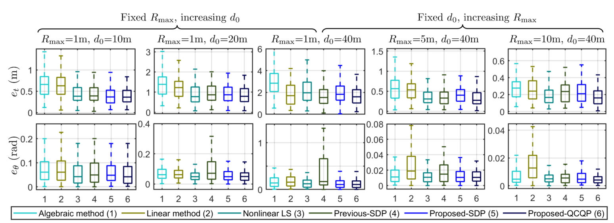

**图 5。** 随 $R_{\max}$ 和 $d_0$ 变化的估计误差。上排：平移误差 $e_t$；下排：航向误差 $e_\theta$。所有仿真取 $\sigma_o=0.001\ \mathrm m$、$\sigma_r=0.1\ \mathrm m$。随着 $d_0$ 增大或 $R_{\max}$ 减小，误差明显增大。图上两组标题分别为“固定 $R_{\max}$、增大 $d_0$”和“固定 $d_0$、增大 $R_{\max}$”。方法编号：1 代数法，2 线性法，3 NLS，4 先前 SDP，5 本文 SDP，6 本文 QCQP。

联系理论结果，$d_0$ 与 $R_{\max}$ 共同限制连续测量之间的最大相对夹角，进而限制 $\alpha,\beta$；$R_{\max}$ 限制目标机器人的最大水平位移，从而限制 $\rho$。因此，$d_0,R_{\max}$ 共同影响 $T_i$，继而影响相对平移估计；$R_{\max}$ 直接改变 $\Phi_i$，继而影响相对航向估计。原则上，有 $\sin\alpha_{\max}\simeq D/d_0$。从实践角度，较大的 $d_0$ 或较小的 $R_{\max}$ 会使问题更困难。增加 $d_0$ 或减小 $R_{\max}$ 都会改善相对平移估计，而增大目标机器人的 $R_{\max}$ 会改善相对航向估计。最后一句按原文保留，其与上下文的冲突见译者核对注 T4。

#### 2）噪声水平的影响

本组仿真均取 $d_0=50\ \mathrm m$、$R_{\max}=10\ \mathrm m$，以模拟室外场景。UWB 噪声 $\sigma_r$ 与里程计噪声 $\sigma_o$ 从接近真值的约 0.001 m 精度，变化到 GPS 级约 1–10 m 精度。图 6 给出两种噪声对估计误差的一般影响，图 7 给出极端条件结果。

总体来看，图 6 表明：测量十分准确，即 $\sigma_r<0.1$ 且 $\sigma_o<0.1$ 时，所有方法性能接近。当噪声更符合现实，即 $\sigma_r\ge0.1$ 或 $\sigma_o\ge0.1$ 时，本文 SDP 明显优于所有先前方法。两种噪声以相似方式影响结果，但影响尺度不同，里程计噪声对整体精度作用更强。需要指出，各方法的 $e_\theta$ 多数相近，因为 $\theta$ 被限制在 $[-\pi,\pi)$，航向误差因此有界。

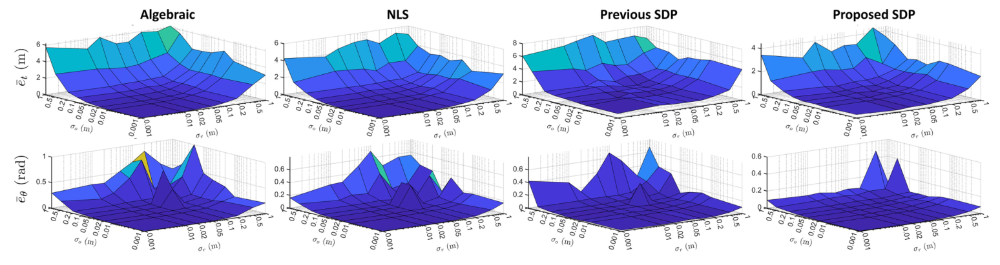

**图 6。** 平均平移误差 $\overline e_t$（米）和平均航向误差 $\overline e_\theta$（弧度）随 UWB 噪声 $\sigma_r$ 和里程计噪声 $\sigma_o$ 的变化。所有仿真取 $d_0=50\ \mathrm m$、$R_{\max}=10\ \mathrm m$。四列依次为代数法、NLS、先前 SDP、本文 SDP。

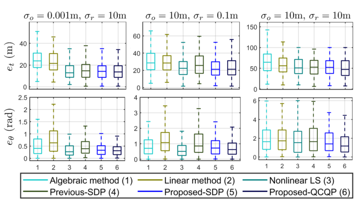

**图 7。** 极大噪声下的估计误差。所有仿真取 $d_0=50\ \mathrm m$、$R_{\max}=10\ \mathrm m$。方法编号与图 5 相同。

在极大噪声下，见图 7，本文方法仍给出最好的结果。QCQP 与 SDP 的结果基本相同，表明在所测试条件下松弛是紧的。不过，可以认为此时报告的平移误差对于实际应用仍过大。因此，我们承认还有进一步改进空间，尤其是处理精度很差的里程计数据。

#### 3）漂移校正能力

SLAM 里程计能够提供准确的短时自身运动，但会因累积误差产生长期漂移，大范围任务中尤其明显 [7]、[12]。可将这种漂移建模为作用于相对坐标变换 ${}^{L_1}_{L_2}\mathbf T$ 的高斯噪声 [30]。因此，RTE 估计器能够通过滑动窗口持续估计 ${}^{L_1}_{L_2}\widehat{\mathbf T}_k$，监测和校正漂移。用 $\sigma_t,\sigma_\theta$ 分别表示相对变换中平移三轴与航向部分的噪声。它们越大，漂移越显著，见图 8(a)。

仿真场景为两台机器人在大环境中探索 10 分钟。主机器人配备 RTK-GPS 或激光 SLAM 等高精度定位系统，目标机器人使用随时间漂移的 VIO。所有方法必须同时完成：1）估计初始相对变换；2）仅使用近期测量跟踪相对变换的变化。主机器人沿曲折轨迹运动，以保证滑动窗口内数据的可观测性；目标机器人沿简单轨迹扫描区域。窗口包含最近 50 条测量，对应 5 秒。所有测量加入 $\sigma_o=0.001\ \mathrm m$、$\sigma_r=0.1\ \mathrm m$ 的噪声。NLS 分别测试具有良好初值和不具有良好初值的情况，初值按第 VI-A 节产生。

最终关注的输出是目标机器人在世界坐标系中的位置，即 ${}^{L_1}_{a_2}\widehat{\mathbf p}_k:=\widehat{\mathbf t}_k+\widehat{\mathbf C}_k{}^{L_2}_{a_2}\widehat{\mathbf p}_k$。表 II 给出其平移误差 RMSE。RMSE 越小，系统寻找并监测相对变换的能力越好。图 8(b) 显示最大漂移情况下的平移误差。

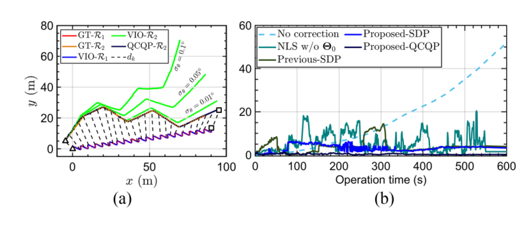

**图 8。** （a）轨迹与 UWB 测量。QCQP-$R_2$ 表示由本文 QCQP 计算的目标机器人全局轨迹，$\sigma_t=\sigma_\theta=0.1$。为清晰起见，仅显示部分距离 $d_k$。（b）相同噪声配置下各方法的平移误差。图内 GT＝真值；No correction＝无校正；Operation time＝运行时间；Translation error＝平移误差；NLS w/o $\Theta_0$＝不提供良好初值的 NLS。

**表 II　不同漂移条件下目标机器人对齐轨迹的平移 RMSE（米）**

| $\sigma_t$（m） | $\sigma_\theta$（度） | 代数法 [31] | 线性法 [25] | NLS，无良好初值 [30] | 先前 SDP [27] | 本文 SDP | 本文 QCQP | NLS，有良好初值 |
|---|---:|---:|---:|---:|---:|---:|---:|---:|
| 0.01 | 0.01 | 84.36 | 94.35 | 6.81 | 4.86 | 2.36 | 0.51 | 0.56 |
| 0.01 | 0.05 | 88.06 | 108.83 | 7.59 | 4.91 | 2.37 | 0.42 | 0.55 |
| 0.01 | 0.1 | 87.86 | 150.11 | 13.96 | 5.02 | 2.40 | 0.58 | 0.71 |
| 0.05 | 0.01 | 82.07 | 153.26 | 7.05 | 4.94 | 2.37 | 0.59 | 0.63 |
| 0.05 | 0.05 | 83.14 | 160.39 | 7.50 | 4.88 | 2.36 | 0.53 | 0.46 |
| 0.05 | 0.1 | 81.16 | 173.13 | 7.06 | 4.97 | 2.39 | 0.43 | 0.55 |
| 0.1 | 0.01 | 84.86 | 166.32 | 9.03 | 4.73 | 2.39 | 0.53 | 0.56 |
| 0.1 | 0.05 | 85.01 | 170.38 | 9.04 | 4.78 | 2.38 | 0.54 | 0.60 |
| 0.1 | 0.1 | 100.53 | 199.29 | 10.15 | 4.92 | 2.40 | 0.61 | 0.70 |

原表对每行最优和次优结果作标记；“w. $\Theta_0$”与“w/o $\Theta_0$”分别表示提供与不提供良好初值。表格原图也保留供核对：

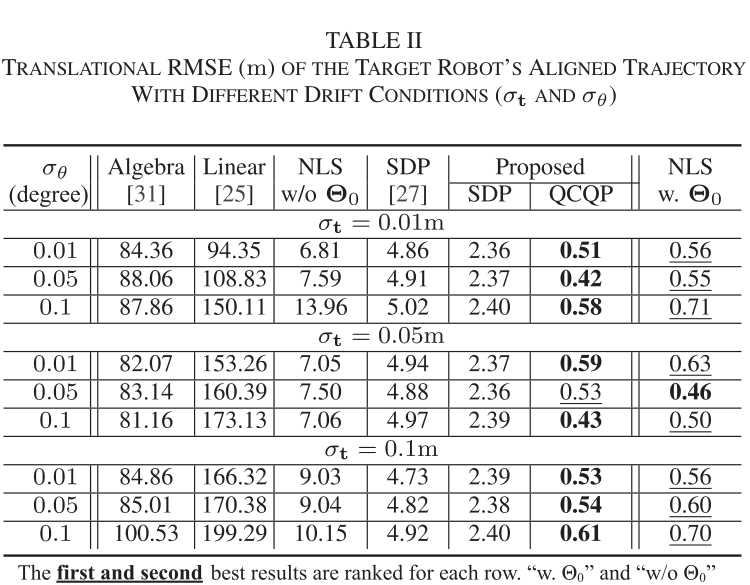

值得注意的是，代数法和线性法实际上使位置估计变差。原因在于，只使用较短滑动窗口的数据时，问题类似于前述 $R_{\max}$ 小、$d_0$ 大的困难场景，这些方法无法在整个运行期间获得良好的相对变换估计。其他基于优化的方法在较大漂移下表现更一致，并改善结果。总体上，在不提供初始猜测时，QCQP 和 SDP 分别为最优与次优，明显优于先前方法。若提供良好初值，NLS 可以持续超过本文 SDP，但仍逊于 QCQP，体现出本文解法的优势。

### C　真实实验

图 9 显示实验硬件平台。每架四旋翼配备 Humatics P440 UWB、UP2 微型计算机和 Intel RealSense T265 VIO 传感器。两台天线在机体系中的位置为

$$
{}^{B_1}_{a_1}\mathbf p=[-0.02,0.1,-0.05]^\mathsf T,\qquad
{}^{B_2}_{a_2}\mathbf p=[-0.05,0.15,-0.15]^\mathsf T.
$$

UWB 数据频率为 37 Hz，VIO 为 200 Hz。噪声标准差设为 $\sigma_r=0.1$、$\sigma_o=0.002$。在能够以 100 Hz 提供真值位姿的 VICON 实验室中，针对不同轨迹构型进行了五组飞行测试，见图 10。所有方法运行于同一台 Intel NUC i7 微型计算机。

原文硬件脚注：P440：`https://fccid.io/NUF-P440-A`；UP2：`https://up-board.org/`；T265：`https://www.intelrealsense.com/tracking-camera-t265/`。

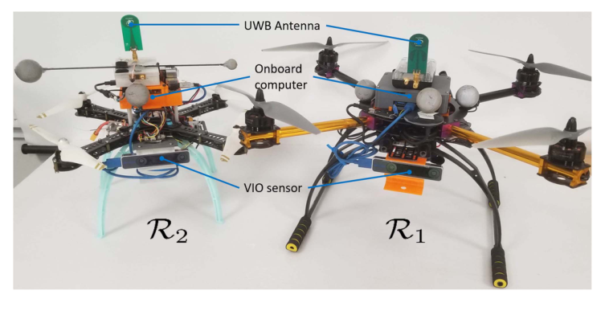

**图 9。** 实验所用四旋翼平台。图内 UWB Antenna＝UWB 天线；Onboard computer＝机载计算机；VIO sensor＝视觉惯性里程计传感器。

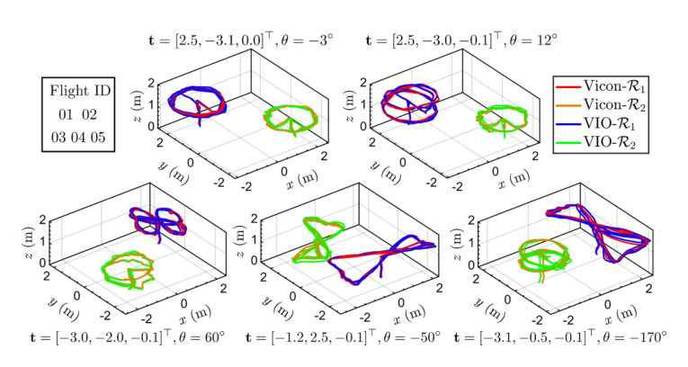

**图 10。** 真实飞行测试中的轨迹。Flight ID＝飞行测试编号；Vicon-$R_1$、Vicon-$R_2$＝两机器人动捕真值轨迹；VIO-$R_1$、VIO-$R_2$＝两机器人 VIO 轨迹。各图上方给出相应初始平移 $\mathbf t$ 和航向 $\theta$。

**表 III　真实实验中的平移与航向 RMSE**

| 场次 | 指标 | 代数法 [31] | 线性法 [25] | NLS [30] | 先前 SDP [27] | 本文 SDP | 本文 QCQP |
|---|---|---:|---:|---:|---:|---:|---:|
| 01 | 平移（m） | 0.759 | 0.469 | 0.333 | 0.258 | 0.310 | 0.296 |
| 01 | 航向（rad） | 0.057 | 0.311 | 0.053 | 0.047 | 0.044 | 0.062 |
| 02 | 平移（m） | 0.384 | 0.456 | 0.295 | 0.379 | 0.203 | 0.201 |
| 02 | 航向（rad） | 0.156 | 0.285 | 0.072 | 0.102 | 0.082 | 0.072 |
| 03 | 平移（m） | 0.570 | 0.339 | 1.855 | 0.130 | 0.131 | 0.124 |
| 03 | 航向（rad） | 0.131 | 0.217 | 0.846 | 0.067 | 0.072 | 0.059 |
| 04 | 平移（m） | 0.315 | 0.397 | 0.162 | 0.531 | 0.124 | 0.108 |
| 04 | 航向（rad） | 0.103 | 0.160 | 0.114 | 0.061 | 0.021 | 0.014 |
| 05 | 平移（m） | 1.265 | 1.125 | 0.195 | 0.459 | 0.184 | 0.178 |
| 05 | 航向（rad） | 0.211 | 0.483 | 0.132 | 0.138 | 0.119 | 0.125 |

每个结果为三次运行的平均值。原表对每行最优和次优结果进行了标记。

表 III 显示平均结果。代数法和线性法在大多数情况下精度相近，但结果并不理想。NLS 和先前 SDP 仅在部分场景中有效。图 11(a) 显示某次运行中的估计演化，所提方法明显优于先前方法。这与图 11(b) 的性能基准一致：本文方法比其他方法更快接近下界。总体上，QCQP 在大多数情况下超过其他方法，并给出一致的结果，本文 SDP 紧随其后。

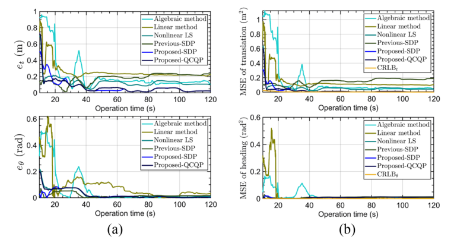

**图 11。** 飞行场次 02 的某次运行结果。（a）估计误差；（b）MSE 与 CRLB 的比较。图内 Operation time＝运行时间（秒）；各方法名称与图 5 一致。

### D　不确定性估计

如第 V-D1 节所述，以估计 FIM 的条件数 $\kappa(\widehat{\mathbf F})$ 表征构型不确定性，以标准误差 $\sigma_{\widehat\Theta_i}$ 表征各参数不确定性。图 12、13 分别显示真实飞行与仿真的这些数值。所有仿真均取 $\sigma_r=0.1$、$\sigma_o=0.001$、$R_{\max}=1$、$d_0=3$；全部结果来自本文 QCQP。

典型可观测情况下，图 12(a)、(b) 中估计不确定性与实际误差趋势一致：加入更多测量后，误差和不确定性均减小。仿真中机器人运动覆盖所有方向，因此 $x,y,z$ 轴不确定性的表现相近。真实飞行中，由于安全和平台能力限制，$z$ 轴运动远小于其他方向，所以 $\sigma_z$ 的改善明显更慢。多无人机场景的实验通常从退化构型开始：首先两机起飞，即沿 $z$ 方向平行运动；随后至少一机短暂停悬，以建立通信或收集数据，即一台机器人静止。因此，监测条件数可以检测退化。图 12(a) 中 $\kappa(\widehat{\mathbf F})$ 在 $t=20\ \mathrm s$ 前保持较高，此时 $R_2$ 开始移动；之后条件数明显下降，说明构型已不再不可观测。

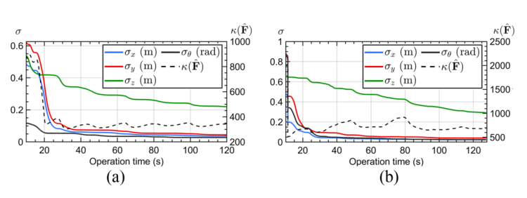

**图 12。** 两次真实飞行的估计不确定性。（a）场次 02；（b）场次 05。左轴 $\sigma$ 表示参数标准误差，右轴 $\kappa(\widehat{\mathbf F})$ 表示估计 FIM 条件数；横轴为运行时间。

另一方面，图 13(a)–(d) 给出整个实验始终不可观测的构型。首先，条件数显著更大，并且总体趋于增大。其次，图 3 中对应的不可观测参数具有明显更大的标准误差，且不会随时间改善；其他参数则表现得类似可观测情况。因此，可以识别奇异构型并找出不可观测自由度。

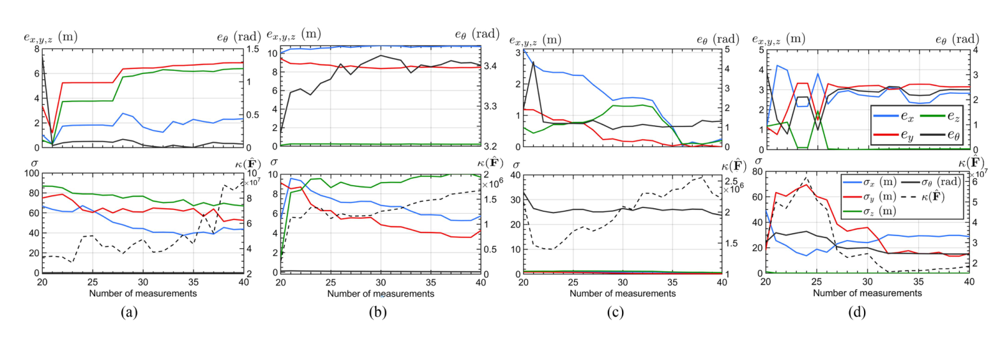

**图 13。** 仿真中的估计误差（上排）与不确定性指标（下排）。可见：1）不可观测情况（a）–（d）的不确定性指标明显大于图 12 的可观测情况；2）若标准误差 $\sigma_i$ 或估计误差 $e_i$ 不随时间改善，则 $\Theta_i$ 很可能在该构型中不可观测。（a）平行运动；（b）平面运动；（c）目标静止；（d）主机器人静止。横轴 Number of measurements＝测量数量。

### E　计算需求

图 14(a)、(b) 分别给出图 5 全部仿真和表 III 真实实验中的求解器时间。总体而言，大多数方法可实时运行。线性方法始终最快，代数法与之接近。QCQP 在仿真中最慢。由于其求解时间经常与问题难度相关，较小的 $R_{\max}/d_0$ 或较大的噪声会使耗时增加，而仿真覆盖从易到难的各种情况，因此 QCQP 的时间变化范围大于其他方法。

在真实实验中，本文 SDP 比本文 QCQP 快近 50%，而先前 SDP 最慢，无法实时运行。原因可能在于 QCQP 求解器库直接支持本文形式，而使用公共 SDP 库处理文献 [27] 的形式时需要适配。因此，库实现的优化可能是本文 SDP 提速的主要原因。不过，真实实验规模有限，这些结果的代表性弱于仿真。

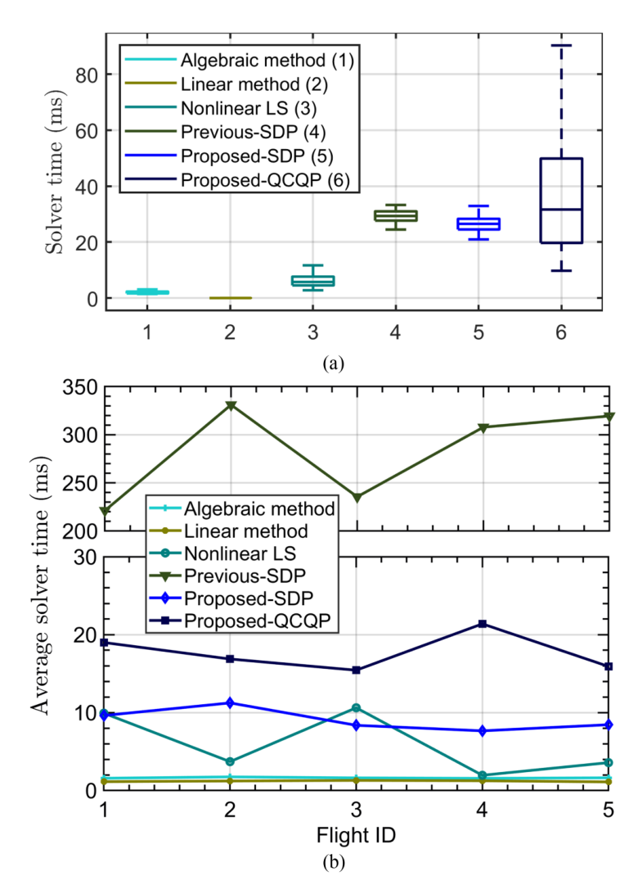

**图 14。** 求解器时间比较，单位为毫秒。（a）图 4 中所有仿真的求解器时间；（b）表 III 真实实验中的平均求解器时间。图内 Solver time＝求解器时间；Average solver time＝平均求解器时间；Flight ID＝飞行编号。图注中的“图 4”按原刊保留，其正文位置引用图 5。

## VII　结论

本文研究了利用本地里程计与机器人间 UWB 距离量测进行四自由度 RTE 的问题。给出了该问题的理论分析，包括 CRLB、FIM 及其行列式。基于这些结果，对各参数信息增益提供了几何解释，并给出检测奇异构型与度量估计不确定性的方法。

为求解该问题，本文提出 QCQP 及其相应 SDP 松弛。与先前方法相比，本文系统在仿真和真实实验中表现更好，尤其在困难场景下，对较大 UWB 噪声也更加鲁棒。两种方法均能在微型计算机上实时运行；QCQP 通常最准确，但耗时大于 SDP。完整不可观测条件的求取、利用 $\det(\mathbf F)$ 设计最优轨迹，以及扩展到一般 $N$ 机器人系统，都是值得进一步研究的方向。

## 附录 A　Jacobian 的推导

计算 Jacobian 后，有

$$
\mathbf G_i=[\partial_x f_i,\partial_y f_i,\partial_z f_i,\partial_\theta f_i]
=\frac1{d_i}[g_i^x,g_i^y,g_i^z,g_i^\theta],
\tag{52}
$$

其中

$$
\begin{aligned}
d_i&=\left\|\mathbf t+\mathbf C{}^{L_2}_{a_2}\mathbf p_i-{}^{L_1}_{a_1}\mathbf p_i\right\|
=\sqrt{(g_i^x)^2+(g_i^y)^2+(g_i^z)^2},\\
g_i^x&=g_i^x(t^x,\theta)=t^x+o_i^x\cos\theta-o_i^y\sin\theta-\varphi_i^x,\\
g_i^y&=g_i^y(t^y,\theta)=t^y+o_i^x\sin\theta+o_i^y\cos\theta-\varphi_i^y,\\
g_i^z&=g_i^z(t^z)=t^z+o_i^z-\varphi_i^z,\\
g_i^\theta&=g_i^\theta(t^x,t^y,\theta)\\
&=g_i^x(-o_i^x\sin\theta-o_i^y\cos\theta)
+g_i^y(o_i^x\cos\theta-o_i^y\sin\theta).
\end{aligned}
$$

$g_i^x,g_i^y,g_i^z$ 分别对应时刻 $t_i$ 两机器人位置之间在 $x,y,z$ 轴上的位移，真实距离 $d_i$ 等于 $\|\mathbf p^{a_1}_{a_2,i}\|$。因此可写成

$$
[\partial_xf_i,\partial_yf_i,\partial_zf_i]^\mathsf T
=\frac1{d_i}[g_i^x,g_i^y,g_i^z]^\mathsf T
=\frac{\mathbf p^{a_1}_{a_2,i}}{\|\mathbf p^{a_1}_{a_2,i}\|}
=\mathbf u_i,
\tag{53}
$$

其中 $\mathbf u_i$ 与相对位置向量平行，且 $\|\mathbf u_i\|=1$。$\partial_\theta f_i=g_i^\theta/d_i$ 也可整理为

$$
\begin{aligned}
\partial_\theta f_i
&=\frac1{d_i}\left[g_i^x(-o_i^x\sin\theta-o_i^y\cos\theta)
+g_i^y(o_i^x\cos\theta-o_i^y\sin\theta)\right]\\
&=\begin{bmatrix}
0\cdot o_i^z-o_i^x\sin\theta-o_i^y\cos\theta\\
o_i^x\cos\theta-o_i^y\sin\theta-0\cdot o_i^z\\
0\cdot(o_i^x\sin\theta+o_i^y\cos\theta)
-0\cdot(o_i^x\cos\theta-o_i^y\sin\theta)
\end{bmatrix}\cdot
\begin{bmatrix}g_i^x/d_i\\g_i^y/d_i\\g_i^z/d_i\end{bmatrix}\\
&=\left(
\begin{bmatrix}0\\0\\1\end{bmatrix}\times
\begin{bmatrix}
o_i^x\cos\theta-o_i^y\sin\theta\\
o_i^x\sin\theta+o_i^y\cos\theta\\
o_i^z
\end{bmatrix}\right)\cdot
\begin{bmatrix}g_i^x/d_i\\g_i^y/d_i\\g_i^z/d_i\end{bmatrix}\\
&=\left(\begin{bmatrix}0\\0\\1\end{bmatrix}\times
\left(\begin{bmatrix}\cos\theta&-\sin\theta&0\\\sin\theta&\cos\theta&0\\0&0&1\end{bmatrix}
\begin{bmatrix}o_i^x\\o_i^y\\o_i^z\end{bmatrix}\right)\right)
\cdot\frac{\mathbf p^{a_1}_{a_2,i}}{\|\mathbf p^{a_1}_{a_2,i}\|}\\
&=[\mathbf u_z\times(\mathbf C{}^{L_2}_{a_2}\mathbf p_i)]\cdot\mathbf u_i
=(\mathbf u_z\times\mathbf C{}^{L_2}_{a_2}\mathbf p_i)\cdot\mathbf u_i.
\end{aligned}
\tag{54}
$$

$\mathbf u_z=[0,0,1]^\mathsf T$。因此，$\mathbf G_i$ 可重写为

$$
\mathbf G_i=[\mathbf u_i^\mathsf T,\Phi_i],
\tag{55}
$$

其中 $\Phi_i:=\partial_\theta f_i=(\mathbf u_z\times\mathbf C{}^{L_2}_{a_2}\mathbf p_i)\cdot\mathbf u_i$。

$\Phi_i$ 还可以进一步简化：

$$
\begin{aligned}
\Phi_i&=(\mathbf u_z\times\mathbf C{}^{L_2}_{a_2}\mathbf p_i)\cdot\mathbf u_i\\
&=\|\mathbf u_z\|\|\mathbf C{}^{L_2}_{a_2}\mathbf p_i\|\|\mathbf u_i\|
\left|\sin\angle(\mathbf u_z,\mathbf C{}^{L_2}_{a_2}\mathbf p_i)\right|\\
&\qquad\cdot\cos\angle(\mathbf u_z\times\mathbf C{}^{L_2}_{a_2}\mathbf p_i,\mathbf u_i).
\end{aligned}
\tag{56}
$$

令 $\gamma_i=\pi/2-\angle(\mathbf u_z\times\mathbf C{}^{L_2}_{a_2}\mathbf p_i,\mathbf u_i)$，并令 $\rho_i$ 为 $\mathbf C{}^{L_2}_{a_2}\mathbf p_1$ 在 $\{L_i\}$ 的 $xy$ 平面上的投影长度，则

$$
\sin\gamma_i=\cos\angle(\mathbf u_z\times\mathbf C{}^{L_2}_{a_2}\mathbf p_i,\mathbf u_i),
$$

$$
\rho_1:=\|\mathbf C{}^{L_2}_{a_2}\mathbf p_i\|
\left|\sin\angle(\mathbf u_z,\mathbf C{}^{L_2}_{a_2}\mathbf p_i)\right|.
$$

于是

$$
\Phi_i=\rho_i\sin\gamma_i.
\tag{57}
$$

### 关于附录 A 原式排印的说明

上面保留了原文对 $\rho_1$、$\mathbf p_1$、$\{L_i\}$ 的下标用法。式 (54) 的原刊中，若干与零相乘的项在上下标和正弦、余弦的排印上存在不一致；这些项整体为零，上文按前后矩阵表达明确展开，完整原式见随附原刊对应第 2875 页。该排印整理未改变非零项及最后的叉乘结果。

## 附录 B　命题 IV.1 的证明

### A　三维 RTE，存在公共航向参考

状态向量为 $\boldsymbol\Theta=[t^x,t^y,t^z]^\mathsf T$，Jacobian 简化为 $\mathbf G_i=[\partial_xf_i,\partial_yf_i,\partial_zf_i]$。仍有 $\mathbf F=\sigma_r^{-2}\mathbf J^\mathsf T\mathbf J$，$\mathbf J$ 的第 $i$ 行为 $\mathbf G_i$。令 $S_1=\{1\le i<j<l\le k\}$，Cauchy–Binet 公式给出

$$
\begin{aligned}
\det(\mathbf F)
&=\frac1{\sigma_r^2}\sum_{S_1}
\left(\det\begin{bmatrix}\mathbf u_i^\mathsf T\\\mathbf u_j^\mathsf T\\\mathbf u_l^\mathsf T\end{bmatrix}\right)^2\\
&=\frac1{\sigma_r^2}\sum_{S_1}
\big(\det[\mathbf u_i\ \mathbf u_j\ \mathbf u_l]\big)^2.
\end{aligned}
\tag{58}
$$

利用 $\det[\mathbf a\ \mathbf b\ \mathbf c]=(\mathbf a\times\mathbf b)\cdot\mathbf c$：

$$
\begin{aligned}
\det(\mathbf F)
&=\frac1{\sigma_r^2}\sum_{S_1}\big[(\mathbf u_i\times\mathbf u_j)\cdot\mathbf u_l\big]^2\\
&=\frac1{\sigma_r^2}\sum_{S_1}
\|\mathbf u_i\|^2\|\mathbf u_j\|^2\|\mathbf u_l\|^2\sin^2\alpha\sin^2\beta\\
&=\frac1{\sigma_r^2}\sum_{S_1}\sin^2\alpha\sin^2\beta,
\end{aligned}
\tag{59}
$$

其中 $\alpha=\angle(\mathbf u_i,\mathbf u_j)$，$\beta=\pi/2-\angle(\mathbf u_i\times\mathbf u_j,\mathbf u_l)$。

### B　二维 RTE，不存在公共航向参考

状态向量为 $\boldsymbol\Theta=[t^x,t^y,\theta]^\mathsf T$。为简化分析，局部里程计向量与相对位置单位向量仍采用三维表示，但 $z$ 分量为零。待估旋转矩阵 $\mathbf C\in SO(3)$ 保持不变。${}^{L_2}_{a_2}\mathbf p_i$ 在 $\{L_2\}$ 的 $xy$ 平面上的投影长度为 $\rho_i=\|{}^{L_2}_{a_2}\mathbf p_i\|$。距离测量模型为

$$
f_i=\left\|
\begin{bmatrix}
t^x+o_i^x\cos\theta-o_i^y\sin\theta-\varphi_i^x\\
t^y+o_i^x\sin\theta+o_i^y\cos\theta-\varphi_i^y
\end{bmatrix}\right\|.
\tag{60}
$$

Jacobian 为 $\mathbf G_i=[\partial_xf_i,\partial_yf_i,\partial_\theta f_i]=[g_i^x,g_i^y,g_i^\theta]/d_i$，其中

$$
\begin{aligned}
d_i&=\sqrt{(g_i^x)^2+(g_i^y)^2},\\
g_i^x&=t^x+o_i^x\cos\theta-o_i^y\sin\theta-\varphi_i^x,\\
g_i^y&=t^y+o_i^x\sin\theta+o_i^y\cos\theta-\varphi_i^y,\\
g_i^\theta&=g_i^x(-o_i^x\sin\theta-o_i^y\cos\theta)
+g_i^y(o_i^x\cos\theta-o_i^y\sin\theta).
\end{aligned}
\tag{61}
$$

FIM 为 $\mathbf F=\sigma_r^{-2}\mathbf J^\mathsf T\mathbf J$，其中 $\mathbf J$ 第 $i$ 行为 $\mathbf G_i$。由 Cauchy–Binet 公式，

$$
\begin{aligned}
\det(\mathbf F)
&=\frac1{\sigma_r^2}\sum_{S_2}
\left(\det\begin{bmatrix}
\partial_x f_{j_1}&\partial_y f_{j_1}&\partial_\theta f_{j_1}\\
\partial_x f_{j_2}&\partial_y f_{j_2}&\partial_\theta f_{j_2}\\
\partial_x f_{j_3}&\partial_y f_{j_3}&\partial_\theta f_{j_3}
\end{bmatrix}\right)^2\\
&=\frac1{\sigma_r^2}\sum_{S_2}
\left[\sum_{i=1}^{3}(-1)^{i+3}\partial_\theta f_l
\det\begin{bmatrix}\partial_xf_p&\partial_yf_p\\\partial_xf_q&\partial_yf_q\end{bmatrix}\right]^2.
\end{aligned}
\tag{62}
$$

其中 $S_2=\{(j_1,j_2,j_3)\mid1\le j_1<j_2<j_3\le k\}$，$l=j_i$，$(p,q)\in\{j_1,j_2,j_3\}\setminus\{l\}$，$p<q$。由式 (61)，可写出

$$
\begin{aligned}
\partial_\theta f_l
&=\frac1{d_l}\left[g_l^x(-o_l^x\sin\theta-o_l^y\cos\theta)
+g_l^y(o_l^x\cos\theta-o_l^y\sin\theta)\right]\\
&=\left(\begin{bmatrix}0\\0\\1\end{bmatrix}\times
\begin{bmatrix}o_l^x\cos\theta-o_l^y\sin\theta\\
o_l^x\sin\theta+o_l^y\cos\theta\\0\end{bmatrix}\right)
\cdot\begin{bmatrix}g_l^x/d_l\\g_l^y/d_l\\0\end{bmatrix}\\
&=(\mathbf u_z\times\mathbf C{}^{L_2}_{a_2}\mathbf p_l)\cdot\mathbf u_l.
\end{aligned}
\tag{63}
$$

$\mathbf u_l=[g_l^x/d_l,g_l^y/d_l,0]^\mathsf T$。由于 $\mathbf C{}^{L_2}_{a_2}\mathbf p_l$ 位于 $xy$ 平面，其与 $\mathbf u_z$ 的夹角恒为 $\pi/2$。另外，$\|\mathbf C{}^{L_2}_{a_2}\mathbf p_l\|=\|{}^{L_2}_{a_2}\mathbf p_l\|=\rho_l$。令 $\gamma_l=\pi/2-\angle(\mathbf u_z\times\mathbf C{}^{L_2}_{a_2}\mathbf p_l,\mathbf u_l)$，式 (63) 化为

$$
\begin{aligned}
\partial_\theta f_l
&=\|\mathbf u_z\|\|\mathbf C{}^{L_2}_{a_2}\mathbf p_l\|\|\mathbf u_l\|
\left|\sin\angle(\mathbf u_z,\mathbf C{}^{L_2}_{a_2}\mathbf p_l)\right|\sin\gamma_l\\
&=\rho_l\sin\gamma_l.
\end{aligned}
\tag{64}
$$

其次，

$$
\begin{aligned}
\det\begin{bmatrix}\partial_xf_p&\partial_yf_p\\\partial_xf_q&\partial_yf_q\end{bmatrix}
&=\det\begin{bmatrix}\partial_xf_p&\partial_xf_q\\\partial_yf_p&\partial_yf_q\end{bmatrix}\\
&=\det\begin{bmatrix}\partial_xf_p&\partial_xf_q&0\\\partial_yf_p&\partial_yf_q&0\\0&0&1\end{bmatrix}
=(\mathbf u_p\times\mathbf u_q)\cdot\mathbf u_z.
\end{aligned}
\tag{65}
$$

因为 $\mathbf u_p,\mathbf u_q$ 均位于 $xy$ 平面，所以叉乘沿 $\mathbf u_z$ 方向。从 $\mathbf u_p$ 到 $\mathbf u_q$ 的带符号夹角为

$$
\alpha_i=\operatorname{atan2}([\mathbf u_p\times\mathbf u_q]_z,\mathbf u_p\cdot\mathbf u_q).
\tag{66}
$$

$[\cdot]_z$ 提取三维向量的 $z$ 元素。于是 $\mathbf u_p\times\mathbf u_q=\|\mathbf u_p\|\|\mathbf u_q\|\sin\alpha_i\mathbf u_z=\sin\alpha_i\mathbf u_z$。式 (65) 可写为

$$
\det\begin{bmatrix}\partial_xf_p&\partial_yf_p\\\partial_xf_q&\partial_yf_q\end{bmatrix}
=\sin\alpha_i\|\mathbf u_z\|^2=\sin\alpha_i.
\tag{67}
$$

将式 (64)、(67) 代入式 (62)，得到

$$
\det(\mathbf F)=\frac1{\sigma_r^2}\sum_{S_2}
\left[\sum_{i=1}^{3}(-1)^{i+1}\rho_i\sin\alpha_i\sin\gamma_i\right]^2.
\tag{68}
$$

### C　二维 RTE，存在公共航向参考

状态向量为 $\boldsymbol\Theta=[t^x,t^y]^\mathsf T$。沿用附录 B-A 的记号和关系，FIM 行列式为

$$
\begin{aligned}
\det(\mathbf F)
&=\frac1{\sigma_r^2}\sum_{S_3}
\left(\det\begin{bmatrix}\partial_xf_i&\partial_yf_i\\\partial_xf_j&\partial_yf_j\end{bmatrix}\right)^2\\
&=\frac1{\sigma_r^2}\sum_{S_3}\big((\mathbf u_i\times\mathbf u_j)\cdot\mathbf u_z\big)^2
=\frac1{\sigma_r^2}\sum_{S_3}\sin^2\alpha,
\end{aligned}
\tag{69}
$$

其中 $S_3=\{(i,j)\mid1\le i<j\le k\}$，$\alpha=\angle(\mathbf u_i,\mathbf u_j)$。证明完毕。

## 致谢

作者感谢 Cao Kun 博士和 Cao Muqing 先生就先前研究所进行的富有成果的讨论。

## 参考文献

为便于与原文交叉查找，保留编号、作者、刊物及卷页信息；英文题名后给出中文译名。以下信息依原刊记录，不以外部资料替换。

[1] J. P. Queralta et al. “Collaborative multi-robot search and rescue: Planning, coordination, perception, and active vision.” **协同多机器人搜索与救援：规划、协调、感知与主动视觉。** *IEEE Access*, vol. 8, pp. 191617–191643, 2020.

[2] W. Shule, C. M. Almansa, J. P. Queralta, Z. Zou, T. Westerlund. “UWB-based localization for multi-UAV systems and collaborative heterogeneous multi-robot systems.” **多无人机系统与协同异构多机器人系统的 UWB 定位。** *Procedia Comput. Sci.*, vol. 175, pp. 357–364, 2020.

[3] Y. Rizk, M. Awad, E. W. Tunstel. “Cooperative heterogeneous multi-robot systems: A survey.” **协同异构多机器人系统综述。** *ACM Comput. Surv.*, vol. 52, no. 2, pp. 1–31, 2019.

[4] X. S. Zhou, S. I. Roumeliotis. “Determining 3-D relative transformations for any combination of range and bearing measurements.” **由任意组合的距离与方位量测确定三维相对变换。** *IEEE Trans. Robot.*, vol. 29, no. 2, pp. 458–474, Apr. 2013.

[5] J. Knuth, P. Barooah. “Collaborative localization with heterogeneous inter-robot measurements by Riemannian optimization.” **基于黎曼优化、利用异构机器人间量测的协同定位。** *Proc. IEEE Int. Conf. Robot. Autom.*, 2013, pp. 1534–1539.

[6] F. de Ponte Müller. “Survey on ranging sensors and cooperative techniques for relative positioning of vehicles.” **车辆相对定位中的测距传感器与协同技术综述。** *Sensors*, vol. 17, no. 2, Art. no. 271, 2017.

[7] S. Yuan, H. Wang, L. Xie. “Survey on localization systems and algorithms for unmanned systems.” **无人系统定位系统与算法综述。** *Unmanned Syst.*, vol. 9, no. 2, pp. 129–163, Feb. 2021.

[8] A. Cornejo, R. Nagpal. “Distributed range-based relative localization of robot swarms.” **机器人集群的分布式测距相对定位。** In *Algorithmic Foundations of Robotics XI*. New York, NY, USA: Springer, 2015, pp. 91–107.

[9] T.-M. Nguyen, Z. Qiu, T. H. Nguyen, M. Cao, L. Xie. “Distance-based cooperative relative localization for leader-following control of MAVs.” **面向微型飞行器领航跟随控制的距离协同相对定位。** *IEEE Robot. Autom. Lett.*, vol. 4, no. 4, pp. 3641–3648, Oct. 2019.

[10] T.-M. Nguyen, A. H. Zaini, C. Wang, K. Guo, L. Xie. “Robust target-relative localization with ultra-wideband ranging and communication.” **利用 UWB 测距与通信的鲁棒目标相对定位。** *Proc. IEEE Int. Conf. Robot. Autom.*, 2018, pp. 2312–2319.

[11] X. Yu, Q. Li, J. P. Queralta, J. Heikkonen, T. Westerlund. “Applications of UWB networks and positioning to autonomous robots and industrial systems.” **UWB 网络与定位在自主机器人和工业系统中的应用。** *Proc. 10th Mediterranean Conf. Embedded Comput.*, 2021, pp. 1–6.

[12] T.-M. Nguyen, M. Cao, S. Yuan, Y. Lyu, T. H. Nguyen, L. Xie. “VIRAL-Fusion: A visual-inertial-ranging-lidar sensor fusion approach.” **VIRAL-Fusion：视觉、惯性、测距与激光雷达融合方法。** *IEEE Trans. Robot.*, vol. 38, no. 2, pp. 958–977, Apr. 2022.

[13] S. A. S. Mohamed, M.-H. Haghbayan, T. Westerlund, J. Heikkonen, H. Tenhunen, J. Plosila. “A survey on odometry for autonomous navigation systems.” **自主导航系统的里程计综述。** *IEEE Access*, vol. 7, pp. 97466–97486, 2019.

[14] G. Huang. “Visual-inertial navigation: A concise review.” **视觉惯性导航简明综述。** *Proc. Int. Conf. Robot. Autom.*, 2019, pp. 9572–9582.

[15] P. N. T. M. Nguyen. “Ranging-based adaptive navigation for autonomous micro aerial vehicles.” **自主微型飞行器的测距自适应导航。** 博士论文，南洋理工大学电气与电子工程学院，新加坡，2020。

[16] Y. Cao, G. Beltrame. “VIR-SLAM: Visual, inertial, and ranging SLAM for single and multi-robot systems.” **VIR-SLAM：面向单机器人与多机器人的视觉、惯性和测距 SLAM。** *Auton. Robots*, vol. 45, no. 6, pp. 905–917, 2021.

[17] T. H. Nguyen, T.-M. Nguyen, L. Xie. “Tightly-coupled ultra-wideband-aided monocular visual SLAM with degenerate anchor configurations.” **退化锚点构型下紧耦合 UWB 辅助单目视觉 SLAM。** *Auton. Robots*, vol. 44, no. 8, pp. 1519–1534, 2020.

[18] H. Xu, L. Wang, Y. Zhang, K. Qiu, S. Shen. “Decentralized visual-inertial-UWB fusion for relative state estimation of aerial swarm.” **面向空中集群相对状态估计的去中心化视觉—惯性—UWB 融合。** *Proc. IEEE Int. Conf. Robot. Autom.*, 2020, pp. 8776–8782.

[19] S. Güler, M. Abdelkader, J. S. Shamma. “Peer-to-peer relative localization of aerial robots with ultrawideband sensors.” **配备 UWB 传感器的飞行机器人点对点相对定位。** *IEEE Trans. Control Syst. Technol.*, vol. 29, no. 5, pp. 1981–1996, Sep. 2021.

[20] X. Yu, Q. Li, J. P. Queralta, J. Heikkonen, T. Westerlund. “Cooperative UWB-based localization for outdoors positioning and navigation of UAVs aided by ground robots.” **地面机器人辅助无人机室外定位导航的协同 UWB 定位。** *Proc. IEEE Int. Conf. Auton. Syst.*, 2021, pp. 1–5.

[21] M. Shalaby, C. C. Cossette, J. R. Forbes, J. Le Ny. “Relative position estimation in multi-agent systems using attitude-coupled range measurements.” **利用姿态耦合距离量测的多智能体相对位置估计。** *IEEE Robot. Autom. Lett.*, vol. 6, no. 3, pp. 4955–4961, Jul. 2021.

[22] T.-M. Nguyen, Z. Qiu, T. H. Nguyen, M. Cao, L. Xie. “Persistently excited adaptive relative localization and time-varying formation of robot swarms.” **持续激励下的机器人集群自适应相对定位与时变编队。** *IEEE Trans. Robot.*, vol. 36, no. 2, pp. 553–560, Apr. 2020.

[23] K. Guo, X. Li, L. Xie. “Ultra-wideband and odometry-based cooperative relative localization with application to multi-UAV formation control.” **基于 UWB 与里程计的协同相对定位及其在多无人机编队控制中的应用。** *IEEE Trans. Cybern.*, vol. 50, no. 6, pp. 2590–2603, Jun. 2020.

[24] J. Knuth, P. Barooah. “Distributed collaborative 3D pose estimation of robots from heterogeneous relative measurements: An optimization on manifold approach.” **基于异构相对量测的机器人分布式协同三维位姿估计：流形优化方法。** *Robotica*, vol. 33, no. 7, pp. 1507–1535, 2014.

[25] F. M. Martel, J. Sidorenko, C. Bodensteiner, M. Arens, U. Hugentobler. “Unique 4-DOF relative pose estimation with six distances for UWB/V-SLAM-based devices.” **面向 UWB/V-SLAM 设备、利用六条距离的唯一四自由度相对位姿估计。** *Sensors*, vol. 19, Art. no. 4366, 2019.

[26] M. Li, G. Liang, H. Luo, H. Qian, T. L. Lam. “Robot-to-robot relative pose estimation based on semidefinite relaxation optimization.” **基于半正定松弛优化的机器人间相对位姿估计。** *Proc. IEEE/RSJ Int. Conf. Intell. Robots Syst.*, 2020, pp. 4491–4498.

[27] B. Jiang, B. D. O. Anderson, H. Hmam. “3-D relative localization of mobile systems using distance-only measurements via semidefinite optimization.” **通过半正定优化、仅利用距离量测实现移动系统三维相对定位。** *IEEE Trans. Aerosp. Electron. Syst.*, vol. 56, no. 3, pp. 1903–1916, Jun. 2020.

[28] N. Trawny, S. I. Roumeliotis. “On the global optimum of planar, range-based robot-to-robot relative pose estimation.” **平面内基于距离的机器人间相对位姿估计的全局最优性。** *Proc. IEEE Int. Conf. Robot. Autom.*, 2010, pp. 3200–3206.

[29] A. Shariati, K. Mohta, C. J. Taylor. “Recovering relative orientation and scale from visual odometry and ranging radio measurements.” **从视觉里程计与无线测距中恢复相对方向和尺度。** *Proc. IEEE/RSJ Int. Conf. Intell. Robots Syst.*, 2016, pp. 3627–3633.

[30] T. Ziegler, M. Karrer, P. Schmuck, M. Chli. “Distributed formation estimation via pairwise distance measurements.” **通过两两距离量测实现分布式编队估计。** *IEEE Robot. Autom. Lett.*, vol. 6, no. 2, pp. 3017–3024, Apr. 2021.

[31] N. Trawny, X. Zhou, K. Zhou, S. I. Roumeliotis. “Interrobot transformations in 3-D.” **三维空间中的机器人间坐标变换。** *IEEE Trans. Robot.*, vol. 26, no. 2, pp. 226–243, Apr. 2010.

[32] N. Funabiki, B. Morrell, J. Nash, A.-akbar Agha-mohammadi. “Range-aided pose-graph-based SLAM: Applications of deployable ranging beacons for unknown environment exploration.” **测距辅助位姿图 SLAM：可部署测距信标在未知环境探索中的应用。** *IEEE Robot. Autom. Lett.*, vol. 6, no. 1, pp. 48–55, Jan. 2021.

[33] A. Martinelli. “Vision and IMU data fusion: Closed-form solutions for attitude, speed, absolute scale, and bias determination.” **视觉与 IMU 数据融合：姿态、速度、绝对尺度和偏置确定的闭式解。** *IEEE Trans. Robot.*, vol. 28, no. 1, pp. 44–60, Feb. 2012.

[34] T. H. Nguyen, T.-M. Nguyen, L. Xie. “Range-focused fusion of camera-IMU-UWB for accurate and drift-reduced localization.” **以测距为重点的相机—IMU—UWB 融合：高精度、低漂移定位。** *IEEE Robot. Autom. Lett.*, vol. 6, no. 2, pp. 1678–1685, Apr. 2021.

[35] H. C. So. *Handbook of Position Location: Theory, Practice, and Advances*. **位置定位手册：理论、实践与进展。** vol. 27. Hoboken, NJ, USA: Wiley, 2011.

[36] A. Ly, M. Marsman, J. Verhagen, R. P. Grasman, E.-J. Wagenmakers. “A tutorial on fisher information.” **Fisher 信息教程。** *J. Math. Psychol.*, vol. 80, pp. 40–55, 2017.

[37] K. Guo, Z. Qiu, W. Meng, L. Xie, R. Teo. “Ultra-wideband based cooperative relative localization algorithm and experiments for multiple unmanned aerial vehicles in GPS denied environments.” **GPS 拒止环境下多无人机 UWB 协同相对定位算法与实验。** *Int. J. Micro Air Veh.*, vol. 9, no. 3, pp. 169–186, 2017.

[38] S. van der Helm, M. Coppola, K. N. McGuire, G. C. H. E. de Croon. “On-board range-based relative localization for micro air vehicles in indoor leader–follower flight.” **室内领航—跟随飞行中的微型飞行器机载测距相对定位。** *Auton. Robots*, vol. 44, nos. 3/4, pp. 415–441, 2019.

[39] Z.-Q. Luo, W.-K. Ma, A. M.-C. So, Y. Ye, S. Zhang. “Semidefinite relaxation of quadratic optimization problems.” **二次优化问题的半正定松弛。** *IEEE Signal Process. Mag.*, vol. 27, no. 3, pp. 20–34, May 2010.

[40] T. H. Nguyen, T.-M. Nguyen, L. Xie. “Flexible and resource-efficient multi-robot collaborative visual-inertial-range localization.” **灵活且资源高效的多机器人协同视觉—惯性—测距定位。** *IEEE Robot. Autom. Lett.*, vol. 7, no. 2, pp. 928–935, Apr. 2022.

[41] S. Ponda, R. Kolacinski, E. Frazzoli. “Trajectory optimization for target localization using small unmanned aerial vehicles.” **使用小型无人机进行目标定位的轨迹优化。** *Proc. AIAA Guid., Navigat., Control Conf.*, 2009, pp. 1–25.

[42] C. C. Cossette, M. Shalaby, D. Saussié, J. R. Forbes, J. Le Ny. “Relative position estimation between two UWB devices with IMUs.” **两个配备 IMU 的 UWB 设备之间的相对位置估计。** *IEEE Robot. Autom. Lett.*, vol. 6, no. 3, pp. 4313–4320, Jul. 2021.

[43] T. Halsted, O. Shorinwa, J. Yu, M. Schwager. “A survey of distributed optimization methods for multi-robot systems.” **多机器人系统的分布式优化方法综述。** 2021, arXiv:2103.12840.

[44] P. Biswas, Y. Ye. “A distributed method for solving semidefinite programs arising from ad hoc wireless sensor network localization.” **求解自组织无线传感器网络定位中半正定规划的分布式方法。** In *Multiscale Optimization Methods and Applications*. New York, NY, USA: Springer, 2006, pp. 69–84.

[45] Z. Peng, Y. Xu, M. Yan, W. Yin. “ARock: An algorithmic framework for asynchronous parallel coordinate updates.” **ARock：异步并行坐标更新算法框架。** *SIAM J. Sci. Comput.*, vol. 38, no. 5, pp. A2851–A2879, 2016.

[46] Y. Tian, Y. Chang, F. H. Arias, C. Nieto-Granda, J. How, L. Carlone. “Kimera-multi: Robust, distributed, dense metric-semantic SLAM for multi-robot systems.” **Kimera-multi：面向多机器人的鲁棒、分布式、稠密度量—语义 SLAM。** *IEEE Trans. Robot.*, vol. 38, no. 4, pp. 2022–2038, Aug. 2022.

## 作者简介（按论文发表时信息翻译）

**Thien Hoang Nguyen**（IEEE 学生会员）于 2017 年在越南胡志明市科技大学获得电气与电子工程工学学士（荣誉）学位。原文发表时正在新加坡南洋理工大学电气与电子工程学院攻读博士学位。2017–2018 年，他在南洋理工大学担任项目研究人员。研究兴趣包括传感器融合、同时定位与建图以及自主移动机器人的感知。

**Lihua Xie**（IEEE 会士）于 1992 年在澳大利亚新南威尔士州 Callaghan 的纽卡斯尔大学获得电气工程博士学位。自 1992 年起在新加坡南洋理工大学电气与电子工程学院工作；原文发表时为教授，并于 2016–2021 年担任 Delta-NTU 信息物理系统企业实验室联合主任，任先进机器人技术创新中心主任。2011 年 7 月至 2014 年 6 月任电气与电子工程学院院长。1986–1989 年在南京理工大学自动化系任教。研究兴趣包括鲁棒控制与估计、网络化控制系统、多智能体系统、定位和无人系统。

Xie 博士担任 *Unmanned Systems* 主编，曾担任 IET 图书系列《Control》的编辑，以及 *IEEE Transactions on Automatic Control*、*Automatica*、*IEEE Transactions on Control Systems Technology*、*IEEE Transactions on Control of Network Systems*、*IEEE Transactions on Circuits and Systems II* 等期刊副编辑。2012 年 1 月至 2014 年 12 月任 IEEE 杰出讲师。他是新加坡工程院院士、国际自动控制联合会（IFAC）会士、中国自动化学会会士。

## 译者核对注（与原文正文分开）

**T1　FIM 行列式系数。** 原刊式 (18)、(26)、(28)–(30)、(58)–(59)、(62)、(68)–(69) 均印作前置 $1/\sigma_r^2$。依据式 (16)，在参数维数为 $p$ 时有 $\det(\sigma_r^{-2}\mathbf J^\mathsf T\mathbf J)=\sigma_r^{-2p}\det(\mathbf J^\mathsf T\mathbf J)$。译文保留作者原式，不将核查后的系数替换进正文。

**T2　齐次变量。** 式 (39) 定义 $x_9=1$，而式 (43)–(45) 展示的约束未显式固定该分量。复现时需要核查作者实现如何处理该常数变量。原式完整保留。

**T3　SDP 解恢复。** 算法 1 中秩一时写为 $\mathbf x^*\leftarrow\mathbf U$；正文式 (49)–(50) 则给出含特征值尺度的分解。译文忠实保留两处写法，未自行合并或修正。

**T4　轨迹构型段落。** 第 VI-B1 节有一句“增加 $d_0$ 或减小 $R_{\max}$ 会改善平移估计”，与同段前文、图 5 图注相冲突。译文保留原句并提示核对。

**T5　统计和可观测性表述。** 第 V-D 节关于不可观测参数对应 FIM 行列为零、以逆 FIM 直接作为估计协方差、以及位置样本方差的“0.05 m”阈值，均为原文表述。读者引用时应结合对应数学假设与单位核查，不应把译文当作对这些断言的独立证明。

**T6　符号与排版。** 原文将 $\partial\mathbf f/\partial\boldsymbol\Theta$ 用作行分量堆叠的 Jacobian，本译本沿用该定义；$\mathbf G_i$ 仍为 $1\times4$。个别零乘项、缺省零元的排印仅作明确化处理；编号和非零数学项保持原意。附录 A 的完整原式截图另附于下方，便于核验。

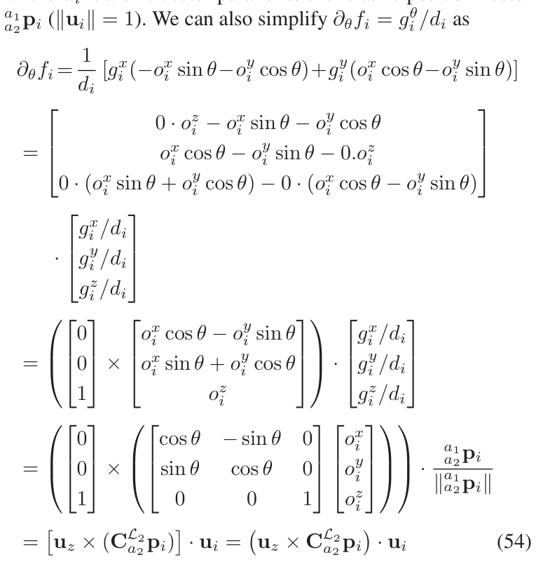

---

**译文结束。** 本文件已覆盖原刊全部正文、两篇附录、算法、图表说明、参考文献及作者简介。
