# 基于相对距离与惯性测量的多无人机去中心化三角形相对定位

**Decentralized triangular relative localization of multiple UAVs based on relative range and inertial measurements**

**作者：** Meysam Alizad，Hadi Nobahari（通信作者）  
**单位：** 伊朗谢里夫理工大学航空航天工程系。  
**出处：** *ISA Transactions*，149（2024）：217–228。  
**DOI：** 10.1016/j.isatra.2024.04.020。

> **译本说明**：以本次对话中上传的 12 页正式发表版为底本，完整译出摘要、正文第 1–6 节、全部图 1–18 的图注、资助信息、伦理声明、作者贡献、利益冲突声明、致谢及 40 条参考文献。全部编号公式 (1)–(59) 均予保留，包括 (31a)–(31c)、(32a)–(32c)。为准确保留长矩阵的每个上下标与原刊印刷内容，式 (13)、(14)、(24)–(29)、(40)、(41)、(46) 以高清原式图嵌入。其余公式可编辑。图内英文另附中文对照。作者的论断、原式和疑似错误均不作隐性修改，核对说明集中于文末。本文件是完整译本，不使用“详见原文”替代任何正文、公式或图注。

## 文章信息

**文章类型：** 研究论文。  
**收稿：** 2023 年 11 月 10 日。  
**收到修订稿：** 2024 年 4 月 18 日。  
**接受：** 2024 年 4 月 18 日。  
**在线发表：** 2024 年 4 月 20 日。  
**电子邮箱：** m.alizad.ab@ae.sharif.edu（M. Alizad）；nobahari@sharif.edu（H. Nobahari）。  
**期刊主页：** `www.elsevier.com/locate/isatrans`。  
**版权：** 0019-0578 / © 2024 ISA。Elsevier Ltd. 出版，保留所有权利。

**原文题名脚注：** 作者感谢先前研究的作者所提供的宝贵认识与指导，这些工作对本文的研究方向和方法产生了重要影响。

## 摘要

本文提出一种基于相对距离与惯性测量的多无人机（UAV）协同相对定位新算法。在该算法中，针对空间中能够形成三角形的每组三架无人机，建立相对运动估计模型。组内每个成员估计其余成员的相对位置和航向角，并与其他成员共享估计结果。当各成员估计的相对位置向量满足三角形法则时，能够获得更准确的估计。分析所提出模型的可观测性后，文中还给出了可观测性的必要条件；与先前方法相比，这些条件的限制更少。随后，将本文方法与基于一致性的去中心化卡尔曼滤波方法进行比较，分析两种方法在噪声、扰动，以及成员间通信中断条件下的结果。

**关键词：** 相对定位；协同相对定位；多智能体；UWB；基于距离的估计；去中心化估计。

## 1　引言

无人机协作能够提供单架无人机无法实现的优势。协同无人机集群有潜力比单机更高效、更迅速地执行任务，同时提高任务可靠性与可扩展性，并降低任务成本。多无人机有许多应用，例如监视 [1,2]、目标定位 [3]、编队飞行 [4–7] 等。为执行可靠且灵活的集群任务，通常要求各无人机相互感知并进行局部交互。部分协同飞行任务，例如紧密编队飞行，需要准确测量或估计智能体之间的相对位置。因此，开发同时考虑传感器限制、可靠性与计算能力的相对位置估计方法，具有重要意义。

现有定位系统主要分为绝对定位和相对定位。GPS 等全球导航卫星系统（GNSS）[4,8] 和运动捕捉系统 [9] 是最常见的绝对定位系统。然而，在 GPS 拒止环境中，GPS 可能无法工作，而且其精度可能无法满足无人机近距离飞行的要求 [10]。运动捕捉系统能够提供精确的位置，但一般受限于实验室环境，部署成本也可能较高。相对定位则是融合机载相机、惯性测量单元（IMU）、激光雷达与超宽带（UWB）测距传感器等不同传感器的数据，以确定每对无人机之间的位置关系。例如，激光—相机系统已用于 SLAM 中的多机器人地图对齐 [11]；视觉—惯性—UWB 估计系统已用于多无人机相对位置估计 [12]；惯性导航系统（INS）、里程计和 UWB 也已用于 GPS 拒止煤矿环境中的定位 [13]。

基于视觉的方法，例如机载相机或红外传感器系统，在协同无人机应用中存在视场限制。传感器阵列或对邻机的主动跟踪可以缓解这一问题。然而，这两种方案都不够理想，因为它们增加重量，且定位精度依赖环境。因此，UWB 这类天然具有全向特性的无线电收发器，被提出作为协同无人机相对定位的更合适替代方案 [14]。UWB 无线电技术因其低成本、低功耗以及在 GPS 拒止环境下的工作能力，使无人机间测距变得更容易，其宣称测距误差小于 10 cm。不过，单个距离量测无法给出完整的三维相对位置，需要额外信息才能获得可观测的相对定位解 [15]。

基于距离的定位通常通过测量到已知位置地标的距离实现，这些地标称为锚点 [16]。没有外部参考时，运动智能体之间的相对位置估计更加困难。相机或多个 UWB 标签等附加传感器已用于从距离测量获取相对位置，但视觉方法需要大量计算资源 [12]。使用多个标签被提出作为解决不可观测问题的一种方法。多项研究已经展示了多标签相对定位，包括两个标签配合九轴 IMU [17]，在四旋翼上安装四个标签以跟踪人员 [18]，在六旋翼上安装三个标签以定位四旋翼 [19]。对于多个 UWB 标签，文献 [20] 研究了提升估计性能的各无人机最佳位置；文献 [15] 借助图论推导了可观测性条件。根据 [21,22]，单距离量测与速度信息能够实现相对位置可观测，但前提是智能体持续相对运动，并满足持久激励条件。

相对距离驱动的相对位置估计主要有两类：基于优化的方法和基于滤波的方法。优化方法依据距离几何确定传感器可能的位置，但测量噪声和传感器运动可能限制其精度 [23]。滑动窗口 [24]、高效代价函数 [25] 和预滤波 [26] 被提出用于克服这些局限。为提高计算效率，一些研究将代价函数重构为半正定规划问题 [27,28]，或定义凸代价函数 [29]。然而，非线性优化方法因其集中式架构而需要大量计算资源，不适合资源受限的嵌入式应用。

扩展卡尔曼滤波（EKF）等滤波方法使用惯性传感器预测机器人运动，再利用量测更新估计 [15,30]。EKF 等递归滤波算法更适合去中心化架构 [17]。去中心化方法具有可靠性，并能在成员之间分摊计算负载，因此近年来受到更多关注，同时也降低了单个智能体算法的复杂性。这样，任务成功不再依赖单一领航节点。此外，对网络内数据处理工具和算法的需求正在增长：这些工具应提供高性能在线估计、降低传感器节点间通信负担、适应节点故障或替换，并适用于分布式控制 [31]。这些要求说明有必要开发高效、鲁棒的去中心化估计方法。

基于一致性的 EKF 使用一致性技术，通过连续两个步骤完成分布式估计。第一步采用 EKF 估计智能体相对位置，第二步执行修正，使结果满足几何约束 [32–34]。这种方法可用于通信与计算资源受限的大规模网络，但可能因故障或恶意智能体产生偏差，或收敛到错误解。此外，这类 EKF 需要调节参数，且收敛可能较慢。

先前部分工作除一个 IMU 外，还为每架无人机配置多个 UWB，以确保可观测性，并提高相对位置估计的收敛速度与精度 [15,24,30]。本文则提出一种快速去中心化方法，每架无人机使用一个 UWB 和 IMU 测量，准确估计集群内无人机之间的相对位置。主要贡献如下。

1. 为三机群组的相对位置向量估计建立相对运动模型，使每架无人机的测量向量能够包含其他成员的估计信息。
2. 去中心化一致性 EKF 通常先估计、再依据几何约束修正；本文方法在估计过程中同时保证几何约束满足。
3. 将个体测量与其他成员的估计信息融合，使系统在悬停和平行飞行时仍然可观测。

其余部分安排如下：第 2 节介绍问题与相对运动模型；第 3 节分析可观测性；第 4 节介绍基于 EKF 的去中心化估计；第 5 节进行仿真；第 6 节给出结论。

## 2　问题描述与相对运动模型

本节介绍问题并说明研究假设，同时给出包含三架无人机动力学的模型。

### 2.1　问题定义

本文考虑 GPS 拒止环境中多无人机的相对定位估计。将相对位置和姿态估计问题简化为仅在水平平面内运动。在该情况下，每架无人机上的 UWB 传感器可以测量机间距离，各机的 UWB 与 IMU 测量也在无人机之间共享。

### 2.2　相对运动模型

惯性坐标系记为 $\mathcal I$。第 $i$ 架四旋翼的机体系记为 $\beta_i$，假设其原点在重心处，UWB 与 IMU 安装于该处。机体系三个轴分别指向机头、右侧和下方。由于四旋翼以较小横滚角 $\phi$、俯仰角 $\theta$ 近悬停飞行，还假设每架四旋翼的 $z$ 轴与惯性系 $z$ 轴平行。

第 $i$ 架四旋翼绕 $z$ 轴的旋转角定义为航向角 $\psi_i$。航向变化率记为 $\omega$，计算为

$$
\widetilde\omega_i=
\frac{\widetilde q_i\sin\widetilde\phi_i+
\widetilde r_i\cos\widetilde\phi_i}{\cos\widetilde\theta_i}.
\tag{1}
$$

$\widetilde q,\widetilde r$ 分别为 IMU 角速度陀螺仪测得的俯仰和偏航角速度。如图 1 所示，二维向量 $\mathbf P_{ij}^{\beta_i}$ 表示在 $\beta_i$ 中表达的第 $i$ 架四旋翼相对于第 $j$ 架四旋翼的位置。$\Delta\psi_{ij}=\psi_j-\psi_i$ 表示两机的相对航向。二维向量 $\mathbf v_i^{\beta_i}$ 和 $\widetilde{\mathbf a}_i^{\beta_i}$ 分别表示第 $i$ 架四旋翼机载 IMU 测得的、以 $\beta_i$ 表达的速度和比力。原文对 $\mathbf P_{ij}$ 的这句文字描述与后续动力学方向约定之间的关系，见文末译者核对注 A1。

定义状态向量 $\mathbf X_{i\triangleright jk}\in\mathbb R^{12}$：

$$
\mathbf X_{i\triangleright jk}=
\left[
(\mathbf P_{ij}^{\beta_i})^\mathsf T,
(\mathbf P_{ik}^{\beta_i})^\mathsf T,
\Delta\psi_{ij},\Delta\psi_{ik},
(\mathbf v_i^{\beta_i})^\mathsf T,
(\mathbf v_j^{\beta_j})^\mathsf T,
(\mathbf v_k^{\beta_k})^\mathsf T
\right]^\mathsf T,
\tag{2}
$$

以及输入向量 $\mathbf U_{i\triangleright jk}\in\mathbb R^9$：

$$
\mathbf U_{i\triangleright jk}=
\left[
\widetilde\omega_i,\widetilde\omega_j,\widetilde\omega_k,
(\widetilde{\mathbf a}_i^{\beta_i})^\mathsf T,
(\widetilde{\mathbf a}_j^{\beta_j})^\mathsf T,
(\widetilde{\mathbf a}_k^{\beta_k})^\mathsf T
\right]^\mathsf T.
\tag{3}
$$

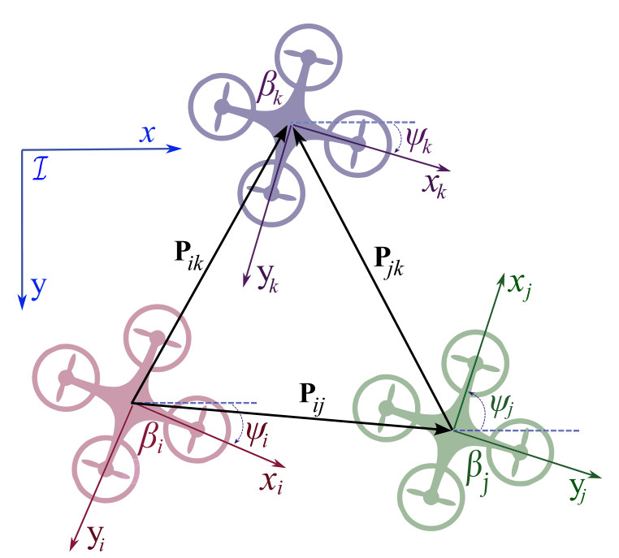

**图 1。** 三架四旋翼相对位置与航向角的几何表示。注意，图示情况下 $\psi_j$ 为负。图中 $\mathcal I$ 为惯性系，$\beta_i,\beta_j,\beta_k$ 为机体系，$\mathbf P_{ij},\mathbf P_{ik},\mathbf P_{jk}$ 为三条边对应的相对位置向量。

基于 [22]、[32] 的模型，第 $i$ 架四旋翼估计相对于第 $j,k$ 架的相对位置和航向所用的相对运动动力学为

$$
\dot{\mathbf X}_{i\triangleright jk}
=\mathbf f(\mathbf X_{i\triangleright jk},\mathbf U_{i\triangleright jk})
=\begin{bmatrix}
\mathbf R^{\beta_i\beta_j}\mathbf v_j^{\beta_j}
-\widetilde\Omega_i\mathbf P_{ij}^{\beta_i}-\mathbf v_i^{\beta_i}\\
\mathbf R^{\beta_i\beta_k}\mathbf v_k^{\beta_k}
-\widetilde\Omega_i\mathbf P_{ik}^{\beta_i}-\mathbf v_i^{\beta_i}\\
\widetilde\omega_j-\widetilde\omega_i\\
\widetilde\omega_k-\widetilde\omega_i\\
\widetilde{\mathbf a}_i^{\beta_i}-\Omega_i\mathbf v_i^{\beta_i}\\
\widetilde{\mathbf a}_j^{\beta_j}-\Omega_j\mathbf v_j^{\beta_j}\\
\widetilde{\mathbf a}_k^{\beta_k}-\Omega_k\mathbf v_k^{\beta_k}
\end{bmatrix}.
\tag{4}
$$

$\widetilde\Omega_i$ 为 $\widetilde\omega_i$ 的二维反对称矩阵，原式写为

$$
\Omega_i=\begin{bmatrix}0&-\widetilde\omega_i\\\widetilde\omega_i&0\end{bmatrix}.
\tag{5}
$$

$\mathbf R^{\beta_i\beta_j}$ 为从 $\beta_j$ 到 $\beta_i$ 的二维旋转矩阵：

$$
\mathbf R^{\beta_i\beta_j}=\begin{bmatrix}
\cos\Delta\psi_{ij}&-\sin\Delta\psi_{ij}\\
\sin\Delta\psi_{ij}&\cos\Delta\psi_{ij}
\end{bmatrix}.
\tag{6}
$$

最后，估计所用测量模型 $\mathbf y_{i\triangleright jk}\in\mathbb R^{12}$ 定义为

$$
\begin{aligned}
\mathbf y_{i\triangleright jk}&=\mathbf h(\mathbf X_{i\triangleright jk})\\
&=\left[
\|\mathbf P_{ij}^{\beta_i}\|,
\|\mathbf P_{ik}^{\beta_i}\|,
\mathbf P_{ik}^{\beta_i}-\mathbf P_{ij}^{\beta_i},
\Delta\psi_{ij},\Delta\psi_{ik},
\mathbf v_i^{\beta_i},\mathbf v_j^{\beta_j},\mathbf v_k^{\beta_k}
\right]^\mathsf T.
\end{aligned}
\tag{7}
$$

$\|\cdot\|$ 表示欧氏范数。利用另外两个成员共享的信息，可以确定 $\mathbf P_{ik}^{\beta_i}-\mathbf P_{ij}^{\beta_i}$。事实上，如图 1，$\mathbf P_{ik}-\mathbf P_{ij}=\mathbf P_{jk}$，其中 $\mathbf P_{jk}$ 来自第 $j,k$ 架无人机的估计。第 4.2 节给出更多细节。

## 3　可观测性分析

局部弱可观测性是动力系统的一种性质：依据系统测量，能否将某个状态与其邻域内其他状态区分开 [35]。可以通过检查由李导数定义的可观测性矩阵的秩研究这一性质。本节先简要说明基于李导数的可观测性条件，再确定所提出模型的可观测性条件。

### 3.1　基于李导数的可观测性

非线性动力系统可描述为

$$
\dot{\mathbf x}=\mathbf f(\mathbf x,\mathbf u),
\tag{8}
$$

$$
\mathbf y=\mathbf h(\mathbf x).
\tag{9}
$$

其中 $\mathbf x=[x_1,x_2,\ldots,x_n]^\mathsf T\in\mathbb R^n$、$\mathbf u=[u_1,u_2,\ldots,u_n]^\mathsf T\in\mathbb R^l$、$\mathbf y=[y_1,y_2,\ldots,y_m]^\mathsf T\in\mathbb R^m$ 分别为状态、控制输入与测量向量；$\mathbf f,\mathbf h$ 为非线性函数。原文将可观测性矩阵记为 $\mathcal O\in\mathbb R^{mn}\times\mathbb R^n$。基于至第 $n$ 阶的李导数 [35]，其形式写为

$$
\mathcal O(\mathbf x)=\frac{\partial}{\partial\mathbf x}
\left[
\mathcal L_f^0\mathbf h(\mathbf x),
\mathcal L_f^1\mathbf h(\mathbf x),\ldots,
\mathcal L_f^{n-1}\mathbf h(\mathbf x)
\right]^\mathsf T.
\tag{10}
$$

李导数 $\mathcal L_f^i\mathbf h(\mathbf x)\in\mathbb R^{m\times1}$ 可递推计算：

$$
\mathcal L_f^i\mathbf h(\mathbf x)
=\frac{\partial\mathcal L_f^{i-1}\mathbf h(\mathbf x)}{\partial\mathbf x}
\mathbf f(\mathbf x,\mathbf u),
\qquad\mathcal L_f^0\mathbf h(\mathbf x)=\mathbf h(\mathbf x).
\tag{11}
$$

为研究非线性系统的局部弱可观测性，应不断向矩阵加入高阶李导数，直到矩阵满秩，即 $\operatorname{rank}(\mathcal O)=n$。如果加入所有高阶李导数后仍不能满秩，则该系统不可观测。

### 3.2　相对运动模型的可观测性分析

如前节所述，对式 (4) 的 12 状态模型，可观测性矩阵的秩必须等于 12，系统才可观测。本节使用至少二阶的李导数来确定必要条件。为便于推导，将式 (7) 的测量向量修改如下：用 $\frac12\mathbf P^\mathsf T\mathbf P$ 替换 $\|\mathbf P\|$。二者包含相同的信息，因此不影响可观测性 [36]。

$$
\begin{aligned}
\mathbf h(\mathbf X_{i\triangleright jk})=\big[&
\tfrac12(\mathbf P_{ij}^{\beta_i})^\mathsf T\mathbf P_{ij}^{\beta_i},
\tfrac12(\mathbf P_{ik}^{\beta_i})^\mathsf T\mathbf P_{ik}^{\beta_i},\\
&\mathbf P_{ik}^{\beta_i}-\mathbf P_{ij}^{\beta_i},
\Delta\psi_{ij},\Delta\psi_{ik},
\mathbf v_i^{\beta_i},\mathbf v_j^{\beta_j},\mathbf v_k^{\beta_k}\big]^\mathsf T.
\end{aligned}
\tag{12}
$$

可观测性矩阵中的第一部分为：

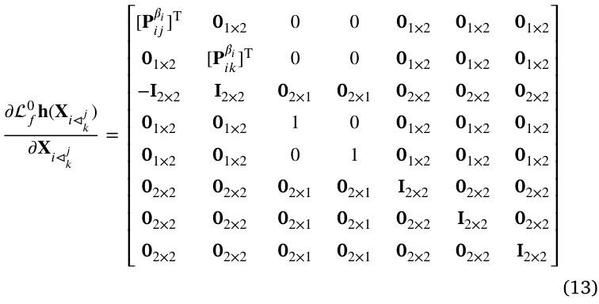

其中 $\mathbf I$ 和 $\mathbf0$ 分别表示单位矩阵与零矩阵。由于 $\Omega$ 为反对称矩阵，$\partial(\mathbf P^\mathsf T\Omega\mathbf P)/\partial\mathbf P=\mathbf0_{1\times2}$，因此可观测性矩阵中的第二部分为：

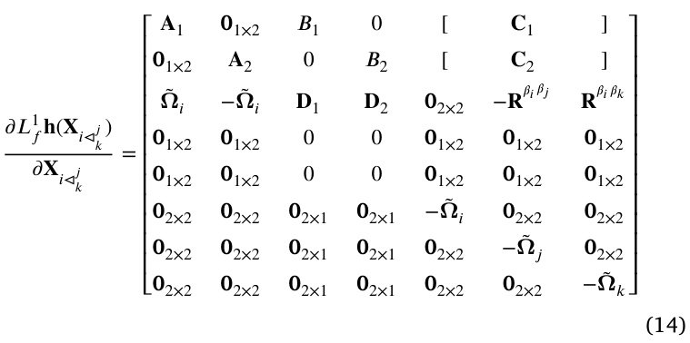

$\mathbf A_i,B_i,\mathbf C_i,\mathbf D_i$ 定义如下：

$$
\mathbf A_1=(\mathbf v_j^{\beta_j})^\mathsf T(\mathbf R^{\beta_i\beta_j})^\mathsf T
-(\mathbf v_i^{\beta_i})^\mathsf T,
\tag{15}
$$

$$
\mathbf A_2=(\mathbf v_k^{\beta_k})^\mathsf T(\mathbf R^{\beta_i\beta_k})^\mathsf T
-(\mathbf v_i^{\beta_i})^\mathsf T,
\tag{16}
$$

$$
B_1=(\mathbf P_{ij}^{\beta_i})^\mathsf T\Gamma\mathbf R^{\beta_i\beta_j}\mathbf v_j^{\beta_j},
\tag{17}
$$

$$
B_2=(\mathbf P_{ik}^{\beta_i})^\mathsf T\Gamma\mathbf R^{\beta_i\beta_k}\mathbf v_k^{\beta_k},
\tag{18}
$$

$$
\mathbf C_1=\left[-(\mathbf P_{ij}^{\beta_i})^\mathsf T\quad
(\mathbf P_{ij}^{\beta_i})^\mathsf T\mathbf R^{\beta_i\beta_j}\quad
\mathbf0_{1\times2}\right],
\tag{19}
$$

$$
\mathbf C_2=\left[-(\mathbf P_{ik}^{\beta_i})^\mathsf T\quad
\mathbf0_{1\times2}\quad
(\mathbf P_{ik}^{\beta_i})^\mathsf T\mathbf R^{\beta_i\beta_k}\right],
\tag{20}
$$

$$
\mathbf D_1=-\Gamma\mathbf R^{\beta_i\beta_j}\mathbf v_j^{\beta_j},
\tag{21}
$$

$$
\mathbf D_2=\Gamma\mathbf R^{\beta_i\beta_k}\mathbf v_k^{\beta_k}.
\tag{22}
$$

$\Gamma$ 定义为

$$
\Gamma=\begin{bmatrix}0&-1\\1&0\end{bmatrix}.
\tag{23}
$$

将式 (13) 与式 (14) 的前两行组合，可以构造如下可观测性矩阵。前两行是能够增加可观测性矩阵秩的行，而其余行与式 (14) 中的某些行线性相关，即与包含 $\Omega$ 和 $\mathbf I_{2\times2}$ 的行线性相关。

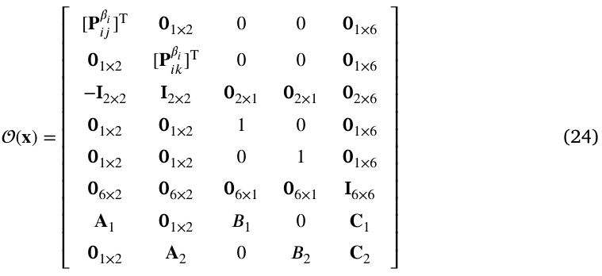

为简化 $\mathcal O(\mathbf x)$ 的秩计算，执行如下初等行变换：$-B_1R_5+R_{13}\rightarrow R_{13}$，$-B_2R_5+R_{14}\rightarrow R_{14}$。$R_n$ 表示矩阵 $\mathcal O$ 的第 $n$ 行。

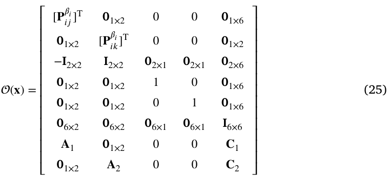

对最后几行进行类似的初等行变换，可以把 $\mathbf C_1,\mathbf C_2$ 变为零矩阵。再交换某些行，得到

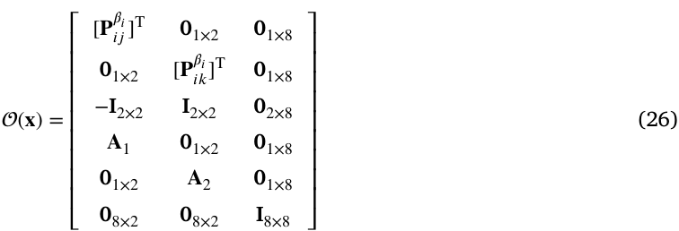

设 $(\mathbf P_{ij}^{\beta_i})^\mathsf T=[P_{xij},P_{yij}]^\mathsf T$，$(\mathbf P_{ik}^{\beta_k})^\mathsf T=[P_{xik},P_{yik}]^\mathsf T$，$\mathbf A_1=[A_{x1},A_{y1}]^\mathsf T$，$\mathbf A_2=[A_{x2},A_{y2}]^\mathsf T$，则矩阵可写成

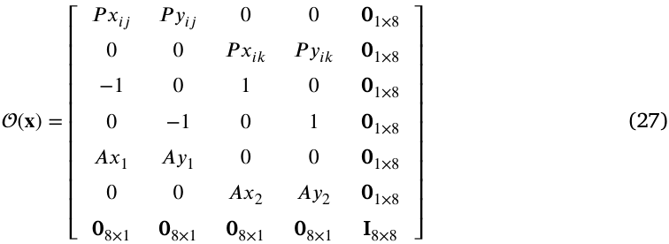

上句行、列转置和机体系上标按原刊保留。接下来进行两步初等行变换。

**步骤 1：** $-P_{xik}R_3+R_2\rightarrow R_2$，$-A_{x2}R_3+R_6\rightarrow R_6$。

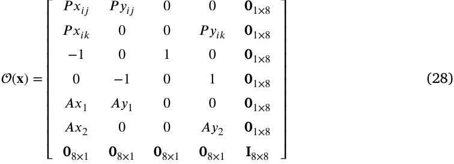

**步骤 2：** $-P_{yik}R_4+R_2\rightarrow R_2$，$-A_{y2}R_4+R_6\rightarrow R_6$。

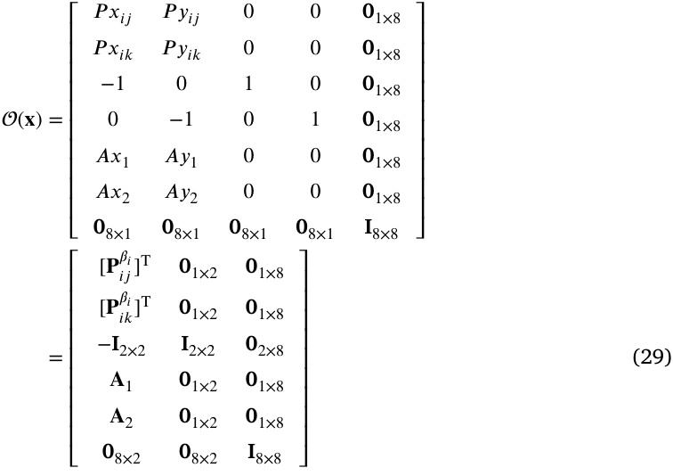

简化后的 $\mathcal O$ 中有 10 行由单位矩阵结构构成，说明最小秩为 10。只需从剩下 4 行中再找到两个线性独立行，即可使秩达到 12，满足局部可观测性判据。因此，下列矩阵必须包含两个独立行：

$$
\mathcal C=
\begin{bmatrix}
(\mathbf P_{ij}^{\beta_i})^\mathsf T\\
(\mathbf P_{ik}^{\beta_i})^\mathsf T\\
\mathbf A_1\\\mathbf A_2
\end{bmatrix}
=
\begin{bmatrix}
(\mathbf P_{ij}^{\beta_i})^\mathsf T\\
(\mathbf P_{ik}^{\beta_i})^\mathsf T\\
(\mathbf v_j^{\beta_j})^\mathsf T(\mathbf R^{\beta_i\beta_j})^\mathsf T
-(\mathbf v_i^{\beta_i})^\mathsf T\\
(\mathbf v_k^{\beta_k})^\mathsf T(\mathbf R^{\beta_i\beta_k})^\mathsf T
-(\mathbf v_i^{\beta_i})^\mathsf T
\end{bmatrix}.
\tag{30}
$$

为获得更实用的理解，可推导以下三组可观测性条件；每一组都保证 $\mathcal C$ 至少有两个独立行。

**第一组：**

$$
\mathbf P_{ij}\ne\mathbf0_{2\times1},
\tag{31a}
$$

$$
\mathbf v_i\ne\mathbf0_{2\times1}\quad\text{或}\quad
\mathbf v_j\ne\mathbf0_{2\times1},
\tag{31b}
$$

$$
\mathbf v_i^{\beta_i}\ne\mathbf R^{\beta_i\beta_j}\mathbf v_j^{\beta_j}.
\tag{31c}
$$

**第二组：**

$$
\mathbf P_{ik}\ne\mathbf0_{2\times1},
\tag{32a}
$$

$$
\mathbf v_i\ne\mathbf0_{2\times1}\quad\text{或}\quad
\mathbf v_k\ne\mathbf0_{2\times1},
\tag{32b}
$$

$$
\mathbf v_i^{\beta_i}\ne\mathbf R^{\beta_i\beta_k}\mathbf v_k^{\beta_k}.
\tag{32c}
$$

**第三组：**

$$
\mathbf P_{ij}^{\beta_i}\ne\nu\mathbf P_{ik}^{\beta_i},
\tag{33}
$$

其中 $\nu$ 为任意常数。

只要满足其中一组条件，系统就弱可观测。根据近期研究 [22]，在三架四旋翼组成的群组中，第一组和第二组条件都应满足；但在本文模型中，满足其中一组即可。此外，依据第三组条件，如果三架四旋翼不共线，即不位于同一直线上，那么即使悬停或平行运动，系统也可观测。这说明本文模型除使用测量外，还引入无人机的估计信息，因此在广泛条件下保持可观测。

在相对运动模型式 (4) 中，$\Delta\dot\psi_{ij}$ 和 $\Delta\dot\psi_{ik}$ 与相对位置无关。因此，若相对动力学仅考虑相对航向，则动力学与测量模型可简化为

$$
\dot{\mathcal X}_{i\triangleright jk}
=\mathcal F(\mathcal X_{i\triangleright jk},\mathbf U_{i\triangleright jk})
=\begin{bmatrix}\widetilde\omega_j-\widetilde\omega_i\\
\widetilde\omega_k-\widetilde\omega_i\end{bmatrix},
\tag{34}
$$

$$
\mathcal Y_{i\triangleright jk}
=\mathcal H(\mathcal X_{i\triangleright jk})
=\begin{bmatrix}\Delta\psi_{ij}\\\Delta\psi_{ik}\end{bmatrix},
\tag{35}
$$

其中状态向量定义为

$$
\mathcal X_{i\triangleright jk}=[\Delta\psi_{ij},\Delta\psi_{ik}]^\mathsf T.
\tag{36}
$$

为研究该简化二阶模型的可观测性，基于李导数的可观测性矩阵第一部分为

$$
\frac{\partial\mathcal L_{\mathcal F}^{0}\mathcal H(\mathcal X_{i\triangleright jk})}
{\partial\mathcal X_{i\triangleright jk}}
=\begin{bmatrix}1&0\\0&1\end{bmatrix}.
\tag{37}
$$

因此，简化模型的可观测性矩阵满秩，相对航向角在任何情况下均可观测。

## 4　基于 EKF 的去中心化估计策略

当估计器无法得到足够的距离、加速度和角速度传感器信息，例如可观测性条件被破坏时，它可能发散，甚至收敛到几何上错误的答案，例如估计的相对位置向量不满足三角形法则。本节详细介绍所提出的 EKF 协同估计方法，先简要回顾 EKF，再介绍通过几何拓扑改善估计精度的四旋翼交互结构。

### 4.1　扩展卡尔曼滤波

EKF 是卡尔曼滤波向非线性动力系统的扩展，对广泛的非线性系统具有局部收敛性。此外，[37] 表明，如果滤波器的初始估计误差位于合理范围内，则误差随时间指数下降并最终达到零。该方法在当前状态估计附近线性化系统的非线性动力学，再使用标准卡尔曼滤波求解估计问题。以下为传播和更新状态及协方差的两个步骤。

**传播步骤。** 根据上一时刻估计状态和协方差，使用非线性动力系统的线性化模型，将状态估计与协方差向前传播。时刻 $t_k$ 的先验状态与协方差通过以下离散方程计算。

先验状态预测：

$$
\widehat{\mathbf X}_{i\triangleright jk,t_k}^{-}
=\mathbf F_{i\triangleright jk,t_k}
\widehat{\mathbf X}_{i\triangleright jk,t_{k-1}}
+\mathbf B_{i\triangleright jk,t_k}\mathbf U_{i\triangleright jk,t_k}.
\tag{38}
$$

先验协方差预测：

$$
\widehat{\mathcal P}_{i\triangleright jk,t_k}^{-}
=\mathbf F_{i\triangleright jk,t_k}
\widehat{\mathcal P}_{i\triangleright jk,t_{k-1}}
\mathbf F_{i\triangleright jk,t_k}^\mathsf T
+\mathbf Q_{i\triangleright jk,t_k}.
\tag{39}
$$

上标“$-$”表示先验估计。波浪号和帽号分别表示测量值与估计值。$\mathbf F_{i\triangleright jk}$ 为状态转移模型，可写为

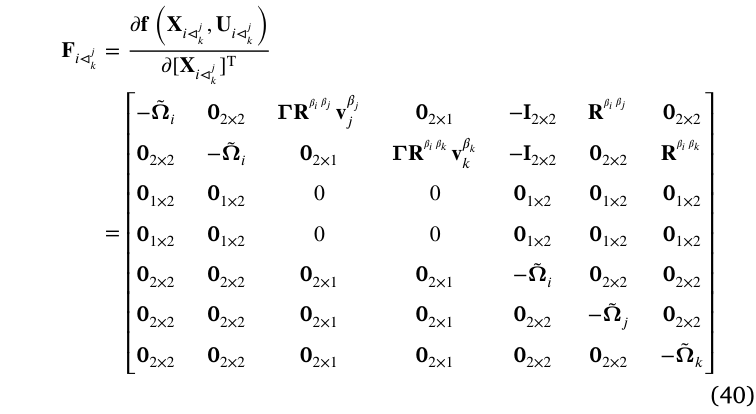

控制输入模型 $\mathbf B_{i\triangleright jk}$ 为

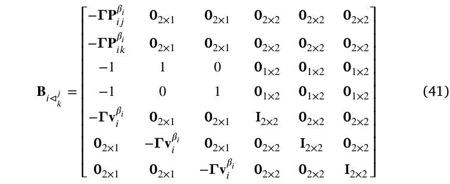

$\mathbf Q$ 表示过程噪声协方差，可由输入噪声协方差定义 [38]：

$$
\mathbf Q=\mathbf B\mathcal Q\mathbf B^\mathsf T,
\tag{42}
$$

其中 $\mathcal Q=\operatorname{diag}(\sigma_{\omega_i}^{2},\sigma_{\omega_j}^{2},\sigma_{\omega_k}^{2},\sigma_{\mathbf a_i}^{2},\sigma_{\mathbf a_j}^{2},\sigma_{\mathbf a_k}^{2})$，$\sigma$ 表示标准差。

**更新步骤。** 将预测测量与实际测量比较，以更新状态估计和协方差：

$$
\begin{aligned}
\mathbf K_{t_k}
=&\mathcal P_{i\triangleright jk,t_k}^{-}\mathbf H_{i\triangleright jk,t_k}^\mathsf T\\
&\cdot\left(
\mathbf H_{i\triangleright jk,t_k}\mathcal P_{i\triangleright jk,t_k}^{-}
\mathbf H_{i\triangleright jk,t_k}^\mathsf T+\mathcal R_{t_k}
\right)^{-1},
\end{aligned}
\tag{43}
$$

$$
\widehat{\mathbf X}_{i\triangleright jk,t_k}
=\widehat{\mathbf X}_{i\triangleright jk,t_k}^{-}
+\mathbf K_{t_k}\left(
\widetilde{\mathbf y}_{i\triangleright jk}
-\mathbf h(\widehat{\mathbf X}_{i\triangleright jk})\right),
\tag{44}
$$

$$
\mathcal P_{i\triangleright jk,t_k}
=(\mathbf I-\mathbf K_{t_k}\mathbf H_{i\triangleright jk,t_k})
\mathcal P_{i\triangleright jk,t_k}^{-}.
\tag{45}
$$

$\widetilde{\mathbf y}$ 为测量向量，$\mathcal R=\operatorname{diag}(\sigma_{d_{ij}}^2,\sigma_{d_{ik}}^2,\sigma_{\mathbf R_{jk}}^2,\sigma_{\mathbf v_i}^2,\sigma_{\mathbf v_j}^2,\sigma_{\mathbf v_k}^2)$ 为其协方差矩阵。$\mathbf H_{i\triangleright jk}$ 为测量模型的 Jacobian：

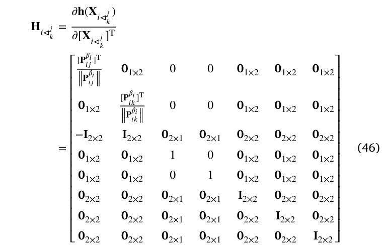

### 4.2　无人机之间的协作配置

一个群组的三架无人机依次进行估计，共分三个步骤。根据图 2，三架无人机的测量向量 $\widetilde{\mathbf y}$ 均借助其他成员的测量与估计得到。测得的速度、航向角、机间距离分别记为 $\widetilde{\mathbf v},\widetilde\psi,\widetilde d$。各步确定 $\widetilde{\mathbf y}$ 的具体过程如下。

**步骤 1：**

$$
\widetilde{\mathbf y}_{i\triangleright jk}=
\left[\widetilde d_{ij},\widetilde d_{ik},
\mathbf P_{ik}^{\beta_i}-\mathbf P_{ij}^{\beta_i},
\Delta\widetilde\psi_{ij},\Delta\widetilde\psi_{ik},
\widetilde{\mathbf v}_i^{\beta_i},\widetilde{\mathbf v}_j^{\beta_j},
\widetilde{\mathbf v}_k^{\beta_k}\right]^\mathsf T.
\tag{47}
$$

其中 $\mathbf P_{ik}^{\beta_i}-\mathbf P_{ij}^{\beta_i}=\mathbf P_{jk}^{\beta_i}$，可估计为

$$
\mathbf P_{jk}^{\beta_i}=\widetilde d_{jk}
\frac{
(\widehat{\mathbf R}^{\beta_j\beta_i})^\mathsf T\widehat{\mathbf u}_{jk}^{\beta_j}
-(\widehat{\mathbf R}^{\beta_k\beta_i})^\mathsf T\widehat{\mathbf u}_{kj}^{\beta_k}}
{\left\|
(\widehat{\mathbf R}^{\beta_j\beta_i})^\mathsf T\widehat{\mathbf u}_{jk}^{\beta_j}
-(\widehat{\mathbf R}^{\beta_k\beta_i})^\mathsf T\widehat{\mathbf u}_{kj}^{\beta_k}
\right\|}.
\tag{48}
$$

$\widehat{\mathbf R}=\mathbf R(\Delta\widehat\psi)$ 是估计旋转矩阵，$\widehat{\mathbf u}$ 是估计位置向量 $\widehat{\mathbf P}$ 的单位向量。因为 $\Delta\widehat\psi,\widehat{\mathbf P}$ 在上一采样时刻计算，最好使用其补偿值 $\widehat\psi^{-},\widehat{\mathbf P}^{-}$。补偿可通过传播以下动力学方程实现：

$$
\begin{bmatrix}\dot{\mathbf P}_{jk}^{\beta_j}\\\Delta\dot\psi_{ji}\end{bmatrix}
=\begin{bmatrix}
-\mathbf v_j^{\beta_j}+\mathbf R^{\beta_j\beta_k}\mathbf v_k^{\beta_k}
-\widetilde\Omega_j\mathbf P_{jk}^{\beta_j}\\
\widetilde\omega_i-\widetilde\omega_j
\end{bmatrix},
\tag{49}
$$

$$
\begin{bmatrix}\dot{\mathbf P}_{kj}^{\beta_k}\\\Delta\dot\psi_{ki}\end{bmatrix}
=\begin{bmatrix}
-\mathbf v_k^{\beta_k}+\mathbf R^{\beta_k\beta_j}\mathbf v_j^{\beta_j}
-\widetilde\Omega_k\mathbf P_{kj}^{\beta_k}\\
\widetilde\omega_i-\widetilde\omega_k
\end{bmatrix}.
\tag{50}
$$

**步骤 2：**

$$
\widetilde{\mathbf y}_{j\triangleright ik}=
\left[\widetilde d_{ji},\widetilde d_{jk},
\mathbf P_{jk}^{\beta_j}-\mathbf P_{ji}^{\beta_j},
\Delta\widetilde\psi_{ji},\Delta\widetilde\psi_{jk},
\widetilde{\mathbf v}_j^{\beta_j},\widetilde{\mathbf v}_i^{\beta_i},
\widetilde{\mathbf v}_k^{\beta_k}\right]^\mathsf T.
\tag{51}
$$

其中 $\mathbf P_{jk}^{\beta_j}-\mathbf P_{ji}^{\beta_j}=\mathbf P_{ik}^{\beta_j}$，可估计为

$$
\mathbf P_{ik}^{\beta_j}
=\widetilde d_{ik}(\widehat{\mathbf R}^{\beta_i\beta_j})^\mathsf T
\widehat{\mathbf u}_{ik}^{\beta_i}.
\tag{52}
$$

**步骤 3：**

$$
\widetilde{\mathbf y}_{k\triangleright ij}=
\left[\widetilde d_{ki},\widetilde d_{kj},
\mathbf P_{kj}^{\beta_k}-\mathbf P_{ki}^{\beta_k},
\Delta\widetilde\psi_{ki},\Delta\widetilde\psi_{kj},
\widetilde{\mathbf v}_k^{\beta_k},\widetilde{\mathbf v}_i^{\beta_i},
\widetilde{\mathbf v}_j^{\beta_j}\right]^\mathsf T.
\tag{53}
$$

其中 $\mathbf P_{kj}^{\beta_k}-\mathbf P_{ki}^{\beta_k}=\mathbf P_{ij}^{\beta_k}$，可估计为

$$
\mathbf P_{ij}^{\beta_k}=\widetilde d_{ij}
\frac{
(\widehat{\mathbf R}^{\beta_i\beta_k})^\mathsf T\widehat{\mathbf u}_{ij}^{\beta_i}
-(\widehat{\mathbf R}^{\beta_j\beta_k})^\mathsf T\widehat{\mathbf u}_{ji}^{\beta_j}}
{\left\|
(\widehat{\mathbf R}^{\beta_i\beta_k})^\mathsf T\widehat{\mathbf u}_{ij}^{\beta_i}
-(\widehat{\mathbf R}^{\beta_j\beta_k})^\mathsf T\widehat{\mathbf u}_{ji}^{\beta_j}
\right\|}.
\tag{54}
$$

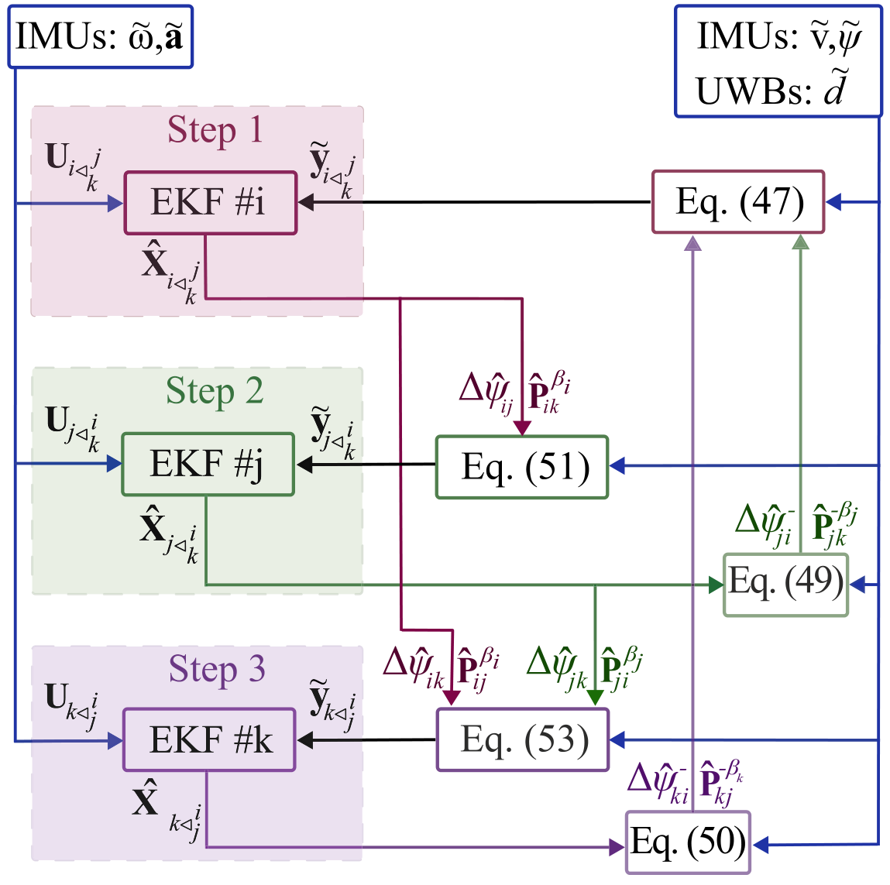

**图 2。** 所提估计策略的框架。图内 Step 1、2、3＝步骤 1、2、3；EKF #i、#j、#k＝三架无人机各自的 EKF；Eq.＝公式；IMUs＝惯性测量单元；UWBs＝UWB 测距设备。箭头表示输入、量测构造、估计输出及时间传播补偿之间的信息流。

## 5　仿真验证

进行若干仿真以考察所提估计方案，包括无噪声下的可观测与不可观测情况，以及有噪测量下的扰动和通信中断。虽然存在模型预测控制（MPC）[39]、滑模控制等现代四旋翼控制方法，本文采用更简单的比例—微分（PD）控制器 [40]，通过控制姿态来控制四旋翼位置。六自由度动力学使用 [40] 的模型与控制方法仿真，系统概览见图 3。

四旋翼总质量为 1.25 kg，转动惯量为 $I_{xx}=0.0232$、$I_{yy}=0.0232$、$I_{zz}=0.0468$，机臂长度为 26 cm。PD 参数为：位置控制各通道的比例、微分增益分别为 0.8、0.5；横滚与俯仰控制为 750、45；偏航控制为 70、20。仿真频率为 50 Hz。为模拟水平面运动，高度变化保持较小。三架四旋翼沿解析确定的轨迹运动。

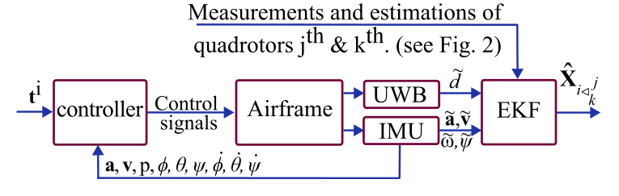

**图 3。** 第 $i$ 架四旋翼的系统模型。图内 Measurements and estimations of quadrotors j-th & k-th＝第 $j,k$ 架四旋翼的测量与估计；controller＝控制器；Control signals＝控制信号；Airframe＝机体；UWB、IMU、EKF 分别为测距、惯性测量与扩展卡尔曼滤波模块。

### 5.1　不可观测情况

本小节设计仿真场景来验证可观测性分析结论，重点研究平行运动和静止等临界场景，并判断 EKF 是否收敛。所有无人机均获得无噪声测量。每架四旋翼的偏航角速度和航向分别保持为 0 rad/s 和 0 rad。EKF 的初始相对位置猜测设为真实值的 0.1 倍。相对航向初始估计误差为 $\Delta\widehat\psi_{ij}=30^\circ$、$\Delta\widehat\psi_{ik}=-20^\circ$、$\Delta\widehat\psi_{jk}=-50^\circ$。由于本节不关注速度估计，各机速度以真实值初始化。各场景在惯性参考系内的参考轨迹如下。

**静止场景：** 四旋翼分别悬停于共线或不共线的点。

共线：

$$
\mathbf t_1^i=[0\quad0]^\mathsf T,\qquad
\mathbf t_1^j=[3\quad0]^\mathsf T,\qquad
\mathbf t_1^k=[6\quad0]^\mathsf T.
\tag{55}
$$

不共线：

$$
\mathbf t_2^i=[0\quad1]^\mathsf T,\qquad
\mathbf t_2^j=[2\quad0]^\mathsf T,\qquad
\mathbf t_2^k=[3\quad-1]^\mathsf T.
\tag{56}
$$

**平行路径场景：** 三架四旋翼平行飞行，分别考虑共线与不共线。

共线：

$$
\mathbf t_3^i=[t\quad3]^\mathsf T,\qquad
\mathbf t_3^j=[t\quad0]^\mathsf T,\qquad
\mathbf t_3^k=[t\quad-3]^\mathsf T.
\tag{57}
$$

不共线：

$$
\mathbf t_4^i=[t\quad3]^\mathsf T,\qquad
\mathbf t_4^j=[2+t\quad0]^\mathsf T,\qquad
\mathbf t_4^k=[1+t\quad-3]^\mathsf T.
\tag{58}
$$

$\mathbf t_n^i$ 表示第 $i$ 架四旋翼的第 $n$ 种轨迹，$t$ 为时间。

图 4 和图 5 分别显示静止且共线轨迹 $\mathbf t_1$ 的相对位置、相对航向估计；静止且不共线轨迹 $\mathbf t_2$ 的结果见图 6。类似地，平行且共线轨迹 $\mathbf t_3$ 的结果见图 7、8；平行且不共线轨迹 $\mathbf t_4$ 的结果见图 9。

在共线场景 $\mathbf t_1,\mathbf t_3$ 中，三组可观测性条件均不满足；不共线场景 $\mathbf t_2,\mathbf t_4$ 满足式 (33) 第三组条件。因此，估计结果表明，如图 4 和图 7，数值收敛到真实值，而图 6 和图 9 未出现这种收敛。这句话按原文保留，其图号与图示结果、前后论述的冲突见译者核对注 A4。

此外，根据第 3.2 节分析，相对航向估计在全部条件下均可观测，仿真也支持这一结论。如图所示，各场景相对航向均收敛到真实值。

**图 4–9 共用图内文字对照：** Estimated by i/j/k＝由第 $i/j/k$ 架无人机估计；Actual＝真实值；Estimated＝估计值；Actual $P_x/P_y$＝相对位置 $x/y$ 分量真实值；Estimated $P_x/P_y$＝对应估计值；time [sec]＝时间（秒）；[m]＝米；[deg]＝度。

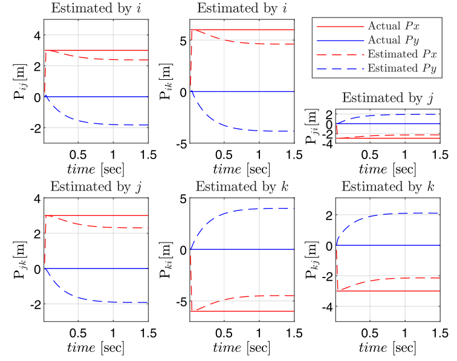

**图 4。** 静止且共线轨迹 $\mathbf t_1$ 的相对位置估计。

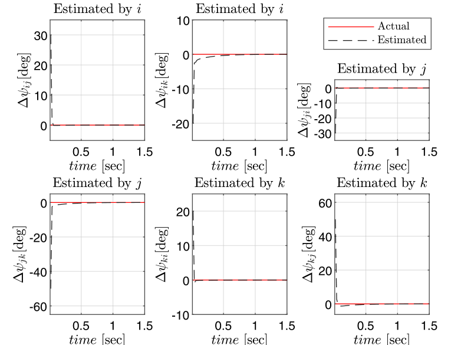

**图 5。** 静止且共线轨迹 $\mathbf t_1$ 的相对航向角估计。

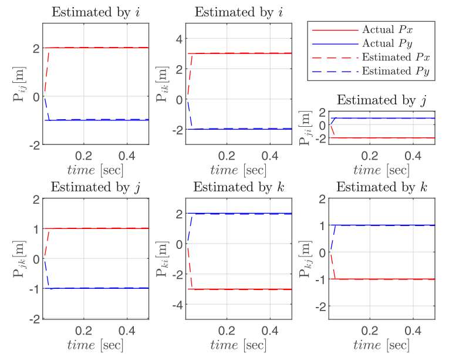

**图 6。** 静止且不共线轨迹 $\mathbf t_2$ 的相对位置估计。

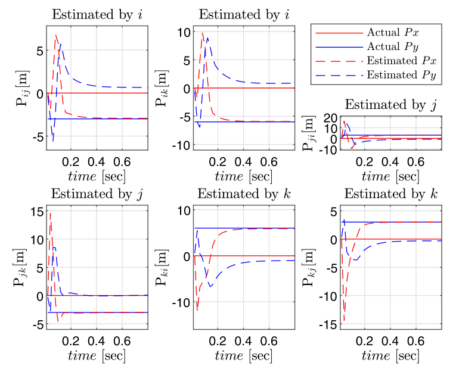

**图 7。** 平行且共线轨迹 $\mathbf t_3$ 的相对位置估计。

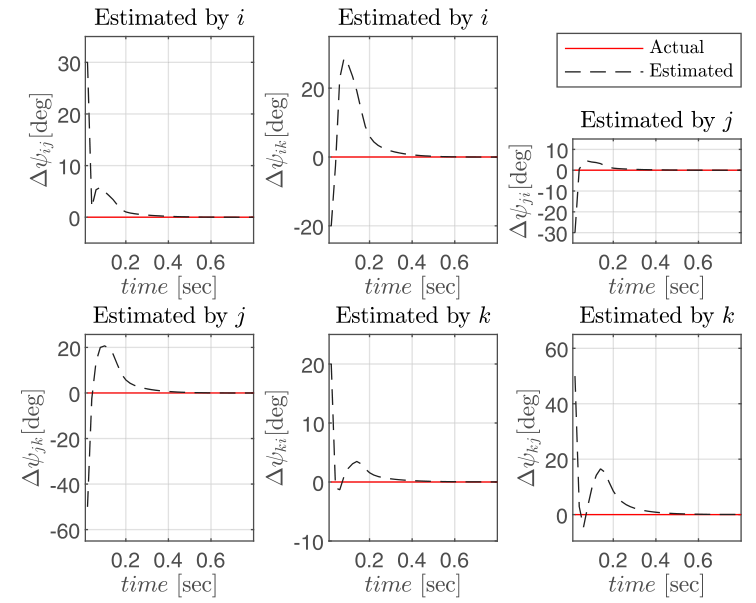

**图 8。** 平行且共线轨迹 $\mathbf t_3$ 的相对航向角估计。

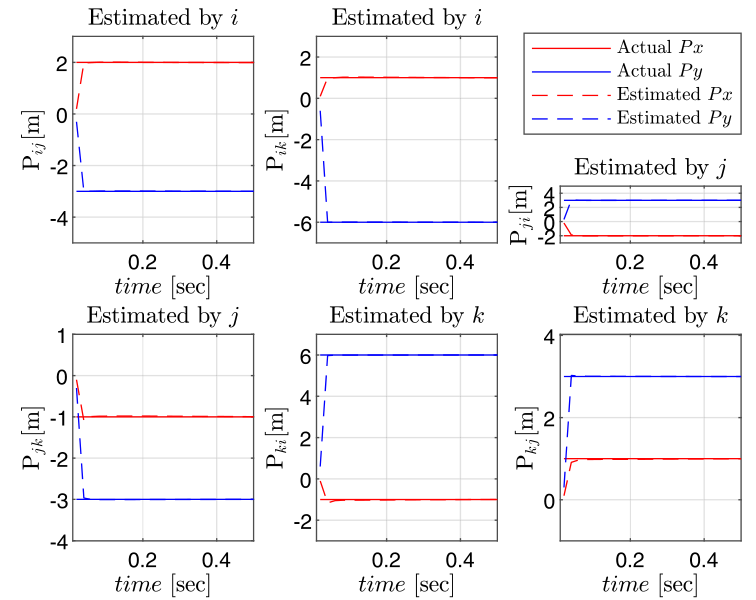

**图 9。** 平行且不共线轨迹 $\mathbf t_4$ 的相对位置估计。

### 5.2　无噪声与有噪声测量研究

本小节研究噪声存在时的性能。为与其他方法比较，也使用文献 [32] 提出的基于一致性 EKF 的去中心化估计策略（DCEKF）生成相同场景结果。相对位置的初始值仍设为真实值的 0.1 倍，其他状态以真实值初始化。图 10 显示四旋翼跟踪的圆形轨迹，持续 22 s，其定义为

$$
\begin{cases}
\mathbf t_5^i=2[\cos(0.3t)\quad\sin(0.3t)]^\mathsf T,\\
\mathbf t_5^j=3[\cos(0.3t+\pi/4)\quad\sin(0.3t+\pi/4)]^\mathsf T,\\
\mathbf t_5^k=4[\cos(0.3t+\pi/2)\quad\sin(0.3t+\pi/2)]^\mathsf T.
\end{cases}
\tag{59}
$$

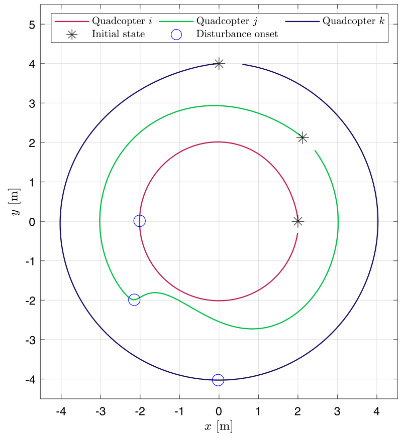

**图 10。** 四旋翼在轨迹 $\mathbf t_5$ 中跟踪的路径。仿真第 12 秒向第 $j$ 架四旋翼施加加速度扰动。图例：Quadcopter i/j/k＝第 $i/j/k$ 架四旋翼；Initial state＝初始状态；Disturbance onset＝扰动开始；横纵坐标为 $x,y$，单位米。

图 11、12 给出 100–170 s 的仿真结果。在最初 100 s 中，两种方法均实现准确估计。但随着仿真继续，由于 DCEKF 累积误差，两种方法差异变得明显。

带噪测量建模为 $\widetilde\square=\square_{tv}+N(0,\sigma)$，其中 $\square_{tv}$ 表示真实值，$N$ 表示均值为零、标准差为 $\sigma$ 的正态白噪声。UWB 噪声标准差取 $\sigma_d=0.1\ \mathrm m$；IMU 噪声标准差取 $\sigma_{\mathbf a}=0.02\mathbf I_{2\times2}\ \mathrm{m/s^2}$、$\sigma_\omega=0.03\ \mathrm{rad/s}$。图 13、14 展示两种方法的有噪性能。本文方法因能抑制不断产生的误差而优于 DCEKF。此外，使用第 4.2 节的适当协作配置，共享并融合不同来源信息，能够获得比 DCEKF 更准确、噪声更小的估计。同时也应承认，随着噪声幅值增大，结果质量会下降 [38]。

**图 11–18 图例与坐标对照：** 位置曲线沿用“真实 $P_x$、真实 $P_y$、估计 $P_x$、估计 $P_y$”；子图标题表示由哪架无人机估计；横轴均为时间（秒），纵轴为相对位置（米）。

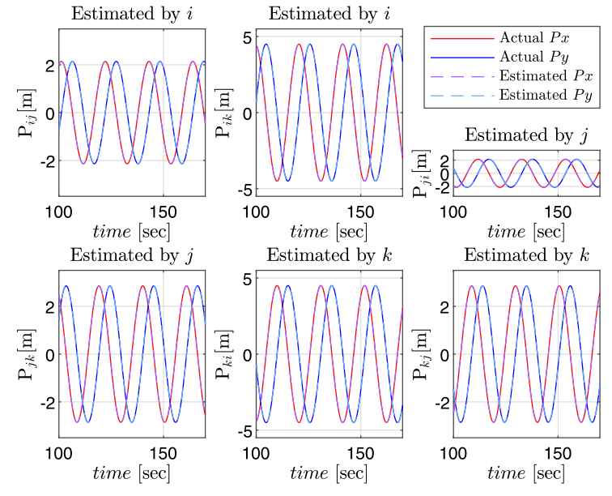

**图 11。** 无噪声测量研究中的相对位置估计。

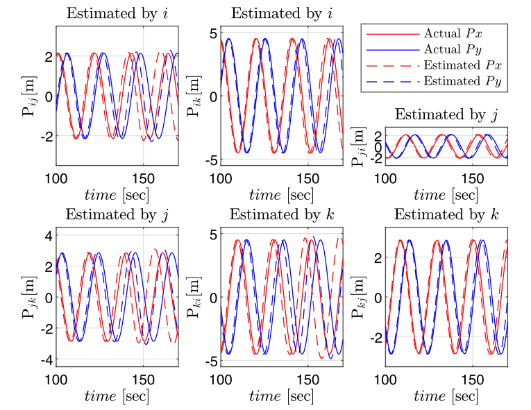

**图 12。** DCEKF 方法 [32] 在无噪声测量研究中的估计结果。

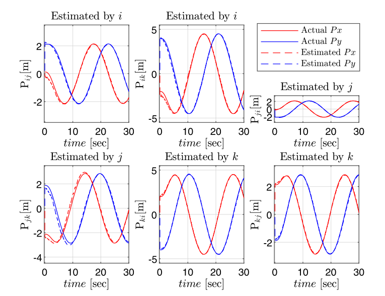

**图 13。** 有噪声测量研究中的相对位置估计。

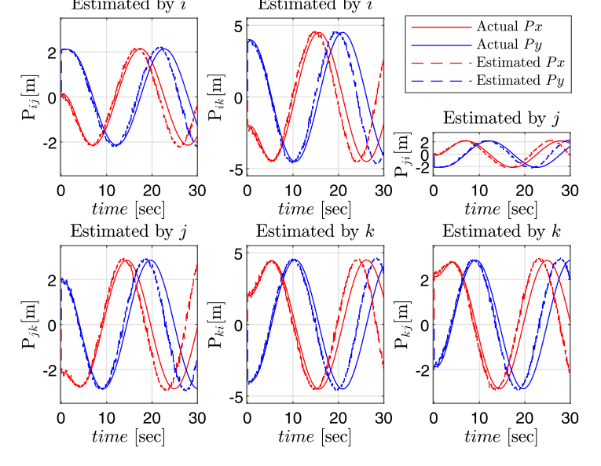

**图 14。** DCEKF 方法 [32] 在有噪声测量研究中的估计结果。

### 5.3　扰动研究

本小节研究外加扰动对性能的影响。向第 $j$ 架四旋翼施加加速度扰动

$$
\mathbf a'_j=[0,\ 4e^{-0.1|12-t|}]^\mathsf T.
$$

相对位置估计结果见图 15。结果显示，即使存在扰动，本文方法在收敛到真实值方面仍优于 DCEKF，后者结果见图 16。原因在于本文将几何约束纳入相对运动模型，使每架四旋翼的 EKF 在这些约束下求解估计问题。DCEKF 的 EKF 估计过程不考虑几何约束，约束仅在随后的一致性过程中用于校正估计并提高精度。

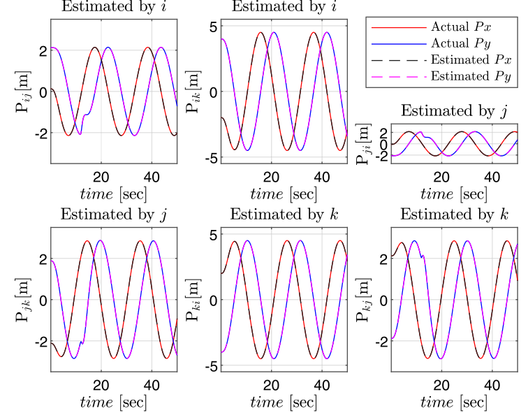

**图 15。** 扰动研究中的相对位置估计。

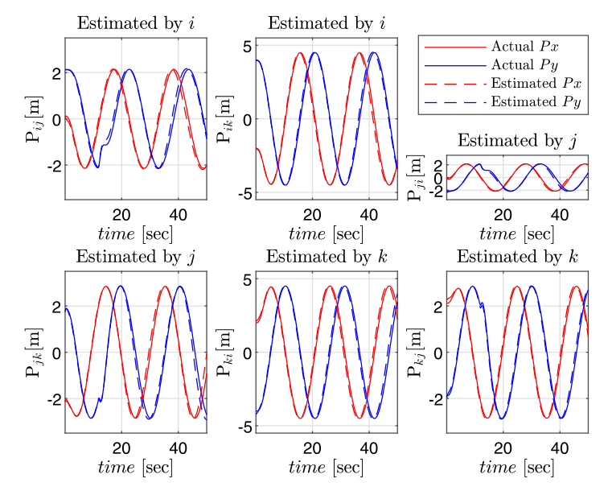

**图 16。** DCEKF 方法 [32] 在扰动研究中的估计结果。

### 5.4　通信中断研究

本小节在四旋翼发生通信中断的场景下评估所提方法，分析失去通信后的估计行为，以及中断对精度的影响。四旋翼沿 $\mathbf t_5$ 运动，并在 5–8 s 期间失去通信。为处理这一问题，保存各四旋翼在通信中断前最后接收的信息，并持续用于估计，直到通信恢复。

结果表明，即使失去机间通信，本文方法（图 17）仍优于 DCEKF（图 18）。由于在估计过程中直接加入几何约束，本文方法能够有效补偿中断误差并收敛至真值。DCEKF 在估计后才以修正项使用几何约束，这限制了它完全补偿中断误差的能力。

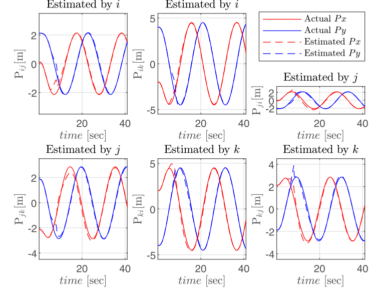

**图 17。** 通信中断研究中的相对位置估计。

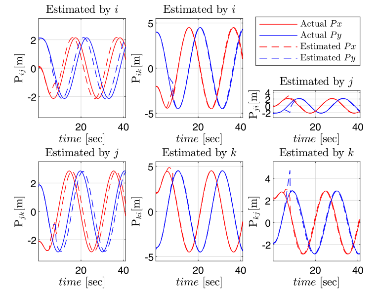

**图 18。** DCEKF 方法 [32] 在通信中断研究中的估计结果。

## 6　结论

本文提出一种以相对距离和惯性测量为基础、面向三成员四旋翼群组的协同相对定位算法。方法在每架四旋翼上使用分布式扩展卡尔曼滤波器求解估计问题。为使 EKF 能够在系统几何拓扑约束下工作，提出了相对运动模型。可观测性分析表明，只要三架四旋翼不共线，即使静止或平行运动，该方案也能够进行估计。

通过共享并融合来自不同来源的信息，协同方法获得更准确、更可靠且噪声更小的估计。仿真结果验证了该方法在不同场景中减小噪声、扰动和通信中断影响的有效性。

## 资助

本研究由谢里夫理工大学资助。

## 伦理声明

本研究遵循伦理准则与相关规范开展。

## CRediT 作者贡献声明

**Meysam Alizad：** 原稿撰写、验证、方法学、研究实施、概念构思。  
**Hadi Nobahari：** 审阅与编辑、监督、项目管理。

## 利益冲突声明

作者声明，不存在已知的、可能被认为会影响本文所报告研究的财务利益冲突或个人关系。

## 致谢

本研究由谢里夫理工大学资助。作者感谢先前研究的作者提供的宝贵认识与指导，这些工作深刻影响了本文的研究方向和方法。

## 参考文献

保留原编号、作者、出处与出版数据；英文题名附中文译名。书目信息依原刊，不自行补全缺失卷页或变更出版年份。

[1] Aska M, Vonásek V, Chudoba J, Thomas J, Loianno G, Kumar V. “Swarm distribution and deployment for cooperative surveillance by micro-aerial vehicles.” **用于微型飞行器协同监视的集群分布与部署。** *J Intell Robot Syst* 2016;84(1–4):469–92.

[2] Merino L, Caballero F, Martnez-de Dios J, Ferruz J, Ollero A. “A cooperative perception system for multiple UAVs: Application to automatic detection of forest fires.” **多无人机协同感知系统及其在森林火灾自动检测中的应用。** *J Field Robotics* 2006;23(34):165–84.

[3] Hayes AT, Martinoli A, Goodman RM. “Swarm robotic odor localization: Off-line optimization and validation with real robots.” **集群机器人气味源定位：离线优化与实机验证。** *Robotica* 2003;21(4):427–41.

[4] Dong X, Zhou Y, Ren Z, Zhong Y. “Time-varying formation tracking for second-order multi-agent systems subjected to switching topologies with application to quadrotor formation flying.” **切换拓扑下二阶多智能体系统的时变编队跟踪及四旋翼编队飞行应用。** *IEEE Trans Ind Electron* 2017;64(6):5014–24.

[5] Li X, Xie L. “Dynamic formation control over directed networks using graphical Laplacian approach.” **利用图拉普拉斯方法实现有向网络动态编队控制。** *IEEE Trans Automat Control* 2018;63(11):3761–74.

[6] Du H, Zhu W, Wen G, Duan Z, Lü J. “Distributed formation control of multiple quadrotor aircraft based on nonsmooth consensus algorithms.” **基于非光滑一致性算法的多四旋翼分布式编队控制。** *IEEE Trans Cybern* 2019;49(1):342–53.

[7] Han T, Lin Z, Zheng R, Fu M. “A barycentric coordinate-based approach to formation control under directed and switching sensing graphs.” **有向与切换感知图下基于重心坐标的编队控制。** *IEEE Trans Cybern* 2018;48(4):1202–15.

[8] Kang S-M, Park M-C, Ahn H-S. “Distance-based cycle-free persistent formation: Global convergence and experimental test with a group of quadcopters.” **基于距离的无环持久编队：全局收敛性与四旋翼群实验。** *IEEE Trans Ind Electron* 2017;64(1):380–9.

[9] Jasim W, Gu D. “Robust team formation control for quadrotors.” **四旋翼团队的鲁棒编队控制。** *IEEE Trans Control Syst Technol* 2018;26(4):1516–23.

[10] Jaimes A, Kota S, Gomez J. “An approach to surveillance an area using swarm of fixed wing and quad-rotor unmanned aerial vehicles UAV.” **利用固定翼与四旋翼无人机集群进行区域监视的方法。** *Proc. IEEE Int. Conf. Syst. Syst.*, 2008, pp. 1–6.

[11] Zhou XS, Roumeliotis SI. “Multi-robot SLAM with unknown initial correspondence: The robot rendezvous case.” **初始对应关系未知的多机器人 SLAM：机器人会合情形。** *Proc. IEEE/RSJ Int. Conf. Intell.*, 2006, pp. 1785–92.

[12] Xu H, Wang L, Zhang Y, Qiu K, Shen S. “Decentralized visual-inertial-UWB fusion for relative state estimation of aerial swarm.” **面向空中集群相对状态估计的去中心化视觉—惯性—UWB 融合。** *IEEE Int. Conf. Robotics and Automation*, Paris, 2020, pp. 8776–82.

[13] Cui Yuming, Liu Songyong, Li Hongsheng, Gu Congcong, Jiang Hongxiang, Meng Deyuan. “Accurate integrated position measurement system for mobile applications in GPS-denied coal mine.” **用于 GPS 拒止煤矿移动应用的高精度组合位置测量系统。** *ISA Trans*, 2023.

[14] Nguyen Thien-Minh, Nguyen Thien Hoang, Cao Muqing, Qiu Zhirong, Xie Lihua. “Integrated UWB-vision approach for autonomous docking of UAVs in GPS-denied environments.” **GPS 拒止环境中无人机自主对接的 UWB—视觉融合方法。** *2019 Int. Conf. Robotics and Automation*, pp. 9603–9.

[15] Shalaby M, Cossette CC, Forbes JR, Ny JL. “Relative position estimation in multi-agent systems using attitude-coupled range measurements.” **利用姿态耦合距离测量的多智能体相对位置估计。** *IEEE Rob Autom Lett* 2021;6(3):4955–61.

[16] Fang X, Wang C, Nguyen T-M, Xie L. “Graph optimization approach to range-based localization.” **基于图优化的测距定位方法。** *IEEE Trans Syst, Man, Cybern: Syst* 2020;51(11):6830–41.

[17] Cossette CC, Shalaby M, Saussié D, Forbes JR, Ny JL. “Relative position estimation between two UWB devices with IMUs.” **两个配备 IMU 的 UWB 设备之间的相对位置估计。** *IEEE Robot Autom Lett* 2021;6(3):4313–20.

[18] Hepp B, Nageli T, Hilliges O. “Omni-directional person tracking on a flying robot using occlusion-robust ultra-wideband signals.” **飞行机器人利用抗遮挡 UWB 信号进行全向人员跟踪。** *IEEE International Conference on Intelligent Robots and Systems*, 2016.

[19] Güler S, Abdelkader M, Shamma JS. “Infrastructure-free multi-robot localization with ultrawideband sensors.” **利用 UWB 传感器实现无基础设施多机器人定位。** *American Control Conference*, 2019, pp. 13–8.

[20] Cossette CC, Shalaby MA, Saussié D, Ny JL, Forbes JR. “Optimal multi-robot formations for relative pose estimation using range measurements.” **面向测距相对位姿估计的最优多机器人编队。** *2022 IEEE/RSJ International Conference on Intelligent Robots and Systems*, 2022, pp. 2431–7.

[21] Batista P, Silvestre C, Oliveira P. “Single range aided navigation and source localization: Observability and filter design.” **单距离辅助导航与源定位：可观测性和滤波器设计。** *Systems Control Lett* 2011;60(8):665–73.

[22] van der Helm S, Coppola M, McGuire KN, et al. “On-board range-based relative localization for micro air vehicles in indoor leader–follower flight.” **室内领航—跟随飞行中微型飞行器的机载测距相对定位。** *Auton Robot* 2020;44:415–41.

[23] Liu H, Darabi H, Banerjee P, Liu J. “Survey of wireless indoor positioning techniques and systems.” **无线室内定位技术与系统综述。** *IEEE Trans Syst Man Cybern Part C Appl Rev* 2007;37:1067–80.

[24] Zheng S, Li Z, Liu Y, Zhang H, Zou X. “An optimization-based UWB-IMU fusion framework for UGV.” **面向无人地面车辆、基于优化的 UWB—IMU 融合框架。** *IEEE Sens J* 2022;22(5):4369–77.

[25] Zheng S, et al. “Multi-robot relative positioning and orientation system based on UWB range and graph optimization.” **基于 UWB 距离和图优化的多机器人相对定位定向系统。** *Measurement* 2022;195:111068.

[26] Bonnin-Pascual F, Ortiz A. “UWB-based self-localization strategies: A novel ICP-based method and a comparative assessment for noisy-ranges-prone environments.” **UWB 自定位策略：一种新的 ICP 方法及易受测距噪声影响环境中的比较评估。** *Sensors* 2020;20(19):5613.

[27] Nguyen TH, Xie L. “Relative transformation estimation based on fusion of odometry and UWB ranging data.” **基于里程计与 UWB 测距数据融合的相对坐标变换估计。** *IEEE Trans Robot*, 2023.

[28] Li M, Lam TL, Sun Z. “3-D inter-robot relative localization via semidefinite optimization.” **基于半正定优化的机器人间三维相对定位。** *IEEE Robot Autom Lett* 2022;7(4):10081–8.

[29] Doherty L, Ghaoui LE. “Convex position estimation in wireless sensor networks.” **无线传感器网络中的凸位置估计。** *Proceedings IEEE INFOCOM 2001. Conference on Computer Communications. Twentieth Annual Joint Conference of the IEEE Computer and Communications Society*, no. 01CH37213, vol. 3, 2001, pp. 1655–63.

[30] Zhang H, Li Z, Zheng S, Liu Y, Zheng P, Zou X. “UWB/INS-based robust anchor-free relative positioning scheme for UGVs.” **基于 UWB/INS 的无人地面车辆鲁棒无锚相对定位方案。** *Meas Sci Technol* 2022;33(12):125007.

[31] Carli R, Chiuso A, Schenato L, Zampieri S. “Distributed Kalman filtering based on consensus strategies.” **基于一致性策略的分布式卡尔曼滤波。** *IEEE J Sel Areas Commun* 2008;26(4):622–33.

[32] Gong B, Wang S, Hao M, Guan X, Li S. “Range-based collaborative relative navigation for multiple unmanned aerial vehicles using consensus extended Kalman filter.” **采用一致性 EKF 的多无人机测距协同相对导航。** *Aerosp Sci Technol* 2021;112:106647.

[33] Guo K, Li X, Xie L. “Ultra-wideband and odometry-based cooperative relative localization with application to multi-UAV formation control.” **基于 UWB 与里程计的协同相对定位及多无人机编队控制应用。** *IEEE Trans Cybern* 2019;50(6):2590–603.

[34] Ziegler T, Karrer M, Schmuck P, Chli M. “Distributed formation estimation via pairwise distance measurements.” **通过两两距离测量实现分布式编队估计。** *IEEE Robot Autom Lett* 2021;6(2):3017–24.

[35] Hermann R, Krener A. “Nonlinear controllability and observability.” **非线性系统的可控性与可观测性。** *IEEE Trans Automat Control* 1977;22(5):728–40.

[36] Zhou XS, Roumeliotis SI. “Robot-to-robot relative pose estimation from range measurements.” **由距离测量估计机器人间相对位姿。** *IEEE Trans Robot* 2008;24(6):1379–93.

[37] Krener Arthur J. *The convergence of the extended Kalman filter*. **扩展卡尔曼滤波的收敛性。** Berlin, Heidelberg: Springer, 2003.

[38] Bryson AE. *Applied optimal control: Optimization, estimation and control*. **应用最优控制：优化、估计与控制。** CRC Press, 1975.

[39] Nobahari Hadi, Alizad Meysam, Nasrollahi Saeed. “A nonlinear model predictive controller based on the gravitational search algorithm.” **基于引力搜索算法的非线性模型预测控制器。** *Optim Control Appl Methods* 2021;42(6):1734–61.

[40] Michael Nathan, Mellinger Daniel, Lindsey Quentin, Kumar Vijay. “The GRASP multiple micro-UAV testbed.” **GRASP 多微型无人机试验平台。** *IEEE Robot Autom Mag* 2010;17(3):56–65.

## 译者核对注（与作者正文分开）

**A1　相对位置方向。** 第 2.2 节原文文字称“第 $i$ 架相对于第 $j$ 架”，而式 (4) 的速度差及图 1 箭头通常对应由 $i$ 指向 $j$。译文保留原句，数学公式和图也完整保留，读者应以同一套方向约定核对实现。

**A2　可观测性条件。** 摘要及第 3.2 节开头使用“必要条件”，后文对式 (31)–(33) 则作“满足一组即可”的充分性表述。式 (30) 的秩与第一、二组条件是否等价，需要独立验证；译文没有把作者条件替换成另外一套条件。

**A3　EKF 方程与长矩阵。** 式 (38)–(41) 中连续动力学 Jacobian 与离散传播的使用方式，以及若干输入矩阵下标、式 (44) 的预测状态上标、测量协方差项目等，按原刊保留。大型公式图保留原刊的零块维度及下标，避免译者将疑点静默改写。

**A4　仿真收敛图号。** 第 5.1 节原文称图 4、7 收敛而图 6、9 未收敛；原图显示的曲线及前后关于非共线条件的论述存在相反关系。译文保留该句并集中标注，便于读者逐图核查。

**A5　估计信息与直接量测。** 原文测量向量包含相对航向、速度以及由邻机估计构造的位置向量。文中“悬停或平行运动仍可观测”的结论基于这一完整测量模型。将其应用到实际系统时，应确认这些输入的来源与相关性；单纯距离传感器的原始量测集合与此模型的输入集合不同。

**A6　时段与噪声参数。** 第 5.2 节先写圆轨迹持续 22 s，又讨论 100–170 s 结果；加速度噪声标准差以 $0.02\mathbf I_{2\times2}$ 表达。译文均保留，未自行统一为新的仿真配置。

---

**译文结束。** 原刊没有独立附录或数据表；全部 59 组编号公式、18 幅图及文末声明、40 条参考文献已纳入本译本。
