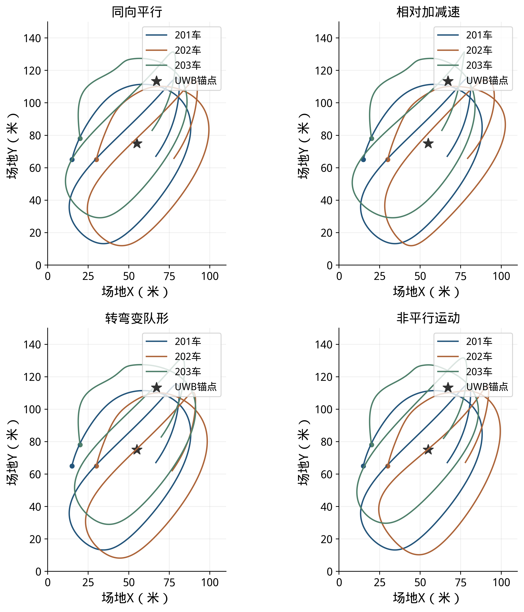
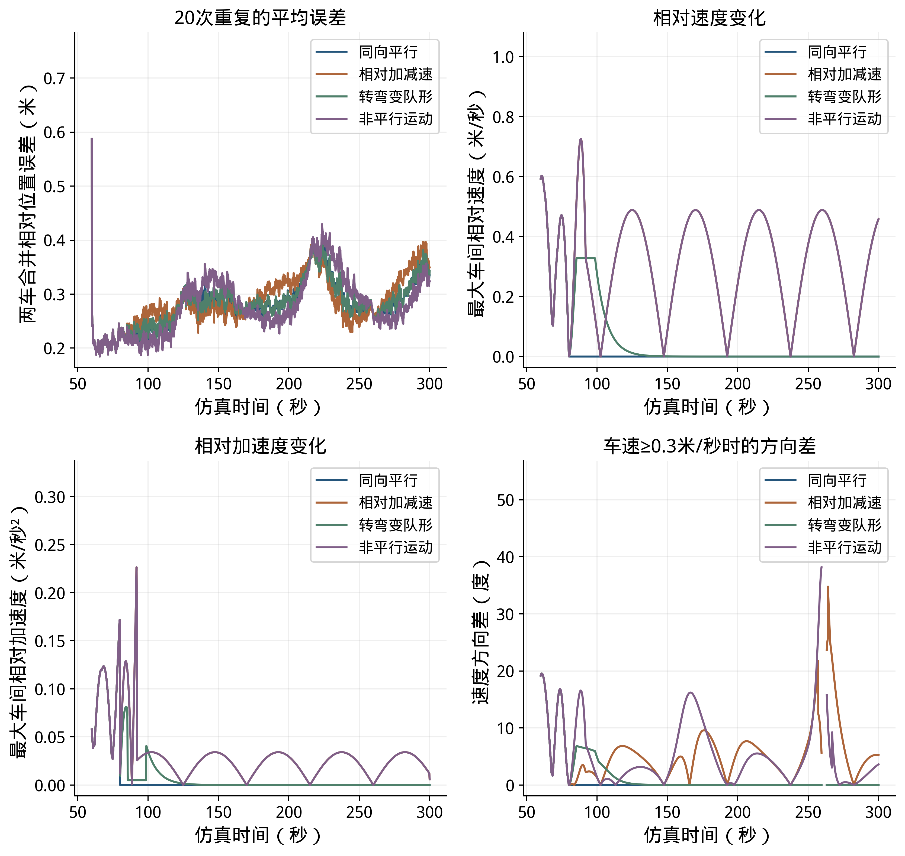
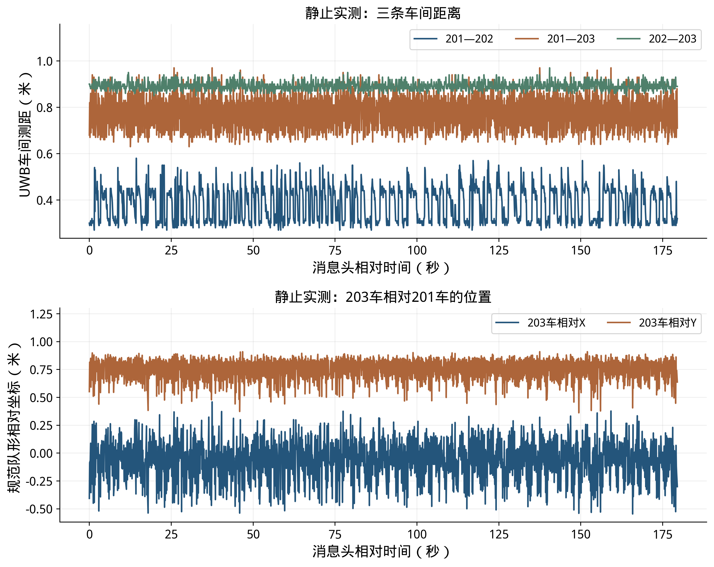
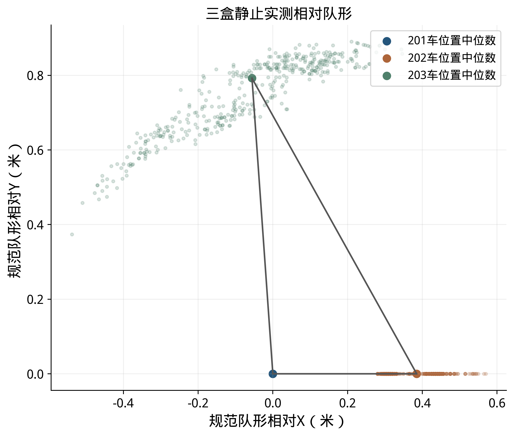
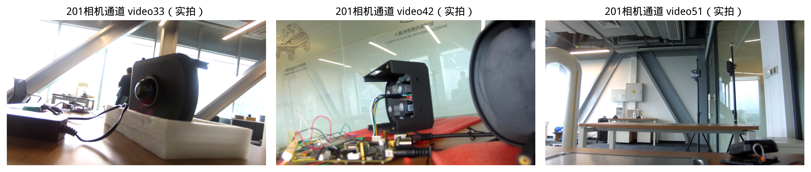
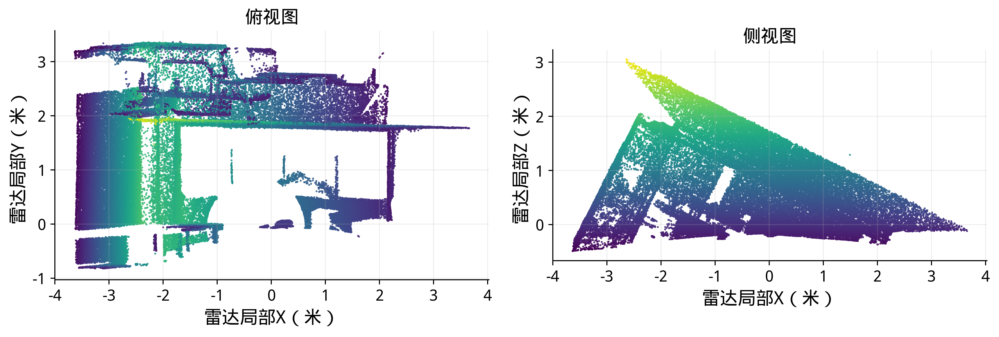

# 不同机动方式补充：改动前后对照

原稿备份：内部材料/20261102_不同机动类型修改前/报告.md。以下逐行对照标明原稿和修改后的位置；减号为原文，加号为新文。

```diff
--- 修改前/报告.md
+++ 修改后/报告.md
@@ -414,13 +414,36 @@
 
 当前三组中，车间相对速度最大值由0.587米/秒增加到0.978和1.173米/秒，距离观测几何的最小非零敏感度中位数由0.685增加到0.689和0.700；同时60～300秒位置RMSE均值由0.214米增加到0.321和0.377米。该对照中，相对机动改变了测距几何与各车运动输入，较高机动对应的位置RMSE没有降低。后续实车可按低速直行、转弯和编队变速分别采集，在相同测距条件下比较位置误差。
 
+机动方式还包括车辆之间的加减速、转弯和行驶方向变化。为比较这些因素，在同一条201车轨迹上设置同向平行、相对加减速、转弯变队形和非平行运动四种情况，各重复20次。四组在0～60秒采用相同的三车运动、起步测量和初始关系，60～80秒平滑过渡，80秒后进入各自的运动方式；同编号试验使用相同的测距和运动误差样本。运动输入采用VIO增强档，使用同一个中部锚点，测距误差及评价坐标与本节前述条件一致。
+
+图20给出四组完整轨迹。同向平行组保持各车间的相对位置不变，三车随201车共同转弯；相对加减速组在场地X方向增加往复相对运动，非平行组在场地Y方向增加往复相对运动，转弯变队形组在201车转弯时调整队形方向。这些运动方式可能同时改变相对速度、加速度和方向，不将它们视为彼此完全独立的因素。四组最高车速为2.52米/秒，最大车间距为27.72米。
+
+
+
+表23 不同机动方式的定位结果
+
+| 机动方式 | 最大相对速度（米/秒） | 最大相对加速度（米/秒²） | 最大方向差（度） | 位置RMSE范围（米） |
+|---|---|---|---|---|
+| 同向平行 | 0.004 | 0.088 | 0.0 | 0.116～0.589 |
+| 相对加减速 | 0.726 | 0.226 | 34.8 | 0.119～0.610 |
+| 转弯变队形 | 0.328 | 0.090 | 6.8 | 0.117～0.592 |
+| 非平行运动 | 0.726 | 0.226 | 38.2 | 0.115～0.595 |
+
+
+
+图21上方为20次重复的平均位置误差和最大车间相对速度，下方为最大车间相对加速度和201车与其他车辆的最大运动方向差。方向差只在对应两车速度均不低于0.3米/秒时统计，以免车辆接近静止时方向角失去意义。表23的运动量取80～300秒最大值；位置RMSE按60～300秒计算，范围包括各组全部20次结果。
+
+四组位置RMSE均值依次为0.301、0.308、0.302和0.302米，全部80次运行的RMSE为0.115～0.610米。相同起步过程使四组在前段的误差过程一致，之后曲线有交叉；在本次设定下，不同运动方式的平均RMSE接近，不能据此认为某一种机动总能提高精度，也不能仅凭图中峰值判断由哪一种机动引起。两组往复运动的位移幅度和周期相同，因此对应的最大相对速度和加速度曲线重合，方向差则随运动方向不同而变化。
+
+本次按既定VIO位移误差模型生成运动输入；实车比较还需结合地面纹理、转弯振动和图像模糊对运动估计的影响，在实际场地分别采集平行行驶、变速、转弯和方向变化的数据。
+
 ## 4 实测数据与接口应用
 
 ### 4.1 静止采集与位置回放
 
 六组静止采集共记录3,229,145帧车载IMU及48,985帧UWB测距，已用于传感器分析、默认UWB位置回放及输入检查。下表用数据编号1～6列示采集规模。消息头时间戳（Header）为消息携带的测量时间，实测曲线按其相对起点表示。
 
-表23 六组静止实测数据
+表24 六组静止实测数据
 
 | 数据编号 | 采集状态 | 车载IMU帧数 | UWB测距帧数 | 已开展的分析 |
 |---|---|---|---|---|
@@ -431,15 +454,15 @@
 | 5 | 三盒静止 | 539,229 | 9,681 | 测距统计、静止IMU特性分析 |
 | 6 | 三盒静止 | 536,078 | 8,235 | 测距统计、静止IMU特性分析 |
 
-
-
-
+
+
+
 
 两批在线输出频率约9.24～9.42赫兹。三盒均已完成三目视觉采集，雷达点云采集已完成；点云与图像后续需按特征提取、标定和甲方实车调试流程接入。已有静止数据用于输入质量分析和回放，动态位置误差按独立运动真值评价。
 
-
-
-
+
+
+
 
 点云图直接读取主盒/livox/lidar消息，累积225条消息，去除全零和非有限点后固定抽样绘制12万个点，分别给出俯视及侧视投影，颜色辅助区分点高。它展示采集场景的空间结构，与三目图像一起为后续实车视场检查、特征提取和安装标定提供数据。图中使用本盒雷达局部坐标。
 
@@ -447,7 +470,7 @@
 
 默认UWB输出话题为/cooperative_localization/poses_2d，坐标系为coop_ref_1_relative，采用瞬时队形坐标定义。RTE原始话题/cooperative_localization/rte/poses_2d的坐标标识为coop_rte_1_local，以201当前位置为原点、201本车初始局部轴为固定轴。启用坐标转换后，/cooperative_localization/rte/coordinates/poses_2d以201当前位置为原点，X轴沿首次有效结果中201指向202的方向并保持固定，坐标标识为coop_rte_1_relative_fixed。下表给出定位输入及输出，接收方按车辆编号、对应坐标系、测量时间与有效性使用位置。
 
-表24 定位输入与输出
+表25 定位输入与输出
 
 | 输入或输出 | 话题及消息类型 | 频率 |
 |---|---|---|
@@ -473,7 +496,7 @@
 
 ### 6.1 仿真与图表重算
 
-运动与测距输入保存在data/single_anchor_outdoor_20261029，无锚点和布点原始输出保存在data/single_anchor_layout_20261029。报告统一201坐标的输出及统计保存在data/common_reference_20261030；峰值对照与RTE参数对照分别保存在data/fusion_peak_analysis_20261030和data/rte_startup_diagnostics_20261030。统一坐标目录的summary.json给出逐条件统计，全部仿真结果.csv便于查表，outputs保存全部重复的逐时位置。本版实验条件清单.json逐项列出报告采用的84个条件及输出文件；按对应输出能够复算全部1680次统计。
+运动与测距输入保存在data/single_anchor_outdoor_20261029，无锚点和布点原始输出保存在data/single_anchor_layout_20261029。报告统一201坐标的输出及统计保存在data/common_reference_20261030；峰值对照与RTE参数对照分别保存在data/fusion_peak_analysis_20261030和data/rte_startup_diagnostics_20261030；不同机动方式的逐次结果保存在data/maneuver_types_20261102。统一坐标目录的summary.json给出逐条件统计，全部仿真结果.csv便于查表，outputs保存全部重复的逐时位置。本版实验条件清单.json逐项列出报告采用的84个条件及输出文件；按对应输出能够复算全部1680次统计。
 
 ```bash
 PYTHONPATH=tools OPENBLAS_NUM_THREADS=1 python3 tools/evaluate_single_anchor.py --trials 20
@@ -489,6 +512,7 @@
 PYTHONPATH=tools python3 tools/evaluate_rte_startup_diagnostics.py
 PYTHONPATH=tools python3 tools/plot_fusion_review.py
 PYTHONPATH=tools python3 tools/analyze_maneuver_observability.py --plot-only
+PYTHONPATH=tools python3 tools/analyze_maneuver_types.py --plot-only
 PYTHONPATH=tools python3 tools/plot_initialization_candidates.py
 python3 tools/check_report_consistency.py
 python3 tools/check_report_results.py
```

配套新增 tools/analyze_maneuver_types.py、data/maneuver_types_20261102/ 及两组PNG/SVG/PDF图；报告生成器、图表目录和阅读复现说明同步更新。校验工具增加对配对起步条件、20次误差计算和表格数值的检查。
