# 多平台协同定位硬件仿真测试报告与联调方案

浙江大学

<!-- pagebreak -->

## 目录

章节目录

| 章节 | 内容 |
|---|---|
| [1](#chapter_1) | [系统方案与试验安排](#chapter_1) |
| [2](#chapter_2) | [传感器分级与配置投入](#chapter_2) |
| [3](#chapter_3) | [单锚点辅助与布置对比](#chapter_3) |
| [4](#chapter_4) | [实测数据与接口应用](#chapter_4) |
| [5](#chapter_5) | [实车采集与联调](#chapter_5) |
| [6](#chapter_6) | [复现与阶段结论](#chapter_6) |

<!-- pagebreak -->

## 1 系统方案与试验安排

本项目面向卫星导航拒止条件下多平台协同任务，已形成三盒传感器采集、在线相对队形输出、联合录包和仿真复现程序。协同定位系统主盒（系统中称为201盒）接收三车信息，对外发送相对位置；202、203盒对应另外两车。浙江大学开展定位算法及接口开发，定位结果可供通信、规划、控制与显示使用。

默认程序通过超宽带测距（Ultra-Wideband，UWB）恢复三车相对三角形。惯性测量单元（Inertial Measurement Unit，IMU）运动传播和相对变换估计（Relative Transformation Estimation，RTE）采用独立入口。本轮围绕三车低速编队，比较运动输入质量、测距精度及增加一个已知位置UWB点后的结果，为后续实车配置和联调提供依据。

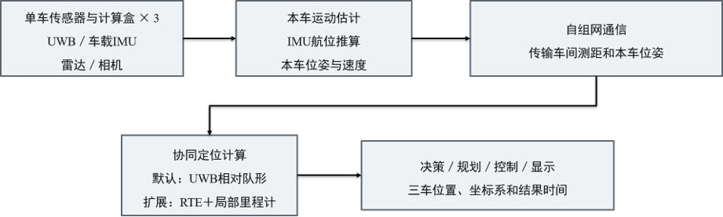

### 1.1 运动条件与评价口径

仿真时长300秒，前30秒静止，30～60秒积累起步及转弯数据用于求初始坐标关系，60～300秒统计连续定位结果。三车整体运动范围约85×115米，最高速度2.39米/秒，最大车间距24.56米。位置、测距及运动输入按10赫兹处理，保持连续视距测距，不添加人为中断。平面模型采用同高天线参考点。

仿真程序保存每辆车的真实位置作为对照，称为真值。位置误差评价202、203车相对201车的位置向量：将估计相对向量减去同一坐标定义下的真值向量，取二维长度。每次运行的位置均方根误差（Root Mean Square Error，RMSE）为两车全部评价时刻的误差平方均值再开平方，单位为米；随后统计20次运行RMSE的均值、样本标准差及最小至最大范围。它直接量化相对位置偏差，测距拟合残差另行说明。

### 1.2 对比试验的组成

IMU、视觉惯性里程计（Visual-Inertial Odometry，VIO）、激光惯性里程计（LiDAR-Inertial Odometry，LIO）各设三档输入质量。VIO/LIO在本轮用局部位移输出误差模型生成数据，包含尺度、方向漂移和随机位移项。传感器原始图像、点云处理在实车安装后按实际视场接入，仿真数值对应本报告列出的输入条件。

试验比较三件事：提高本车运动输入质量能降低多少误差，增加一个已知位置UWB点有多大作用，以及点的位置和测距精度怎样影响结果。三类输入各设三档，共9种运动输入。无锚点组使用车间距离和本车运动，单点组再加入三车到同一个点的距离；各组按实际可用测量求解初始关系，同编号对比使用相同运动与测距噪声样本。

20次重复用于观察固定轨迹下随机误差带来的离散程度，属于噪声蒙特卡洛分析。所有重复均进入统计，过程图固定采用重复试验1。仿真真值用于生成测量及事后评价，估计器接收带误差的运动和距离输入，输出不做真值配准或事后平滑。
表1 仿真项目与分组

| 试验目的 | 条件设置 | 条件数 | 重复次数 |
|---|---|---|---|
| 比较运动输入质量 | 9档输入×仅传播/加入车间测距 | 18 | 每条件20次 |
| 比较单点位置 | 9档输入×5个候选位置，每次只有一个点 | 45 | 每条件20次 |
| 比较测距精度 | 中部单点下，9档输入×5/20厘米测距；10厘米归入上行 | 18 | 每条件20次 |
| 检验默认UWB队形 | 5/10/20厘米三档测距 | 3 | 每条件20次 |

以上共84种条件、1680次重复运行。另用三组无误差局部里程计输入检查RTE求解过程，单独说明首次有效时刻及位置跳变。输入质量、测距精度和布点的作用分别用表格及实际误差曲线对照。

## 2 传感器分级与配置投入

### 2.1 默认UWB方案

默认方案根据三条车间距离求解三角形，以201车为原点、201至202连线为正X轴，203位于Y轴正侧。该方案直接给出相对队形，适合车间距离、相对布局和编队显示。下表调用项目C++库，在各时刻规范队形坐标内与真值比较。

表2 默认纯UWB队形仿真

| 测距标准差（厘米） | RMSE均值±标准差（米） | RMSE范围（米） |
|---|---|---|
| 20 | 0.388±0.009 | 0.374～0.408 |
| 10 | 0.200±0.011 | 0.187～0.225 |
| 5 | 0.112±0.016 | 0.094～0.147 |

测距标准差为10厘米、每条链路固定偏差标准差为3厘米时，默认队形结果已达到本轮亚米级相对位置目标。以下运动融合组进一步保持起点建立的固定轴向，用于连续相对轨迹及本车运动接入；其误差在各自固定局部坐标内计算。两类结果分别对应相对形状和连续固定轴向位置。

### 2.2 UWB与六轴MEMS

六轴MEMS输入包含加速度、角速度及启动校准后的残余误差。三档参数用于比较残余偏置、短时噪声、倾角误差和随时间变化的偏置影响，按这些输入进行运动传播和车间测距更新。

表3 MEMS初始残余误差

| 输入档位 | 加计偏置标准差（米/秒²） | 陀螺偏置标准差（度/小时） | 倾角标准差（度） |
|---|---|---|---|
| 基础 | 0.03 | 30.94 | 0.2 |
| 增强 | 0.01 | 10.31 | 0.1 |
| 精细 | 0.003 | 3.09 | 0.05 |

表4 MEMS动态误差设定

| 误差项 | 基础 | 增强 | 精细 |
|---|---|---|---|
| 加计偏置游走（米/秒²/√秒） | 0.001 | 0.0003 | 0.0001 |
| 陀螺偏置游走（弧度/秒/√秒） | 0.0001 | 0.00003564 | 0.00001 |
| 100赫兹加计白噪声（米/秒²） | 0.05 | 0.02 | 0.01 |
| 100赫兹陀螺白噪声（弧度/秒） | 0.0005 | 0.0005 | 0.0005 |

白噪声按100赫兹逐样本标准差设置，取10样本均值进入10赫兹计算；偏置游走每步按系数乘以时间间隔平方根增加。倾角残余按重力加速度乘小角度计入水平加速度，0.1度约对应0.0171米/秒²。前30秒按已知静止处理，运动后连续积分。融合器估计位置、速度和局部坐标转角，本轮将残余偏置作为输入扰动。

表5 IMU输入的无锚点结果

| 档位 | 仅运动传播RMSE（米） | 加入车间测距RMSE（米） | 加入测距后均值±标准差（米） |
|---|---|---|---|
| 基础 | 179.537～597.905 | 17.376～26.165 | 21.986±1.558 |
| 增强 | 84.434～343.591 | 5.531～26.337 | 19.266±5.258 |
| 精细 | 39.126～144.136 | 1.244～22.595 | 9.739±7.629 |

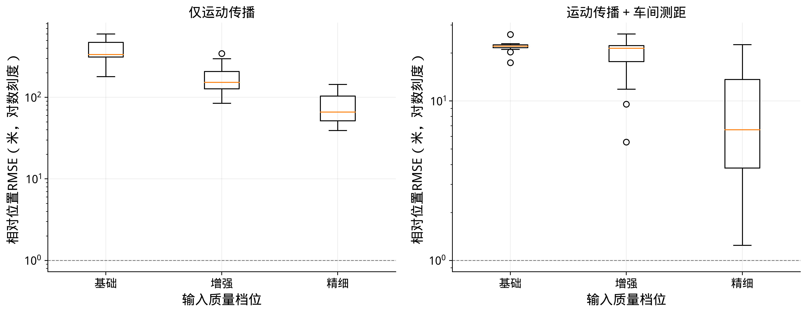

分布图的箱体表示20次RMSE的中间50%，箱内横线为中位数；须线按1.5倍四分位距确定，超出的重复结果单独画点。对数纵轴用于同时显示不同误差量级，所有结果均保留。

车间测距明显约束了纯惯性积分的增长；持续固定轴向定位还受到残余加速度、方向漂移与初始化误差共同影响。下一类配置以相机或雷达与IMU联合形成的本车运动输入替代直接惯性积分，继续使用相同测距与位置融合接口。

### 2.3 UWB、相机与IMU

VIO输入对逐步位移施加固定尺度扰动、随运动时间增加的方向漂移，以及按行驶距离平方根增加的位置随机项。三档数值是本轮输入质量条件，实车通过相机、IMU安装标定及室外轨迹测量对应到同一口径。

表6 VIO局部位移误差

| 输入档位 | 尺度标准差（%） | 方向漂移标准差（弧度/秒） | 位置随机项（米/√米） |
|---|---|---|---|
| 基础 | 1 | 0.0001 | 0.05 |
| 增强 | 0.5 | 5e-05 | 0.03 |
| 精细 | 0.2 | 2e-05 | 0.015 |

表7 VIO输入的无锚点结果

| 档位 | 仅运动传播RMSE（米） | 加入车间测距RMSE（米） | 加入测距后均值±标准差（米） |
|---|---|---|---|
| 基础 | 1.159～3.872 | 0.286～1.423 | 0.713±0.309 |
| 增强 | 0.670～2.200 | 0.174～0.681 | 0.386±0.153 |
| 精细 | 0.342～1.077 | 0.093～0.326 | 0.195±0.067 |

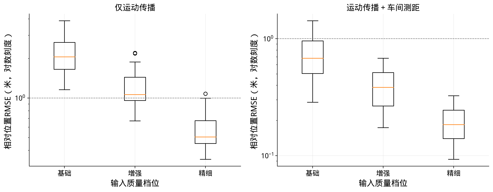

VIO输入由基础改善到增强时，加入车间测距后的相对位置RMSE由0.286～1.423米变为0.174～0.681米；精细输入为0.093～0.326米。这组对比用于明确本车运动输出质量对连续相对定位的影响，为实车前端标定和选配提供参考。

### 2.4 UWB、雷达与IMU

LIO输入采用同样的位移接口，以更细的尺度、方向与随机位移误差设定对比雷达与IMU组合。VIO增强与LIO基础、VIO精细与LIO增强的输入参数相同，并使用同编号扰动，因此相应结果一致；设备类别本身不代替前端输出质量。

表8 LIO局部位移误差

| 输入档位 | 尺度标准差（%） | 方向漂移标准差（弧度/秒） | 位置随机项（米/√米） |
|---|---|---|---|
| 基础 | 0.5 | 5e-05 | 0.03 |
| 增强 | 0.2 | 2e-05 | 0.015 |
| 精细 | 0.1 | 1e-05 | 0.008 |

表9 LIO输入的无锚点结果

| 档位 | 仅运动传播RMSE（米） | 加入车间测距RMSE（米） | 加入测距后均值±标准差（米） |
|---|---|---|---|
| 基础 | 0.670～2.200 | 0.174～0.681 | 0.386±0.153 |
| 增强 | 0.342～1.077 | 0.093～0.326 | 0.195±0.067 |
| 精细 | 0.189～0.601 | 0.057～0.221 | 0.125±0.042 |

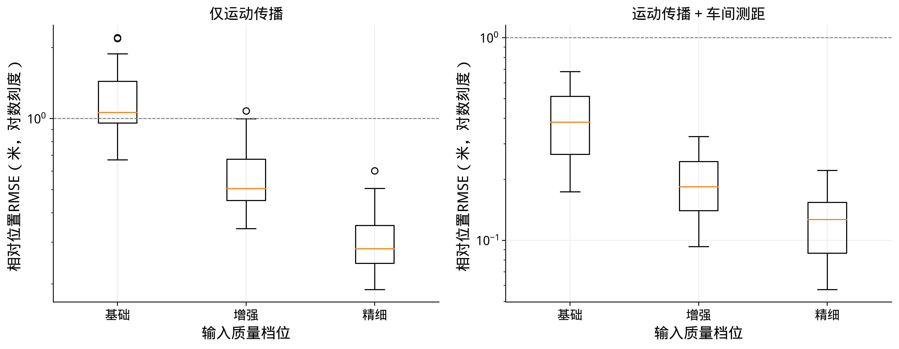

LIO输入由基础改善到增强时，加入车间测距后的相对位置RMSE由0.174～0.681米变为0.093～0.326米；精细输入为0.057～0.221米。这组对比用于明确本车运动输出质量对连续相对定位的影响，为实车前端标定和选配提供参考。

在固定轴向目标下，改善本车运动输入能够降低相对位置误差；具体收益同时取决于起步运动和初始坐标求解。仿真中的输出档位用于提出设备与前端要求，硬件配置概算按设备构成列示。

### 2.5 设备数量与费用比较

本项目采用完整传感器盒，一套指一只完整盒，每车配置一只，三车合计三只。单盒采购价为人民币3万余元，包含已采用的传感器与盒端配套。费用以完整盒的实际成交价为基准，相机、雷达和IMU在盒内复用，按仿真输入档位比较算法结果时不重复购买盒内设备。

表10 三车配置及单点增量费用

| 方案 | 明确的设备数量 | 费用口径 |
|---|---|---|
| 现有三车配置 | 3只完整传感器盒 | 单盒3万余元；总额为单盒成交价×3 |
| 三车加一个已知UWB点 | 3只车载盒＋1只同型完整盒 | 新增1只盒约3万余元；四只总额为单盒成交价×4 |
| 三车分别增加高配IMU | 3只现有盒＋3只ADIS16495-2BMLZ | 在三盒费用外，三只IMU采购预留共15万元 |

高配器件作为投入比较：ADIS16495-2BMLZ为六轴MEMS惯性器件，[公开含税参考单价](https://www.digikey.cn/zh/products/detail/analog-devices-inc/ADIS16495-2BMLZ/7931993)约4.72万元/只，三只按单只价格计算约14.17万元；按5万元/只留采购余量，三车合计预留15万元。价格来自DigiKey销售页，核对日期为2026年10月29日，具体采用以报价和安装适配为准。该器件用于说明逐车升级的投入规模，前述九档仿真仍按明确的输入误差条件评价。

本方案优先使用已采用的传感器盒完成运动估计，再增加一个同型盒作为已知位置UWB点。这样只增加一只设备，就能为三车同时提供距离参考；相对于每车增加高配器件，设备数量和投入更集中。下一节用相同运动输入比较增加该点前后的误差，判断这项新增配置的实际作用。

## 3 单锚点辅助与布置对比

### 3.1 测量与坐标定义

锚点只有一个，位置已知且配备UWB，可以是地标上的设备，也可以是已落地并保持静止的无人机。三条车间距离加三车到该点的三条距离，共六条链路，各为10赫兹，总计每秒60条距离。新增观测同时参与起点求解和运动中的更新。

单点方案以该点为局部原点，X轴取起点由该点指向201车的方向，Y轴在平面内逆时针90度，Z轴向上，建立后保持轴向固定。将三车局部位置减去201车同一时刻的位置，得到固定轴向相对位置。无锚点运动方案以201起点为原点，X轴取起点201至202方向，建立后同样固定；默认纯UWB继续采用第2.1节的瞬时队形轴。

单个点的距离确定半径，结合三条车间距离可恢复三车与点的形状及夹角。整体绕点共同旋转时，这些距离保持相同；本车局部运动也随其局部坐标关系共同旋转。因此地图方向通过独立方向参考与局部坐标变换接入。局部轴的明确定义使三车能够在同一约定下连续输出和使用相对位置。

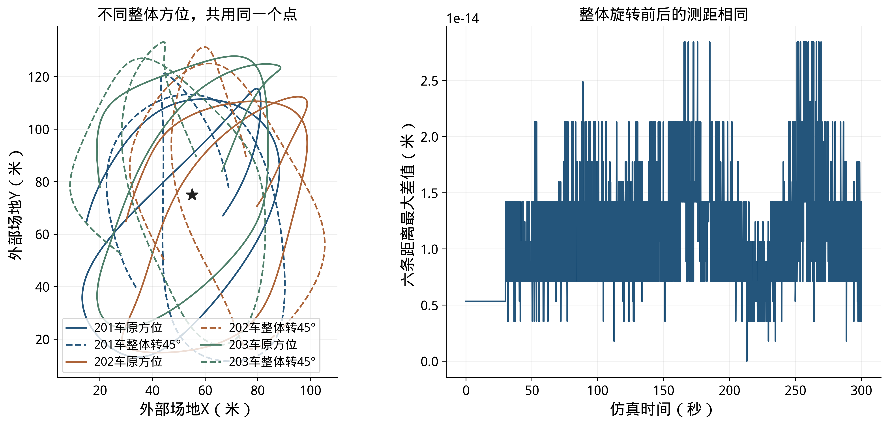

### 3.2 初始关系求解

初始化把各车自己的局部运动变成同一个局部坐标内的初始位置与转角。先由静止段平均测距形成几何候选，再累计0～60秒运动与测距、按1秒抽样求解。60秒是本轮统一数据窗口，起步与转弯提供了多时刻约束。数值优化仅以测距残差选解，静止状态用于恢复形状，运动信息用于确定局部坐标之间的关系。

表11 初始化输入与求解

| 方案 | 使用的测量 | 坐标约定后的未知量 | 候选与选择 |
|---|---|---|---|
| 无锚点 | 三条车间距离与三车局部运动 | 起点位置3自由度、局部转角3自由度 | 两种镜像、四种共同转角、三种相对转角初值，按测距残差选解 |
| 单锚点 | 六条距离与三车局部运动 | 起点位置5自由度、局部转角3自由度 | 两种镜像、三种转角初值，按测距残差选解 |

本轮检查求解是否收敛及规定坐标后雅可比矩阵的局部秩，同时保存所有初始解和连续输出。静止输入下，局部运动坐标转角尚无运动约束；测试轨迹包含相对运动后再求解。初始化结果直接进入后续估计，误差统计保留起点偏差及后续累积影响。

### 3.3 增加一个点后的精度变化

先把同一个点放在场景中部（55，75）米。测距白噪声标准差均为10厘米，链路固定偏差标准差为3厘米，同编号运动输入和车间测距逐点相同。无锚点组只使用三条距离建系及更新，单点组增加三条车锚距离；对比包含新增测量对初始化和连续更新的共同作用。

表12 同输入条件下增加单点的结果

| 运动输入 | 无锚点RMSE范围（米） | 中部单点RMSE范围（米） | 中部单点均值±标准差（米） |
|---|---|---|---|
| IMU 基础 | 17.376～26.165 | 4.065～22.497 | 16.970±6.854 |
| IMU 增强 | 5.531～26.337 | 2.350～28.717 | 12.957±9.065 |
| IMU 精细 | 1.244～22.595 | 0.650～22.691 | 3.851±4.936 |
| VIO 基础 | 0.286～1.423 | 0.109～0.653 | 0.280±0.162 |
| VIO 增强 | 0.174～0.681 | 0.089～0.345 | 0.166±0.080 |
| VIO 精细 | 0.093～0.326 | 0.066～0.177 | 0.099±0.032 |
| LIO 基础 | 0.174～0.681 | 0.089～0.345 | 0.166±0.080 |
| LIO 增强 | 0.093～0.326 | 0.066～0.177 | 0.099±0.032 |
| LIO 精细 | 0.057～0.221 | 0.052～0.129 | 0.077±0.020 |

表13 输入条件、精度与设备数量

| 仿真输入与方案 | 相对位置RMSE（米） | 完整盒数量 |
|---|---|---|
| VIO 增强，无锚点 | 0.174～0.681 | 三只车载盒 |
| VIO 精细，无锚点 | 0.093～0.326 | 三只车载盒 |
| VIO 增强＋中部单点 | 0.089～0.345 | 三只车载盒＋一只单点盒 |
| LIO 增强＋中部单点 | 0.066～0.177 | 三只车载盒＋一只单点盒 |

VIO增强加单点与VIO精细无锚点得到接近的误差范围，说明增加共同距离参考能够降低对本车运动输入质量的要求。两种无点输入均复用三只现有盒，单点方案增加一只同型盒；输入档位的变化通过实车标定和前端输出质量核对。

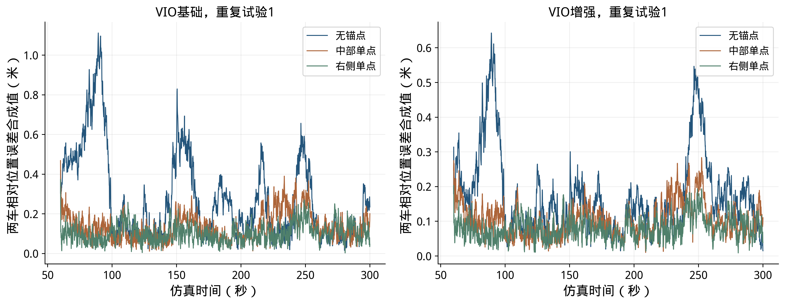

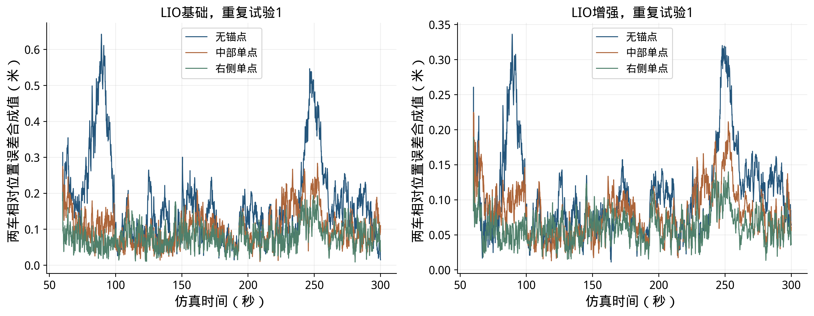

过程图分别给出基础和增强输入下的定位误差，纵轴为202、203两车位置误差平方均值的平方根，保留每次距离更新后的波动。相对运动改变测量方向，本车运动漂移与测距更新在各时刻共同作用；图中的修正直接来自估计器计算，没有人工加入跳变。

单锚点提供了相对于固定点的距离约束，较低误差的运动输入可进一步改善相对位置。默认纯UWB使用现有盒内设备完成相对形状输出；连续固定轴向位置按本节结果选择运动输入及单点配置，结合设备数量和费用安排实车验证。

### 3.4 同一个点放在哪里

选取区域中部、起点侧方、区域左侧、区域右侧及区域角部五个候选位置，每次仅选其中一个。三车轨迹、噪声样本及输入参数保持一致，每个位置按六条测距重新求初始关系并连续更新，9档输入各重复20次，共900次布点运行。

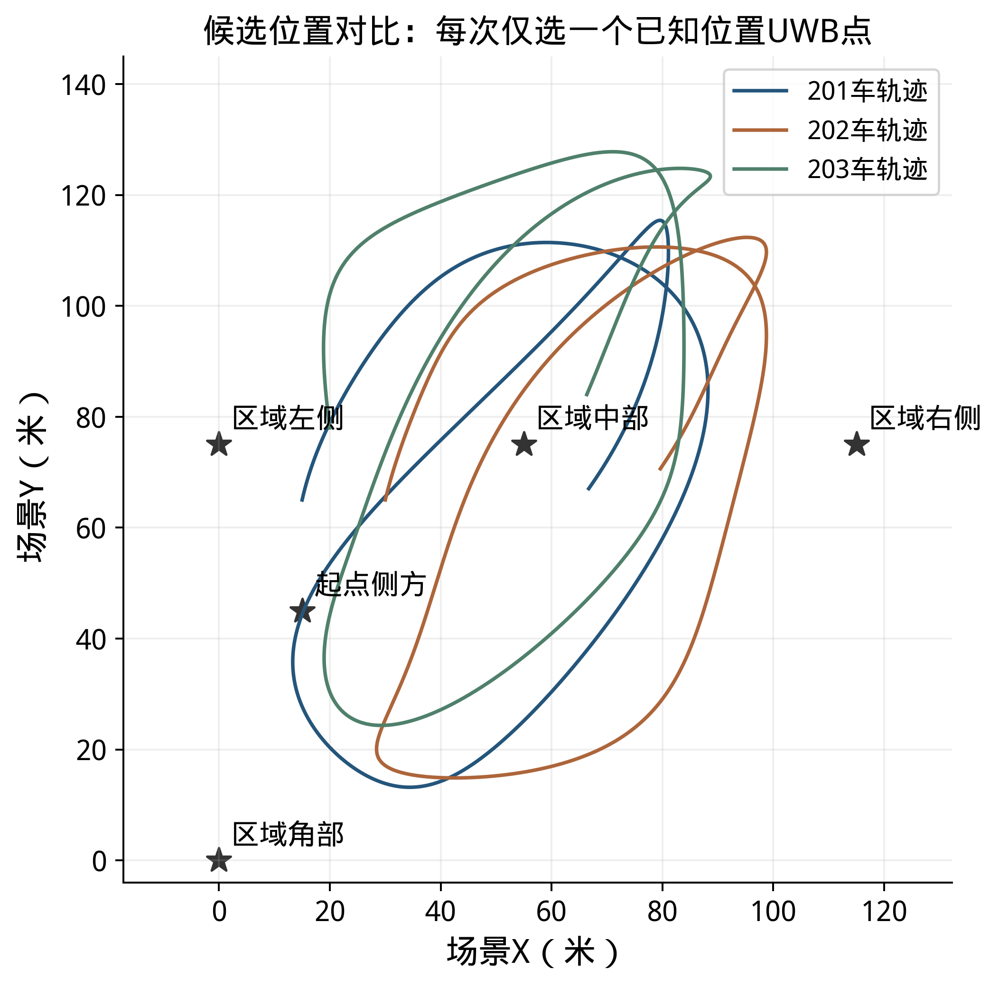

表14 候选位置与测距几何

| 候选位置 | 场景坐标（米） | 车锚距离范围（米） | 5秒方向变化中位数（度） |
|---|---|---|---|
| 区域中部 | （55，75） | 5.36～66.16 | 7.94 |
| 起点侧方 | （15，45） | 0.24～107.73 | 4.10 |
| 区域左侧 | （0，75） | 17.11～104.88 | 4.18 |
| 区域右侧 | （115，75） | 19.03～110.61 | 4.46 |
| 区域角部 | （0，0） | 28.53～152.17 | 2.09 |

表中方向变化指车辆相对点的视线角在连续5秒内的跨度，对评价时段及三车取中位数，用于描述测距方向随运动的变化。布点比较同时包含距离、方向变化、起点几何与整段运动，不以某一个几何量单独判定最优位置。超过100米的车锚距离是候选位置比较中的几何条件，车间距始终保持在24.56米以内；这些候选均沿用相同测距误差模型，未模拟随距离变化的无线传播或天线遮挡。

表15 不同布点下增强输入的结果

| 候选位置 | IMU增强RMSE（米） | VIO增强RMSE（米） | LIO增强RMSE（米） |
|---|---|---|---|
| 区域中部 | 2.350～28.717 | 0.089～0.345 | 0.066～0.177 |
| 起点侧方 | 2.452～21.545 | 0.092～0.719 | 0.059～0.376 |
| 区域左侧 | 0.882～30.066 | 0.076～0.292 | 0.058～0.185 |
| 区域右侧 | 0.980～28.320 | 0.083～0.160 | 0.056～0.117 |
| 区域角部 | 2.417～21.460 | 0.071～0.516 | 0.051～0.296 |

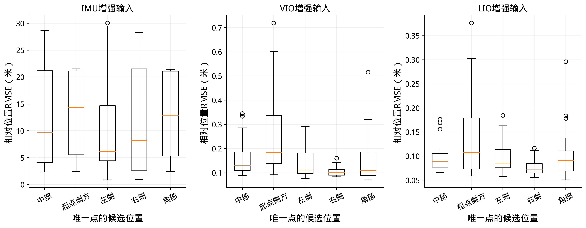

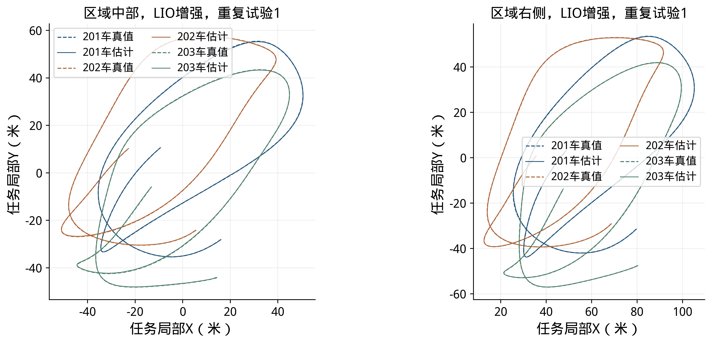

在本轮轨迹及等测距误差条件下，区域右侧的VIO/LIO增强结果优于区域中部；IMU输入下各位置的结果仍受惯性传播误差显著影响。起点侧方的轨迹最近处仅约0.24米，实车布设需按安全距离和天线安装位置调整。选点时结合行驶路线检查车锚距离、遮挡和起步几何，再按同一位置误差口径复测，仿真位置排序不替代现场测距结果。

### 3.5 测距精度与RTE求解结果

测距精度对比保持中部单点和运动输入不变，改变逐时测距标准差，固定链路偏差仍为3厘米。下表保留每个条件的全部20次结果，直接观察改善测距后位置误差的变化。

表16 单点方案的测距精度对照

| 运动输入 | 20厘米测距RMSE（米） | 10厘米测距RMSE（米） | 5厘米测距RMSE（米） |
|---|---|---|---|
| IMU 基础 | 4.331～28.332 | 4.065～22.497 | 3.739～22.474 |
| IMU 增强 | 2.447～30.285 | 2.350～28.717 | 2.461～29.015 |
| IMU 精细 | 0.953～23.303 | 0.650～22.691 | 0.488～21.176 |
| VIO 基础 | 0.135～0.648 | 0.109～0.653 | 0.098～0.681 |
| VIO 增强 | 0.111～0.361 | 0.089～0.345 | 0.076～0.334 |
| VIO 精细 | 0.077～0.189 | 0.066～0.177 | 0.060～0.169 |
| LIO 基础 | 0.111～0.361 | 0.089～0.345 | 0.076～0.334 |
| LIO 增强 | 0.077～0.189 | 0.066～0.177 | 0.060～0.169 |
| LIO 精细 | 0.059～0.129 | 0.052～0.129 | 0.045～0.128 |

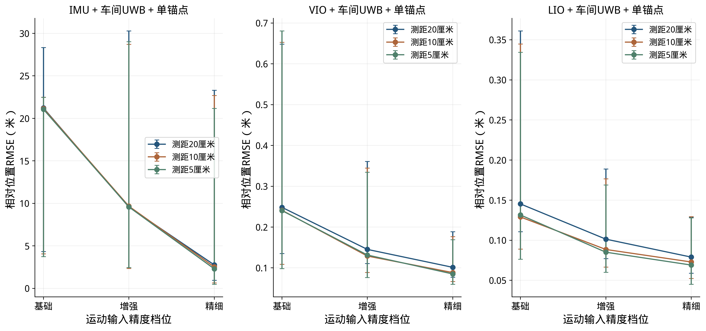

RTE求解测试采用300秒运动轨迹及仿真无误差局部里程计，分别加入2、5、10厘米测距噪声，用于观察测距误差对初次建系和后续位置修正的影响。下图直接读取C++算法输出，横轴均从仿真0秒开始，纵轴为逐车相对位置误差。

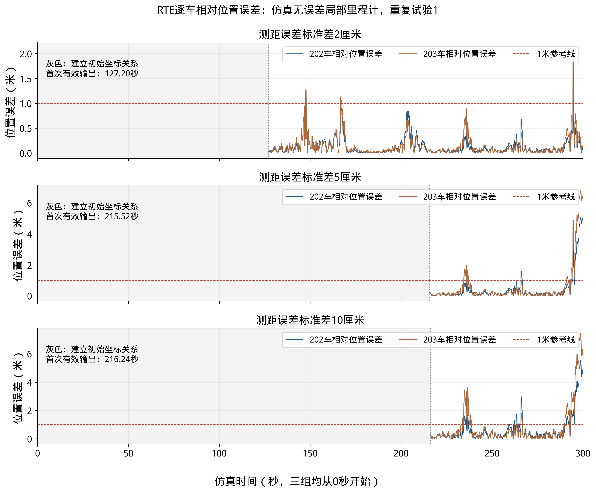

三组首次有效输出分别为127.20、215.52、216.24秒。出线前的灰色区间表示算法正在建立初始坐标关系：程序积累运动与测距，检查求解是否收敛，以及初始位置、方向是否得到足够约束。测距噪声改变了这些检查通过的时刻，因此三条曲线的出线位置不同。图中保留真实时刻，统一横轴便于直接比较建系所需时间和后续误差。

2厘米组在294.48秒时，窗口更新使203车位置变化约2.76米，位置误差由0.646米变为2.117米，而测距拟合残差约1.7厘米。代码重建表明，新窗口对相对变换约束较弱时直接更新变换，造成位置跳变。厘米级残差描述距离拟合，位置误差由仿真真值直接计算。这组测试帮助确定初始关系检查及后续变换更新对位置输出的影响。

## 4 实测数据与接口应用

### 4.1 静止采集与位置回放

六组静止采集共记录3,229,145帧车载IMU及48,985帧UWB测距，已用于传感器分析、默认UWB位置回放及输入检查。下表用数据编号1～6列示采集规模。消息头时间戳（Header）为消息携带的测量时间，实测曲线按其相对起点表示。

表17 六组静止实测数据

| 数据编号 | 采集状态 | 车载IMU帧数 | UWB测距帧数 | 已开展的分析 |
|---|---|---|---|---|
| 1 | 三盒静止 | 538,560 | 6,905 | 测距统计、静止IMU特性分析 |
| 2 | 三盒静止 | 538,593 | 6,879 | 测距统计、静止IMU特性分析 |
| 3 | 三盒静止 | 538,396 | 6,933 | 测距统计、静止IMU特性分析 |
| 4 | 三盒静止 | 538,289 | 10,352 | 测距与惯性数据回放、RTE输入分析 |
| 5 | 三盒静止 | 539,229 | 9,681 | 测距统计、静止IMU特性分析 |
| 6 | 三盒静止 | 536,078 | 8,235 | 测距统计、静止IMU特性分析 |

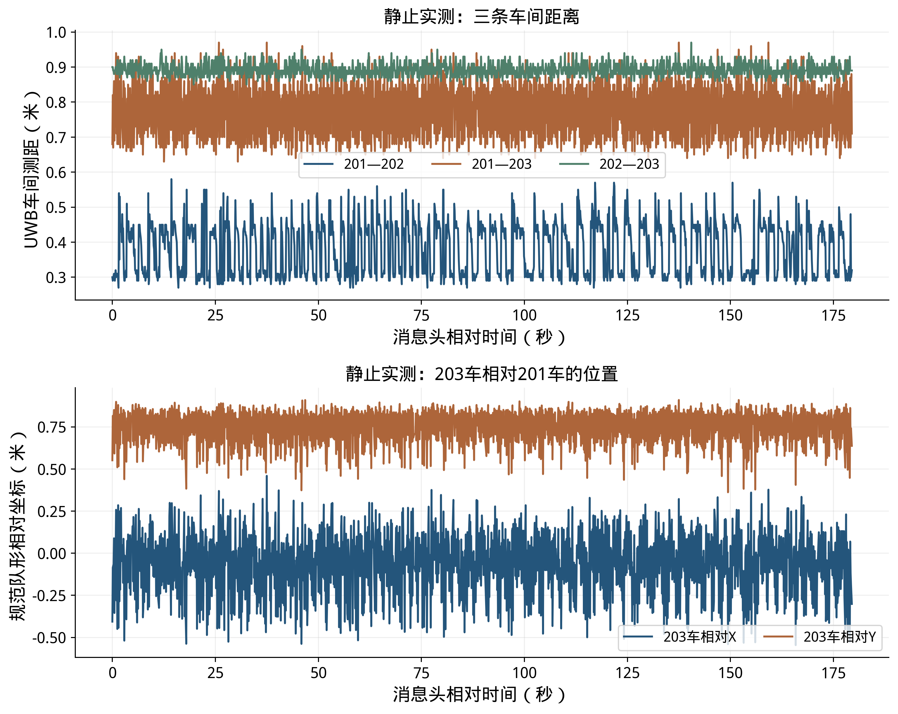

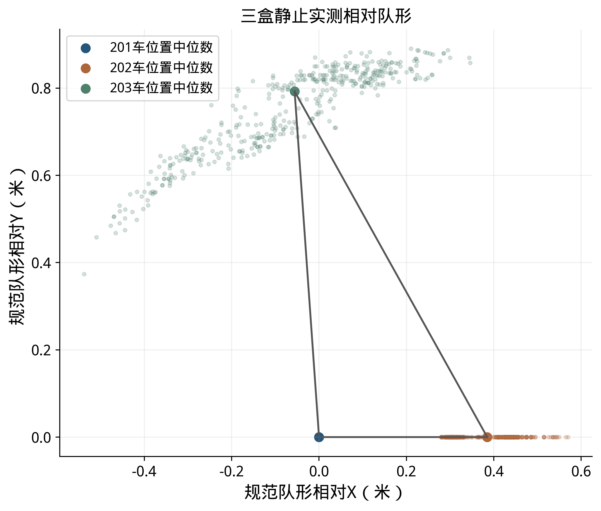

两批在线输出频率约9.24～9.42赫兹。三盒均已完成三目视觉采集，雷达点云采集已完成；点云与图像后续需按特征提取、标定和甲方实车调试流程接入。已有静止数据用于输入质量分析和回放，动态位置误差按独立运动真值评价。

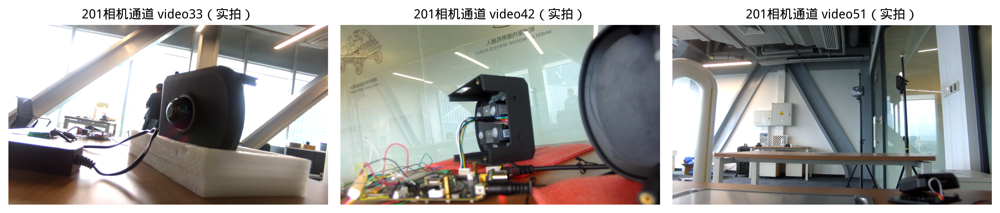

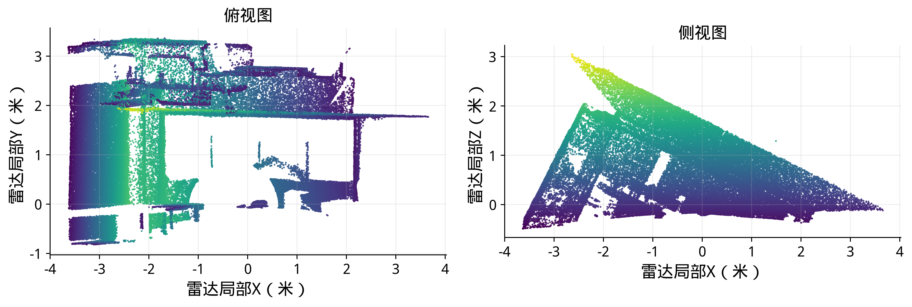

点云图直接读取主盒/livox/lidar消息，累积225条消息，去除全零和非有限点后固定抽样绘制12万个点，分别给出俯视及侧视投影，颜色辅助区分点高。它展示采集场景的空间结构，与三目图像一起为后续实车视场检查、特征提取和安装标定提供数据。图中使用本盒雷达局部坐标。

### 4.2 对外位置接口

默认UWB输出话题为/cooperative_localization/poses_2d，坐标系为coop_ref_1_relative，采用瞬时三角形定义。RTE使用/cooperative_localization/rte/poses_2d，固定轴向相对坐标由坐标转换程序输出。下表给出定位输入及输出，接收方按车辆编号、坐标系、测量时间与有效性使用位置。

表18 定位输入与输出

| 输入或输出 | 话题及消息类型 | 频率 |
|---|---|---|
| 默认UWB位置输出 | /cooperative_localization/poses_2d；CooperativePose2DArray | 配置约10赫兹，实测约9.24～9.42赫兹 |
| RTE原始位置输出 | /cooperative_localization/rte/poses_2d；CooperativePose2DArray | 配置20赫兹 |
| RTE固定相对位置输出 | /cooperative_localization/rte/coordinates/poses_2d；CooperativePose2DArray | 配置20赫兹 |
| RTE运行状态 | /cooperative_localization/rte/status；String | 配置20赫兹 |
| 各车局部位姿 | /cooperative_localization/rte/node_state；NodeState | 配置50赫兹 |
| UWB测距输入 | /uwb/range；UwbRange | 各测距链路约10赫兹 |
| 车载IMU输入 | 各盒/imu/raw；Imu | 静止实测约1000赫兹 |

单点仿真另导出位置CSV，任务局部系为coop_single_anchor，相对系为coop_single_anchor_relative。anchor_x_m、anchor_y_m表示以点为原点的固定轴向位置，x_m、y_m表示减去201车同刻位置后的相对向量。该离线文件给出位置结果，航向有效位为false；默认在线UWB话题保持现状。

## 5 实车采集与联调

实车使用同一个已知位置UWB点，记录点的天线坐标及安装高度，同时采集三条车间测距和三条车锚测距。车速保持2～3米/秒以内，最大车间距20～30米。沿起步、转弯及编队整体移动路线采集，分别记录无锚点和有单点的输入，复用本轮位置评价程序比较配置收益。

IMU通过静止窗口估计启动角速度均值和重力方向，加计开展多姿态标定；在安装后的温度与振动条件下检查偏置变化。相机、雷达与IMU完成时间和安装位姿标定后，在实际室外视场中输出本车运动，并按尺度、方向漂移和随机位移统计对应本报告的输入条件。

运动试验配套独立位置测量，例如载波相位差分定位（Real-Time Kinematic，RTK）或全站仪。定位侧按统一车辆编号输出相对位置和测量时间，通信、规划与控制沿用现有消息接口接入；需要地图坐标时，将实测方向关系与任务局部系结合换算。采集命令、启动顺序和时间检查继续使用21号操作文档。

## 6 复现与阶段结论

### 6.1 仿真与图表重算

测距精度数据位于data/single_anchor_outdoor_20261029，无锚点和布点数据位于data/single_anchor_layout_20261029。各目录summary.json给出逐条件统计，蒙特卡洛分组统计.csv便于查表，outputs保存全部重复的逐时位置。本版实验条件清单.json逐项列出报告采用的84个条件及输出文件；按对应输出能够复算全部1680次统计。

```bash
PYTHONPATH=tools OPENBLAS_NUM_THREADS=1 python3 tools/evaluate_single_anchor.py --trials 20
PYTHONPATH=tools OPENBLAS_NUM_THREADS=1 python3 tools/evaluate_anchor_layout.py
PYTHONPATH=tools python3 tools/check_anchor_layout.py
PYTHONPATH=tools python3 tools/plot_single_anchor.py
PYTHONPATH=tools python3 tools/plot_anchor_layout.py
source /opt/ros/humble/setup.bash
python3 tools/plot_report_replay.py --replay-rte
python3 tools/check_report_results.py
```

手工修改本报告Markdown后，用以下命令更新其他格式；它们保留手工源稿：

```bash
PYTHONPATH=/tmp/cooperative_report_deps python3 tools/render_formal_report.py
python3 tools/export_formal_pdf.py
```

图1直接使用提供的原图。误差图及统计表读取保存的算法输出与真值，点云读取原始消息，三目图像使用实际采集画面。图中文字由绘图程序按明确文字与字体排版；结果图提供PNG、SVG及矢量PDF。逐图数据和重算命令见配套复现说明，SVG可用Inkscape修改。

### 6.2 阶段结论

三盒采集、默认UWB相对队形、独立RTE库和消息接口已形成可运行链路。六组静止数据支持输入分析及位置回放，本轮仿真补充了三类运动输入、三档质量、三档测距误差与五个单点候选位置的量化对比。参数、统计、误差过程及轨迹按同一条件相邻列示。

在10厘米测距白噪声和3厘米链路固定偏差标准差下，默认纯UWB队形的20次RMSE为0.187～0.225米。固定轴向定位采用LIO增强输入、无锚点时为0.093～0.326米；增加中部单点后为0.066～0.177米，改为区域右侧单点后为0.056～0.117米。上述结果分别按规定坐标和明确的仿真输入计算。

配置上可保留默认UWB满足相对队形使用，再根据连续运动与共同位置参考的需要选用相机/雷达与IMU组合，以及一个已知位置UWB点。三车硬件概算及单点增量配置已列示。后续按低速编队和同一评价口径采集实车动态数据，完成位置输出与通信、规划和控制的联调。
