# 机动章节顺序调整：改动前后对照

修改前报告与复现说明保存在内部材料/20261102_机动章节调整前/。以下逐行列示正文位置变化、章节及图表引用调整；减号为原文，加号为新文。

```diff
--- 修改前/报告.md
+++ 修改后/报告.md
@@ -29,9 +29,9 @@
 
 ### 1.1 运动条件与评价口径
 
-传感器分级和锚点布置仿真的时长为300秒，前30秒静止，30～60秒积累起步及转弯数据用于求初始坐标关系，60～300秒统计连续定位结果。RTE低速初始化对照及评价口径见第3.4节。三车整体运动范围约85×115米，最高速度2.39米/秒，最大车间距24.56米。位置、测距及运动输入按10赫兹处理，保持连续视距测距。平面模型采用同高天线参考点。主计算周期为0.1秒，即10赫兹；UWB距离和视觉惯性里程计（Visual-Inertial Odometry，VIO）或激光惯性里程计（LiDAR-Inertial Odometry，LIO）的局部位移按10赫兹进入位置计算。IMU白噪声用100赫兹原始采样水平折算到10赫兹，表示噪声强度的参考采样率。
-
-UWB依据无线信号的传播时间计算距离，天线及收发电路本身也会引入延迟。延迟补偿后的残余可能使同一对设备的平均测距持续偏大或偏小，在短时、工作条件稳定时可用近似固定的测距偏差表示。这类偏移会随重复测量保留，进而影响三车距离关系和相对位置；逐次测量的随机波动则另行建模。因此，传感器分级、锚点布置及默认UWB对照保留了固定偏差项，用于考察测距标定残余对定位的影响。其标准差设为3厘米，作为本轮仿真条件。RTE低速初始化对照采用的测距模型在第3.4节单独说明。
+传感器分级和锚点布置仿真的时长为300秒，前30秒静止，30～60秒积累起步及转弯数据用于求初始坐标关系，60～300秒统计连续定位结果。RTE低速初始化对照及评价口径见第3.5节。三车整体运动范围约85×115米，最高速度2.39米/秒，最大车间距24.56米。位置、测距及运动输入按10赫兹处理，保持连续视距测距。平面模型采用同高天线参考点。主计算周期为0.1秒，即10赫兹；UWB距离和视觉惯性里程计（Visual-Inertial Odometry，VIO）或激光惯性里程计（LiDAR-Inertial Odometry，LIO）的局部位移按10赫兹进入位置计算。IMU白噪声用100赫兹原始采样水平折算到10赫兹，表示噪声强度的参考采样率。
+
+UWB依据无线信号的传播时间计算距离，天线及收发电路本身也会引入延迟。延迟补偿后的残余可能使同一对设备的平均测距持续偏大或偏小，在短时、工作条件稳定时可用近似固定的测距偏差表示。这类偏移会随重复测量保留，进而影响三车距离关系和相对位置；逐次测量的随机波动则另行建模。因此，传感器分级、锚点布置及默认UWB对照保留了固定偏差项，用于考察测距标定残余对定位的影响。其标准差设为3厘米，作为本轮仿真条件。RTE低速初始化对照采用的测距模型在第3.5节单独说明。
 
 仿真过程中同时保留每辆车的真实位置作为对照。位置误差评价202、203车相对201车的位置向量：将估计相对向量减去同一坐标定义下的真值向量，取二维长度。每次运行的位置均方根误差（Root Mean Square Error，RMSE）为两车全部评价时刻的误差平方均值再开平方，单位为米；随后统计20次运行RMSE的均值、样本标准差及最小至最大范围。它直接量化相对位置偏差，测距拟合残差另行说明。
 
@@ -41,7 +41,7 @@
 
 试验比较三件事：提高本车运动输入质量能降低多少误差，增加一个已知位置UWB锚点有多大作用，以及锚点的位置和测距精度怎样影响结果。三类输入各设三档，共9种运动输入。无锚点组使用车间距离和本车运动，单锚点组再加入三车到同一个锚点的距离；各组按实际可用测量求解初始关系，同编号对比使用相同运动与测距噪声样本。
 
-20次重复用于观察固定轨迹下随机误差带来的离散程度，属于噪声蒙特卡洛分析。所有重复均进入统计；单次过程图采用重复试验1，图3、图19、图21和图23展示20次结果的平均过程。仿真真值用于生成测量和评价，算法直接使用带误差的运动和距离输入输出定位结果。
+20次重复用于观察固定轨迹下随机误差带来的离散程度，属于噪声蒙特卡洛分析。所有重复均进入统计；单次过程图采用重复试验1，图3、图14、图16和图18展示20次结果的平均过程。仿真真值用于生成测量和评价，算法直接使用带误差的运动和距离输入输出定位结果。
 表1 仿真项目与分组
 
 | 试验目的 | 条件设置 | 条件数 | 重复次数 |
@@ -252,11 +252,11 @@
 
 前面的传感器分级比较表明，继续提升每车运动输入需要增加较高等级器件。本节考察增加一个外部共同参考的方案：在编队外设置一个已知位置的UWB锚点，可安装在地标或已落地并保持静止的无人机上。
 
-单锚点仿真的基准设置为：三辆车和一个位置已知、固定不动的锚点，天线按同一高度处理；三条车间测距和三条车锚测距均按10赫兹生成，共六条链路，每秒合计60条距离。基准测距随机误差标准差为10厘米，每条链路的标定残余固定偏差按标准差3厘米设置。第3.4节另比较5厘米、20厘米测距误差，固定偏差条件保持一致。
-
-运动和评价设置为：三车整体运动范围约85×115米，最高速度2.39米/秒，最大车间距24.56米；仿真共300秒，前30秒静止，使用0～60秒的测距和运动信息求初始关系，以60～300秒评价相对位置。每种条件重复20次，无锚点与单锚点的同编号试验使用对应的运动及车间测距误差样本。第3.2节采用场景中部（55，75）米的锚点，第3.3节另比较其他四个位置；各位置的车锚距离见表18。模型采用连续视距测距，各位置使用相同的测距误差参数。
-
-本车运动分别使用三档IMU、VIO或LIO仿真输入，具体误差参数见第2.2～2.4节；第3.5节机动对照采用VIO增强档，尺度误差标准差为1%，方向漂移标准差为0.0001弧度/秒，100米累计随机位移误差设为60厘米。输出沿用第1.3节的201局部固定轴，原点仍在201当前位置。新增距离的预测值是车辆到已知锚点的距离，EKF用车锚测距残差修正位置；锚点约束参与起步关系求解和后续更新。图9取实际仿真轨迹的两个时刻说明：201一直在原点，锚点在该相对坐标中的位置随201移动而变化。
+单锚点仿真的基准设置为：三辆车和一个位置已知、固定不动的锚点，天线按同一高度处理；三条车间测距和三条车锚测距均按10赫兹生成，共六条链路，每秒合计60条距离。基准测距随机误差标准差为10厘米，每条链路的标定残余固定偏差按标准差3厘米设置。第3.5节另比较5厘米、20厘米测距误差，固定偏差条件保持一致。
+
+运动和评价设置为：三车整体运动范围约85×115米，最高速度2.39米/秒，最大车间距24.56米；仿真共300秒，前30秒静止，使用0～60秒的测距和运动信息求初始关系，以60～300秒评价相对位置。每种条件重复20次，无锚点与单锚点的同编号试验使用对应的运动及车间测距误差样本。第3.2节采用场景中部（55，75）米的锚点，第3.4节另比较其他四个位置；各位置的车锚距离见表21。模型采用连续视距测距，各位置使用相同的测距误差参数。
+
+本车运动分别使用三档IMU、VIO或LIO仿真输入，具体误差参数见第2.2～2.4节；第3.3节机动对照采用VIO增强档，尺度误差标准差为1%，方向漂移标准差为0.0001弧度/秒，100米累计随机位移误差设为60厘米。输出沿用第1.3节的201局部固定轴，原点仍在201当前位置。新增距离的预测值是车辆到已知锚点的距离，EKF用车锚测距残差修正位置；锚点约束参与起步关系求解和后续更新。图9取实际仿真轨迹的两个时刻说明：201一直在原点，锚点在该相对坐标中的位置随201移动而变化。
 
 单个锚点提供距离参考，结合车间测距和各车运动约束局部相对位置。所有平台及其局部方向绕锚点共同转动时，距离仍保持不变；本系统以201局部初始轴约定共同方向。地图方向由201的地图位置和方向关系换算，锚点提供共同距离参考。
 
@@ -318,13 +318,80 @@
 
 单锚点提供了相对于固定锚点的距离约束，较低误差的运动输入可进一步改善相对位置。默认纯UWB使用现有盒内设备完成相对形状输出；连续固定轴向位置按本节结果选择运动输入及单锚点配置，结合设备数量和费用安排实车验证。
 
-### 3.3 锚点位置的影响
-
-选取区域中部、起点侧方、区域左侧、区域右侧及区域角部五个候选位置，每次仅选其中一个。三车轨迹、噪声样本及输入参数保持一致，每个位置按六条测距重新求初始关系并连续更新，9档输入各重复20次，共900次布点运行。
-
-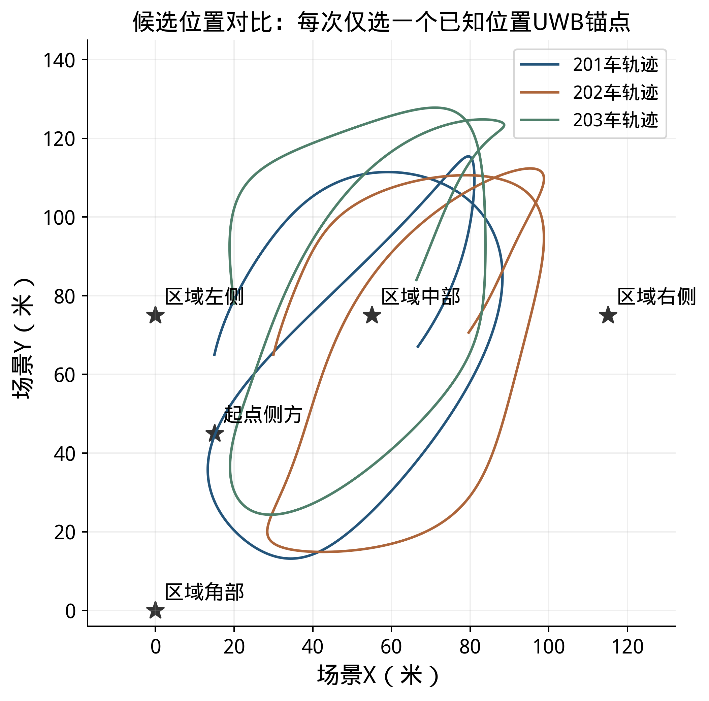
-
-表18 候选位置与测距几何
+### 3.3 机动对相对定位的影响
+
+直线运动对照包括同速平行、不同速平行和非平行直行，如图13所示。三组试验采用相同的三车起始位置，40～300秒保持直线运动，最高车速约0.63米/秒，最大车间距不超过18.7米；不同速平行组中202、203车的速度分别为0.575和0.625米/秒，非平行组中两车的行驶方向相对201车分别偏转约3.34度。
+
+各组分别比较无锚点和单锚点情况，均使用VIO增强档和车间测距，单锚点组增加车锚测距；测距误差标准差为10厘米，每种条件重复20次，使用对应的误差样本。各组按实际可用的测距和运动信息求初始关系，以60～300秒的相对位置误差计算RMSE。这里的无锚点结果采用运动信息与车间测距联合计算，第2.1节默认纯UWB队形采用另一种坐标定义。
+
+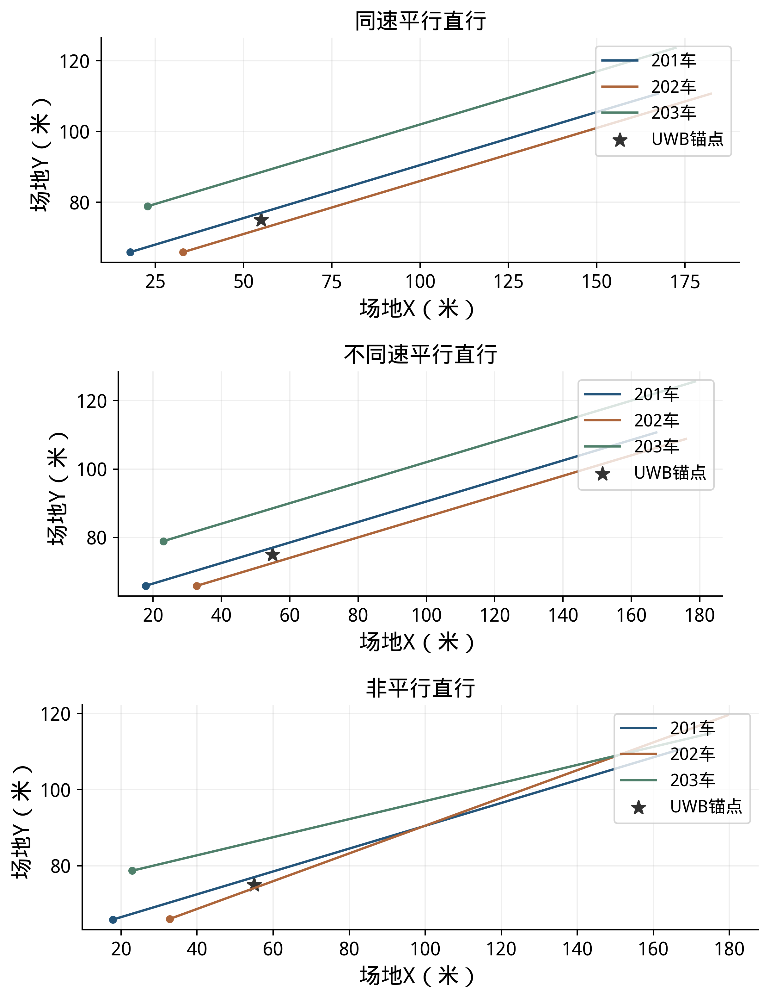
+
+同速平行直行时，车间距离基本不变；非平行直行使车间位置关系发生变化；在假设局部位移准确的分析中，本组非平行直行对位置关系的局部约束有所改善。表18和图14给出20次试验的定位误差：表中列出各次RMSE的均值和范围，曲线为逐时误差的平均值。
+
+表18 直线运动下的相对位置误差
+
+| 运动方式 | 无锚点均值（米） | 无锚点范围（米） | 单锚点均值（米） | 单锚点范围（米） |
+|---|---|---|---|---|
+| 同速平行直行 | 16.672 | 1.013～28.811 | 6.366 | 0.112～16.815 |
+| 不同速平行直行 | 18.213 | 1.099～28.157 | 5.531 | 0.113～16.942 |
+| 非平行直行 | 16.088 | 0.624～25.187 | 3.987 | 0.175～10.038 |
+
+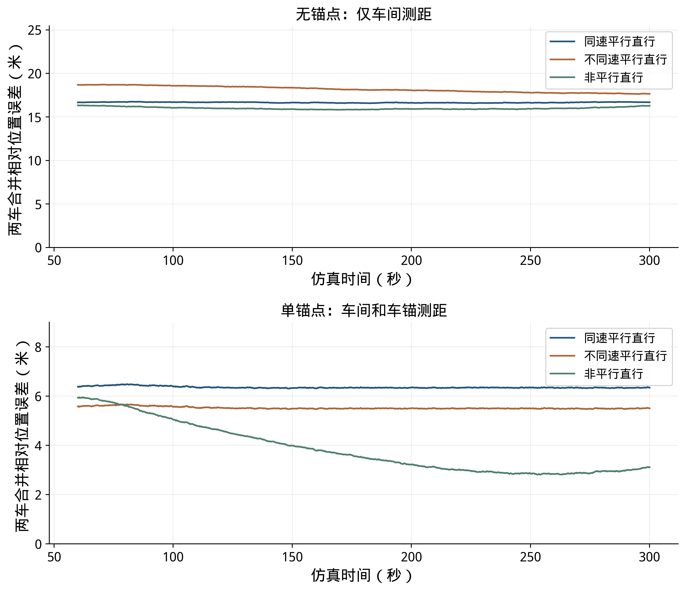
+
+三种直线运动加入锚点后，20次试验的平均误差均有所降低。起步阶段持续直行时，仅凭距离和运动信息可能将左右相反的队形判断为同一种位置关系。单锚点的同速平行、不同速平行和非平行组分别有7、6和7次在60秒出现镜像队形，造成较大位置误差；表中保留了全部试验结果。后续可结合持续运动及相机或雷达提供的相对方位，进一步区分候选位置。
+
+起步时适当改变车间相对方位，即改变201车指向其他车辆的方向，可能使不同初始位置关系产生更容易区分的测距变化。后面的同向平行运动组在0～60秒已有车间相对方位变化，80秒后保持车间相对位置不变，其20次试验在60～300秒的位置RMSE为0.116～0.589米，见表20。因此，可建议规划模块在条件允许时考虑起步阶段适当改变车间相对方位，并结合可用的初始位置和方位信息选择运动方式。
+
+在上述直线对照之外，进一步比较不同相对机动幅度下的距离观测变化和位置误差。三组均使用中部单锚点、室外退化VIO增强输入、10厘米测距、20次重复和同编号随机误差样本；把202、203相对201的运动幅度分别设置为当前轨迹的0.6、1.0和1.2倍，由此形成三组距离和运动输入。图15左上轨迹以及表19、图16的误差，均以201当前位置为原点、201自身起点局部轴为固定轴。各组按各自的起步测量建立初始关系，统计60～300秒的定位结果。
+
+表19 机动条件与定位结果
+
+| 机动条件 | 车间相对速度最大值（米/秒） | 距离观测最小非零敏感度中位数 | RMSE均值±标准差（米） | RMSE范围（米） |
+|---|---|---|---|---|
+| 低相对机动 | 0.587 | 0.685 | 0.214±0.095 | 0.104～0.393 |
+| 当前相对机动 | 0.978 | 0.689 | 0.321±0.159 | 0.120～0.602 |
+| 高相对机动 | 1.173 | 0.700 | 0.377±0.187 | 0.132～0.705 |
+
+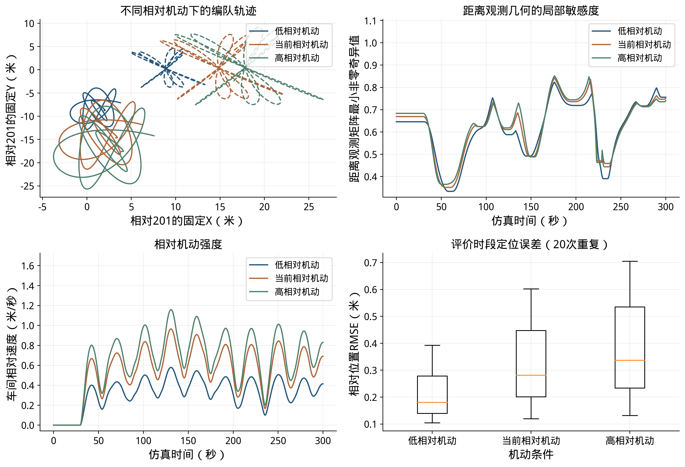
+
+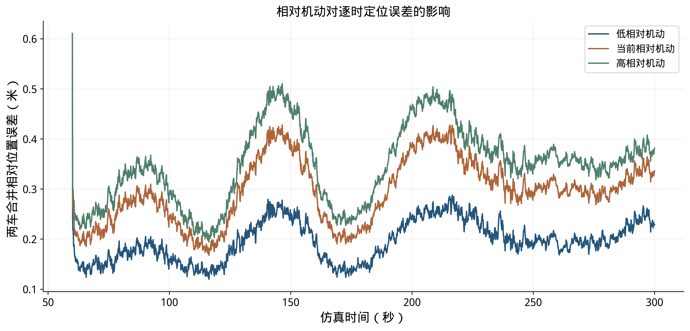
+
+图15包含四个子图：左上是三种机动下202、203相对201的轨迹；右上是最近5秒内距离观测最小非零敏感度的最小值，左下是最近5秒内最大车间相对速度的均方根；右下是20次重复试验在60～300秒的位置RMSE分布。表19的敏感度为60～300秒逐时值的中位数。图16为20次重复的平均误差过程。距离本身对整队共同转动仍有一个不敏感方向，因此右上采用最小非零值表示其余位置变化的可区分程度；数值越大，距离变化对位置变化越敏感。
+
+从图16可见，本次单锚点对照中，较大相对机动对应的平均误差及部分峰值更高。例如在146.5秒，低、当前和高相对机动组的20次平均误差分别为0.278、0.428和0.511米。三组同时改变了相对轨迹、车间和车锚测距几何及本车运动输入，并分别求解初始关系，因此这一结果反映了本次条件下机动幅度变化与误差的关系。为进一步分辨峰值由哪些因素造成，还需分别控制测距几何、起点关系和运动输入开展对照。
+
+当前三组中，车间相对速度最大值由0.587米/秒增加到0.978和1.173米/秒，距离观测几何的最小非零敏感度中位数由0.685增加到0.689和0.700；同时60～300秒位置RMSE均值由0.214米增加到0.321和0.377米。该对照中，相对机动改变了测距几何与各车运动输入，较高机动对应的位置RMSE没有降低。后续实车可按低速直行、转弯和编队变速分别采集，在相同测距条件下比较位置误差。
+
+机动方式还包括车辆之间的加减速、转弯和行驶方向变化。为比较这些因素，在同一条201车轨迹上设置同向平行、相对加减速、转弯变队形和非平行运动四种情况，各重复20次。四组在0～60秒采用相同的三车运动、起步测量和初始关系，60～80秒平滑过渡，80秒后进入各自的运动方式；同编号试验使用相同的测距和运动误差样本。运动输入采用VIO增强档，使用同一个中部锚点，测距误差及评价坐标与本节前述条件一致。
+
+图17给出四组完整轨迹。同向平行组保持各车间的相对位置不变，三车随201车共同转弯；相对加减速组在场地X方向增加往复相对运动，非平行组在场地Y方向增加往复相对运动，转弯变队形组在201车转弯时调整队形方向。这些运动方式可能同时改变相对速度、加速度和方向，不将它们视为彼此完全独立的因素。四组最高车速为2.52米/秒，最大车间距为27.72米。
+
+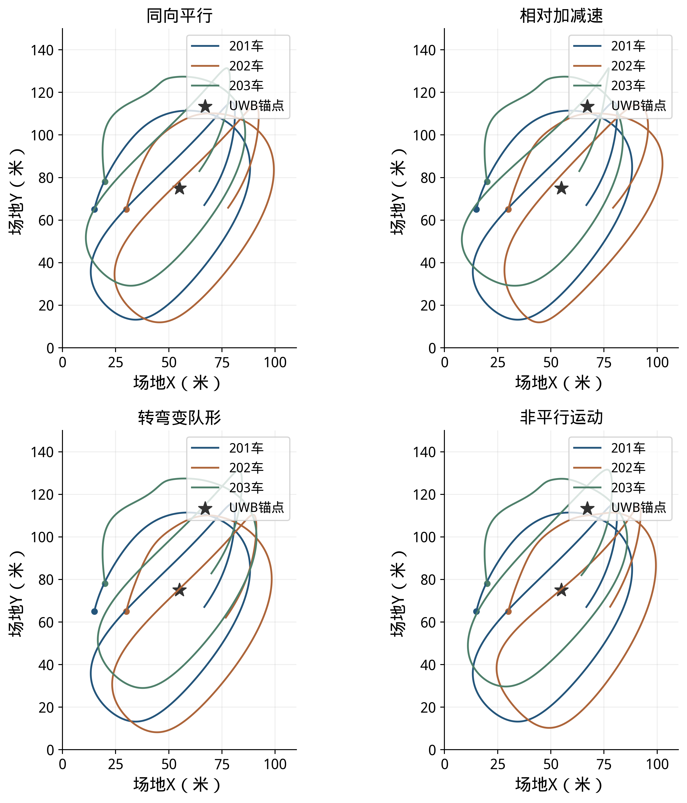
+
+表20 不同机动方式的定位结果
+
+| 机动方式 | 最大相对速度（米/秒） | 最大相对加速度（米/秒²） | 最大方向差（度） | 位置RMSE范围（米） |
+|---|---|---|---|---|
+| 同向平行 | 0.004 | 0.088 | 0.0 | 0.116～0.589 |
+| 相对加减速 | 0.726 | 0.226 | 34.8 | 0.119～0.610 |
+| 转弯变队形 | 0.328 | 0.090 | 6.8 | 0.117～0.592 |
+| 非平行运动 | 0.726 | 0.226 | 38.2 | 0.115～0.595 |
+
+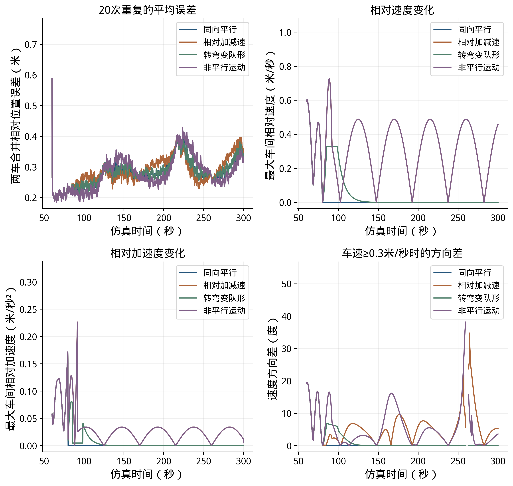
+
+图18上方为20次重复的平均位置误差和最大车间相对速度，下方为最大车间相对加速度和201车与其他车辆的最大运动方向差。方向差只在对应两车速度均不低于0.3米/秒时统计，以免车辆接近静止时方向角失去意义。表20的运动量取80～300秒最大值；位置RMSE按60～300秒计算，范围包括各组全部20次结果。
+
+四组位置RMSE均值依次为0.301、0.308、0.302和0.302米，全部80次运行的RMSE为0.115～0.610米。相同起步过程使四组在前段的误差过程一致，之后曲线有交叉；在本次设定下，不同运动方式的平均RMSE接近，不能据此认为某一种机动总能提高精度，也不能仅凭图中峰值判断由哪一种机动引起。两组往复运动的位移幅度和周期相同，因此对应的最大相对速度和加速度曲线重合，方向差则随运动方向不同而变化。
+
+本次按既定VIO位移误差模型生成运动输入；实车比较还需结合地面纹理、转弯振动和图像模糊对运动估计的影响，在实际场地分别采集平行行驶、变速、转弯和方向变化的数据。
+
+### 3.4 锚点位置的影响
+
+车辆运动路线确定后，锚点位置也会改变车锚距离及其变化。选取区域中部、起点侧方、区域左侧、区域右侧及区域角部五个候选位置，每次仅选其中一个。三车轨迹、噪声样本及输入参数保持一致，每个位置按六条测距重新求初始关系并连续更新，9档输入各重复20次，共900次布点运行。
+
+
+
+表21 候选位置与测距几何
 
 | 候选位置 | 场景坐标（米） | 车锚距离范围（米） | 5秒方向变化中位数（度） |
 |---|---|---|---|
@@ -336,7 +403,7 @@
 
 表中方向变化指车辆相对锚点的视线角在连续5秒内的跨度，对评价时段及三车取中位数。布点比较同时看距离、方向变化、起点几何和整段运动；候选车间距保持在24.56米以内，车锚距离按表中条件计算。
 
-表19 不同布点下增强输入的结果
+表22 不同布点下增强输入的结果
 
 | 候选位置 | IMU增强RMSE（米） | VIO增强RMSE（米） | LIO增强RMSE（米） |
 |---|---|---|---|
@@ -346,17 +413,17 @@
 | 区域右侧 | 1.219～30.038 | 0.142～0.491 | 0.088～0.234 |
 | 区域角部 | 2.062～21.205 | 0.137～1.462 | 0.086～0.657 |
 
-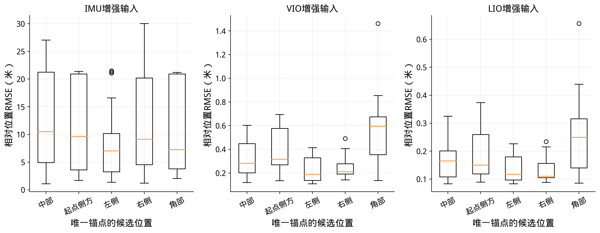
-
-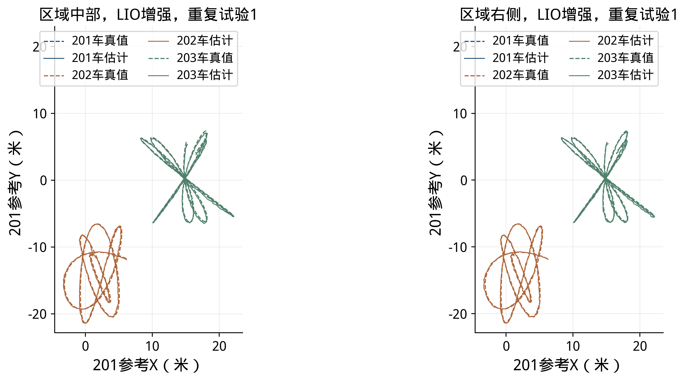
-
-在本轮轨迹及等测距误差条件下，区域中部与右侧的VIO增强组20次RMSE均值分别为0.321米和0.240米，LIO增强组分别为0.163米和0.132米；各次结果范围见表19。IMU输入下各位置的结果仍受惯性传播误差影响。起点侧方的轨迹最近处仅约0.24米，实车布设需按安全距离和天线安装位置调整，并结合行驶路线检查车锚距离和遮挡。
-
-### 3.4 测距精度与RTE求解结果
+
+
+
+
+在本轮轨迹及等测距误差条件下，区域中部与右侧的VIO增强组20次RMSE均值分别为0.321米和0.240米，LIO增强组分别为0.163米和0.132米；各次结果范围见表22。IMU输入下各位置的结果仍受惯性传播误差影响。起点侧方的轨迹最近处仅约0.24米，实车布设需按安全距离和天线安装位置调整，并结合行驶路线检查车锚距离和遮挡。
+
+### 3.5 测距精度与RTE对照
 
 测距精度对比保持中部单锚点和运动输入不变，改变逐时测距标准差，标定残余固定偏差的标准差仍为3厘米。下表保留每个条件的全部20次结果，直接观察改善测距后位置误差的变化。
 
-表20 单锚点方案的测距精度对照
+表23 单锚点方案的测距精度对照
 
 | 运动输入 | 20厘米测距RMSE（米） | 10厘米测距RMSE（米） | 5厘米测距RMSE（米） |
 |---|---|---|---|
@@ -370,94 +437,27 @@
 | LIO 增强 | 0.106～0.333 | 0.084～0.325 | 0.077～0.314 |
 | LIO 精细 | 0.080～0.191 | 0.063～0.188 | 0.050～0.183 |
 
-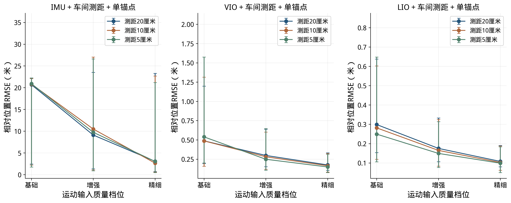
-
-图16按条件汇总20次重复仿真结果。横轴是本车运动输入质量，左、中、右三个图分别对应IMU、VIO和LIO；三条颜色线分别表示测距误差标准差20、10、5厘米。圆点是每组20次结果的中位数，竖线表示20次结果的最小值到最大值。它用来同时比较两件事：提高本车运动输入质量能降低多少误差，以及改善测距精度能降低多少误差。图中的数值属于表中设定条件下的仿真结果。
-
-原RTE方法将本车运动与车间测距结合，计算车辆之间的相对位置和方向。下面选取低速初始化的一组独立仿真对照，使用三条车间测距和本车运动信息；使用10秒窗口、5米窗口内运动范围参数、无误差局部运动输入及2、5、10厘米测距随机误差，每档展示一次试验。仿真前30秒车辆静止，之后按同一轨迹运动。输出按201局部固定轴，与同一时刻的仿真真值比较。
-
-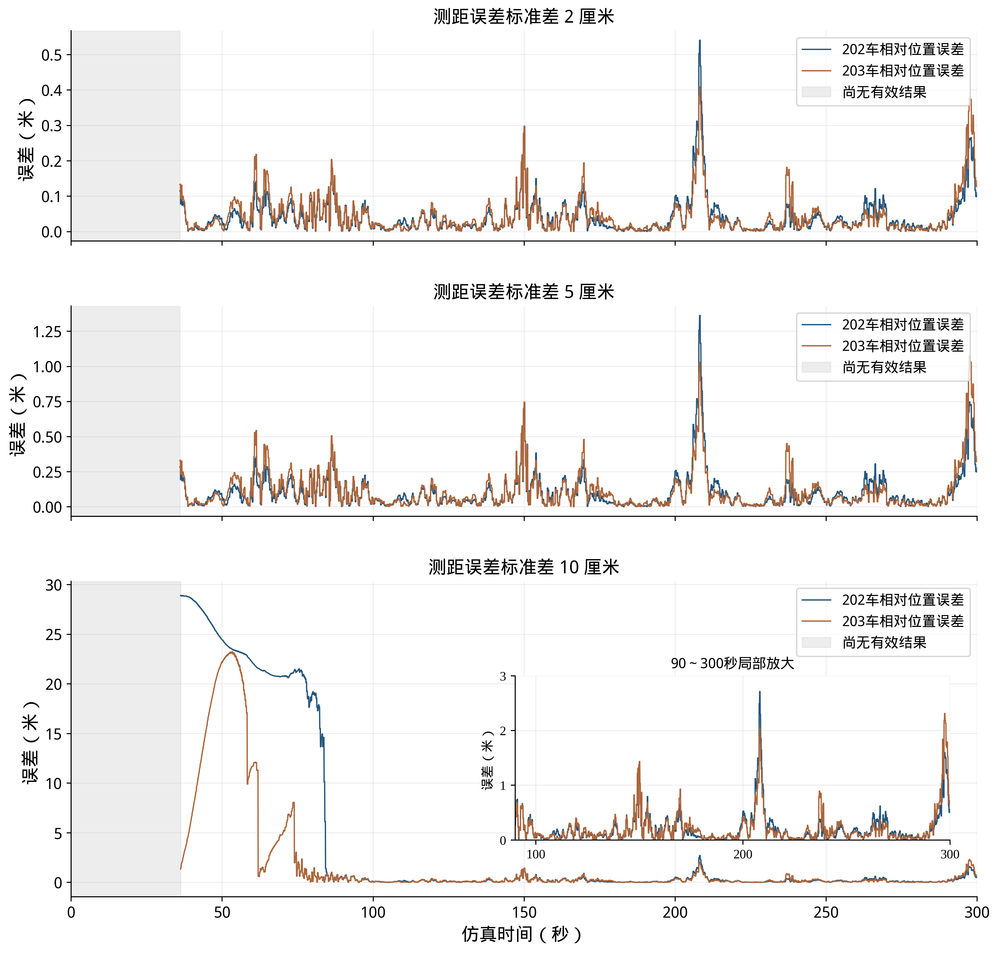
-
-图17中，蓝线和橙线分别表示202、203车相对201的位置误差；灰色区域表示尚未输出有效结果。三个子图的纵轴范围不同；第三幅中的局部放大图展示90～300秒、0～3米范围内的逐车误差，颜色与主图一致。三组使用同一条运动轨迹，车辆起步后的运动变化达到本次仿真设定条件后，算法开始检查初始相对位置。2厘米和5厘米组在36.00秒通过检查并开始输出，首次输出时两车误差均小于0.4米；整段有效结果的RMSE分别为0.068米和0.173米。10厘米组的首次候选结果有一项位置不确定度检查未通过，下一次检查通过后于36.24秒开始输出。
+
+
+图22按条件汇总20次重复仿真结果。横轴是本车运动输入质量，左、中、右三个图分别对应IMU、VIO和LIO；三条颜色线分别表示测距误差标准差20、10、5厘米。圆点是每组20次结果的中位数，竖线表示20次结果的最小值到最大值。它用来同时比较两件事：提高本车运动输入质量能降低多少误差，以及改善测距精度能降低多少误差。图中的数值属于表中设定条件下的仿真结果。
+
+原RTE方法将本车运动与车间测距结合，计算车辆之间的相对位置和方向。下面选取低速初始化的一组无锚点独立仿真对照，使用三条车间测距和本车运动信息；使用10秒窗口、5米窗口内运动范围参数、无误差局部运动输入及2、5、10厘米测距随机误差，每档展示一次试验。仿真前30秒车辆静止，之后按同一轨迹运动。输出按201局部固定轴，与同一时刻的仿真真值比较。
+
+
+
+图23中，蓝线和橙线分别表示202、203车相对201的位置误差；灰色区域表示尚未输出有效结果。三个子图的纵轴范围不同；第三幅中的局部放大图展示90～300秒、0～3米范围内的逐车误差，颜色与主图一致。三组使用同一条运动轨迹，车辆起步后的运动变化达到本次仿真设定条件后，算法开始检查初始相对位置。2厘米和5厘米组在36.00秒通过检查并开始输出，首次输出时两车误差均小于0.4米；整段有效结果的RMSE分别为0.068米和0.173米。10厘米组的首次候选结果有一项位置不确定度检查未通过，下一次检查通过后于36.24秒开始输出。
 
 10厘米组在36.24秒首次输出时，202车误差为28.90米，203车为1.35米。此时202车的估计相对位置约为（−12.86，7.67）米，真值约为（15.04，0.14）米；三车估计队形与真值的方向相反，出现了错误的镜像位置关系。虽然选错了位置，首次输出时的测距拟合残差仍约为0.088米。位置不确定度检查主要反映当前候选解附近的稳定程度，距离拟合较好且局部检查通过时，仍可能存在另一种与测距接近的位置关系。
 
 随后两车的位置解随运动和测距更新发生变化：203车误差在53.22秒升至23.23米，在61.92秒因位置解跳变降至0.63米；202车在84秒前后经过多次大幅调整，到85.02秒两车误差分别降至0.67米和0.74米。10厘米组恢复过程中累计有312条测距未被采用。图中前段的大幅起落反映了该次试验的初始选解错误和后续位置跳变；后段是位置接近真值后的误差变化。10厘米组整段有效结果的RMSE为7.901米，其中包含前段大误差。后续可保留并比较多组可能的初始位置关系，结合后续测距、运动信息以及相机或雷达对其他车辆的相对方位观测，研究初始解选择与错误解恢复方法。
 
-表21 RTE低速初始化对照
+表24 RTE低速初始化对照
 
 | 测距误差标准差（厘米） | 首次有效输出（秒） | 有效输出相对位置RMSE（米） |
 |---|---|---|
 | 2 | 36.00 | 0.068 |
 | 5 | 36.00 | 0.173 |
 | 10 | 36.24 | 7.901 |
-
-### 3.5 机动对相对定位的影响
-
-直线运动对照包括同速平行、不同速平行和非平行直行，如图18所示。三组试验采用相同的三车起始位置，40～300秒保持直线运动，最高车速约0.63米/秒，最大车间距不超过18.7米；不同速平行组中202、203车的速度分别为0.575和0.625米/秒，非平行组中两车的行驶方向相对201车分别偏转约3.34度。
-
-各组分别比较无锚点和单锚点情况，均使用VIO增强档和车间测距，单锚点组增加车锚测距；测距误差标准差为10厘米，每种条件重复20次，使用对应的误差样本。各组按实际可用的测距和运动信息求初始关系，以60～300秒的相对位置误差计算RMSE。这里的无锚点结果采用运动信息与车间测距联合计算，第2.1节默认纯UWB队形采用另一种坐标定义。
-
-
-
-同速平行直行时，车间距离基本不变；非平行直行使车间位置关系发生变化；在假设局部位移准确的分析中，本组非平行直行对位置关系的局部约束有所改善。表22和图19给出20次试验的定位误差：表中列出各次RMSE的均值和范围，曲线为逐时误差的平均值。
-
-表22 直线运动下的相对位置误差
-
-| 运动方式 | 无锚点均值（米） | 无锚点范围（米） | 单锚点均值（米） | 单锚点范围（米） |
-|---|---|---|---|---|
-| 同速平行直行 | 16.672 | 1.013～28.811 | 6.366 | 0.112～16.815 |
-| 不同速平行直行 | 18.213 | 1.099～28.157 | 5.531 | 0.113～16.942 |
-| 非平行直行 | 16.088 | 0.624～25.187 | 3.987 | 0.175～10.038 |
-
-
-
-三种直线运动加入锚点后，20次试验的平均误差均有所降低。起步阶段持续直行时，仅凭距离和运动信息可能将左右相反的队形判断为同一种位置关系。单锚点的同速平行、不同速平行和非平行组分别有7、6和7次在60秒出现镜像队形，造成较大位置误差；表中保留了全部试验结果。后续可结合持续运动及相机或雷达提供的相对方位，进一步区分候选位置。
-
-起步时适当改变车间相对方位，即改变201车指向其他车辆的方向，可能使不同初始位置关系产生更容易区分的测距变化。后面的同向平行运动组在0～60秒已有车间相对方位变化，80秒后保持车间相对位置不变，其20次试验在60～300秒的位置RMSE为0.116～0.589米，见表24。因此，可建议规划模块在条件允许时考虑起步阶段适当改变车间相对方位，并结合可用的初始位置和方位信息选择运动方式。
-
-在上述直线对照之外，进一步比较不同相对机动幅度下的距离观测变化和位置误差。三组均使用中部单锚点、室外退化VIO增强输入、10厘米测距、20次重复和同编号随机误差样本；把202、203相对201的运动幅度分别设置为当前轨迹的0.6、1.0和1.2倍，由此形成三组距离和运动输入。图20左上轨迹以及表23、图21的误差，均以201当前位置为原点、201自身起点局部轴为固定轴。各组按各自的起步测量建立初始关系，统计60～300秒的定位结果。
-
-表23 机动条件与定位结果
-
-| 机动条件 | 车间相对速度最大值（米/秒） | 距离观测最小非零敏感度中位数 | RMSE均值±标准差（米） | RMSE范围（米） |
-|---|---|---|---|---|
-| 低相对机动 | 0.587 | 0.685 | 0.214±0.095 | 0.104～0.393 |
-| 当前相对机动 | 0.978 | 0.689 | 0.321±0.159 | 0.120～0.602 |
-| 高相对机动 | 1.173 | 0.700 | 0.377±0.187 | 0.132～0.705 |
-
-
-
-
-
-图20包含四个子图：左上是三种机动下202、203相对201的轨迹；右上是最近5秒内距离观测最小非零敏感度的最小值，左下是最近5秒内最大车间相对速度的均方根；右下是20次重复试验在60～300秒的位置RMSE分布。表23的敏感度为60～300秒逐时值的中位数。图21为20次重复的平均误差过程。距离本身对整队共同转动仍有一个不敏感方向，因此右上采用最小非零值表示其余位置变化的可区分程度；数值越大，距离变化对位置变化越敏感。
-
-从图21可见，本次单锚点对照中，较大相对机动对应的平均误差及部分峰值更高。例如在146.5秒，低、当前和高相对机动组的20次平均误差分别为0.278、0.428和0.511米。三组同时改变了相对轨迹、车间和车锚测距几何及本车运动输入，并分别求解初始关系，因此这一结果反映了本次条件下机动幅度变化与误差的关系。为进一步分辨峰值由哪些因素造成，还需分别控制测距几何、起点关系和运动输入开展对照。
-
-当前三组中，车间相对速度最大值由0.587米/秒增加到0.978和1.173米/秒，距离观测几何的最小非零敏感度中位数由0.685增加到0.689和0.700；同时60～300秒位置RMSE均值由0.214米增加到0.321和0.377米。该对照中，相对机动改变了测距几何与各车运动输入，较高机动对应的位置RMSE没有降低。后续实车可按低速直行、转弯和编队变速分别采集，在相同测距条件下比较位置误差。
-
-机动方式还包括车辆之间的加减速、转弯和行驶方向变化。为比较这些因素，在同一条201车轨迹上设置同向平行、相对加减速、转弯变队形和非平行运动四种情况，各重复20次。四组在0～60秒采用相同的三车运动、起步测量和初始关系，60～80秒平滑过渡，80秒后进入各自的运动方式；同编号试验使用相同的测距和运动误差样本。运动输入采用VIO增强档，使用同一个中部锚点，测距误差及评价坐标与本节前述条件一致。
-
-图22给出四组完整轨迹。同向平行组保持各车间的相对位置不变，三车随201车共同转弯；相对加减速组在场地X方向增加往复相对运动，非平行组在场地Y方向增加往复相对运动，转弯变队形组在201车转弯时调整队形方向。这些运动方式可能同时改变相对速度、加速度和方向，不将它们视为彼此完全独立的因素。四组最高车速为2.52米/秒，最大车间距为27.72米。
-
-
-
-表24 不同机动方式的定位结果
-
-| 机动方式 | 最大相对速度（米/秒） | 最大相对加速度（米/秒²） | 最大方向差（度） | 位置RMSE范围（米） |
-|---|---|---|---|---|
-| 同向平行 | 0.004 | 0.088 | 0.0 | 0.116～0.589 |
-| 相对加减速 | 0.726 | 0.226 | 34.8 | 0.119～0.610 |
-| 转弯变队形 | 0.328 | 0.090 | 6.8 | 0.117～0.592 |
-| 非平行运动 | 0.726 | 0.226 | 38.2 | 0.115～0.595 |
-
-
-
-图23上方为20次重复的平均位置误差和最大车间相对速度，下方为最大车间相对加速度和201车与其他车辆的最大运动方向差。方向差只在对应两车速度均不低于0.3米/秒时统计，以免车辆接近静止时方向角失去意义。表24的运动量取80～300秒最大值；位置RMSE按60～300秒计算，范围包括各组全部20次结果。
-
-四组位置RMSE均值依次为0.301、0.308、0.302和0.302米，全部80次运行的RMSE为0.115～0.610米。相同起步过程使四组在前段的误差过程一致，之后曲线有交叉；在本次设定下，不同运动方式的平均RMSE接近，不能据此认为某一种机动总能提高精度，也不能仅凭图中峰值判断由哪一种机动引起。两组往复运动的位移幅度和周期相同，因此对应的最大相对速度和加速度曲线重合，方向差则随运动方向不同而变化。
-
-本次按既定VIO位移误差模型生成运动输入；实车比较还需结合地面纹理、转弯振动和图像模糊对运动估计的影响，在实际场地分别采集平行行驶、变速、转弯和方向变化的数据。
 
 ## 4 实测数据与接口应用
 
```

此外，《阅读与复现说明》同步更新机动章节编号及RTE图号，报告生成器、图表顺序和一致性校验同步更新。仿真数据和结果未重新计算或改动。
