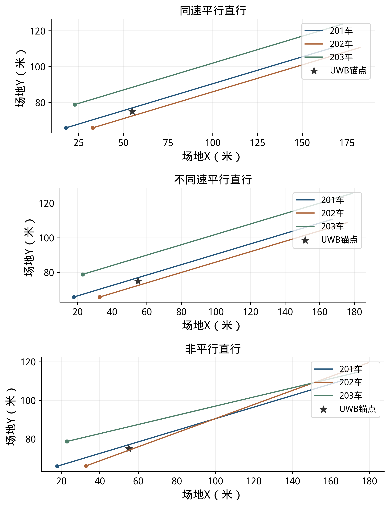
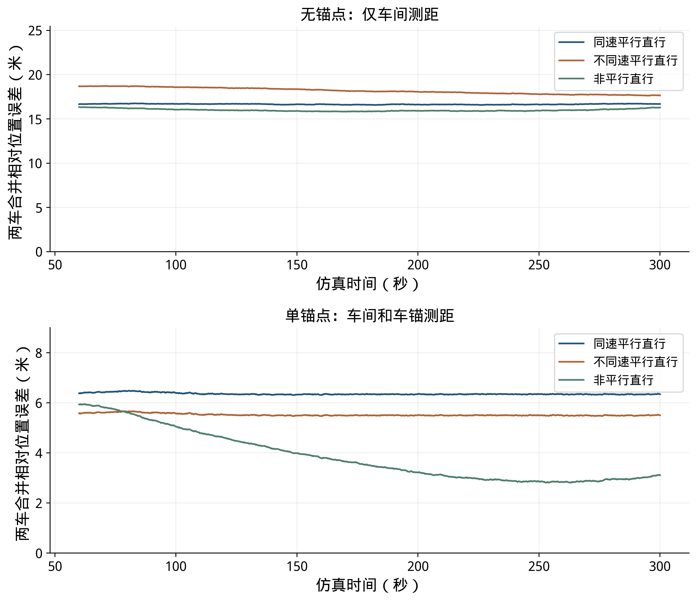
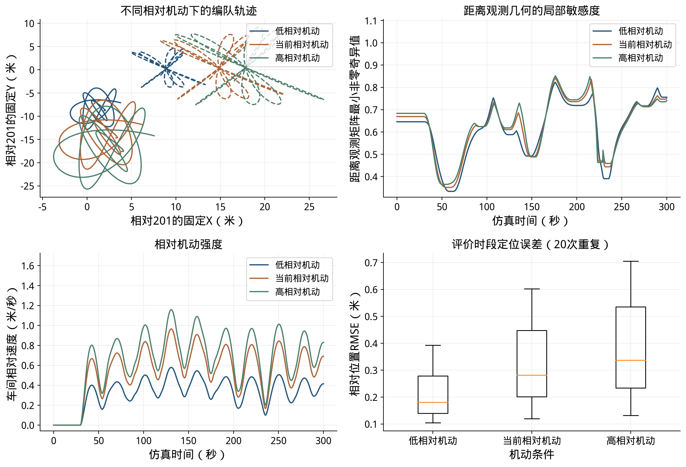
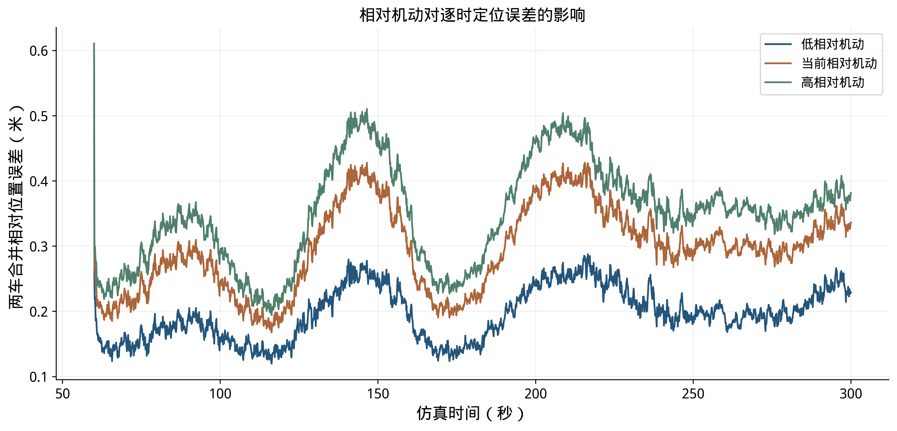
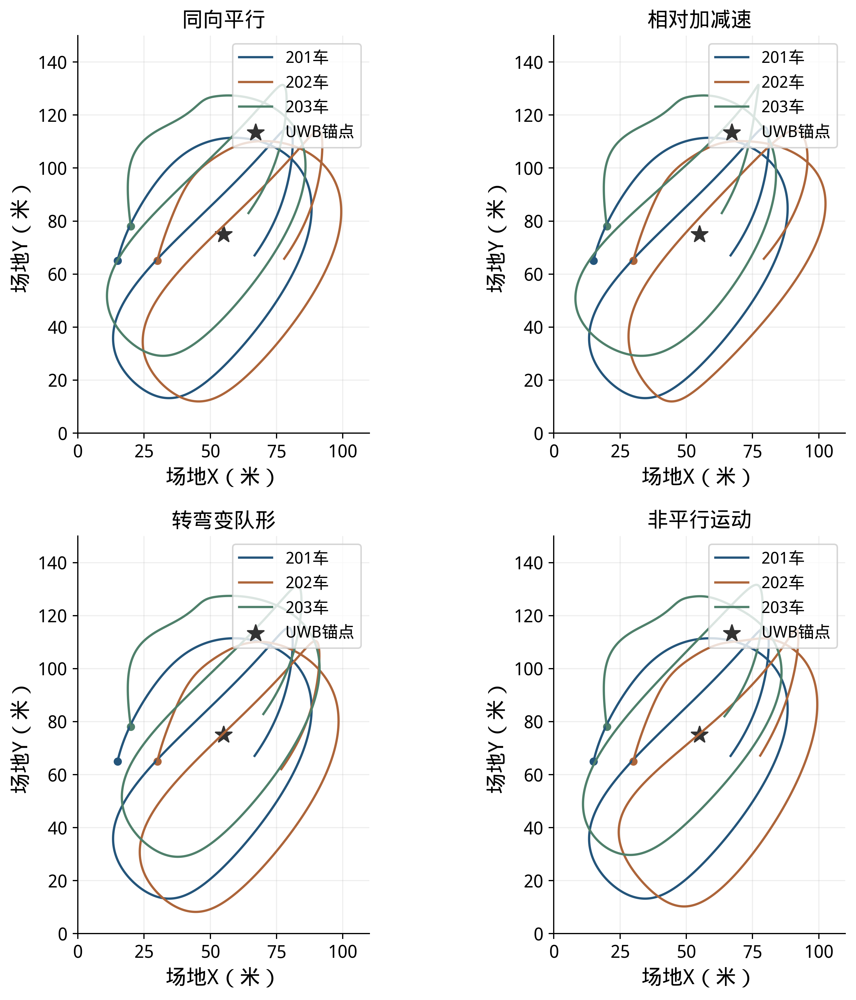
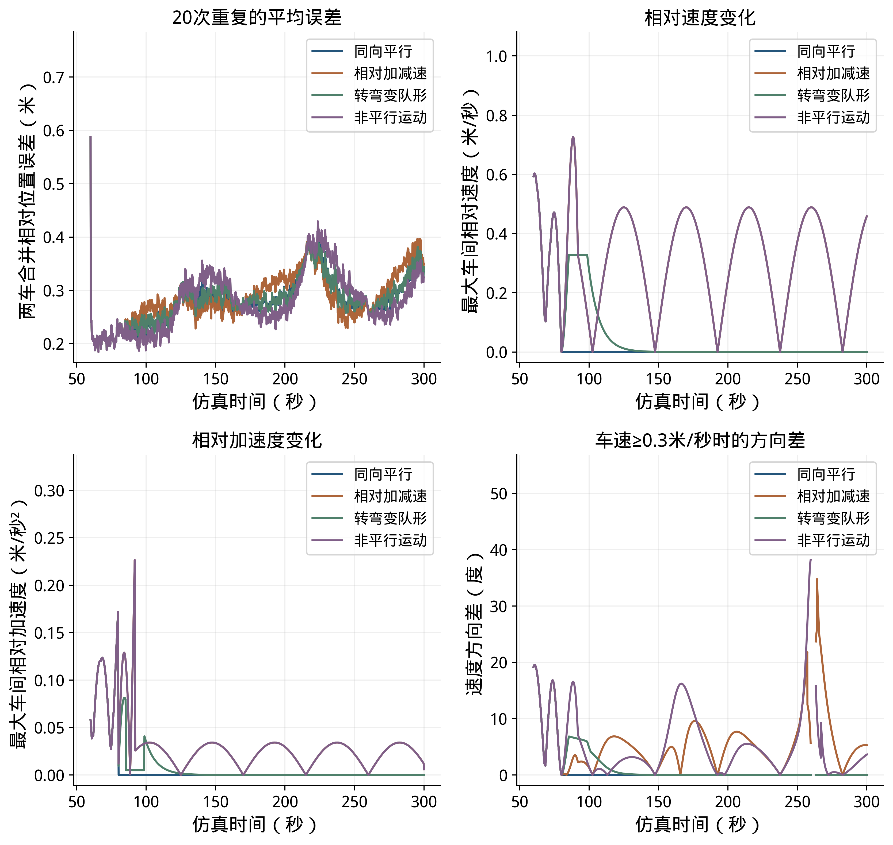
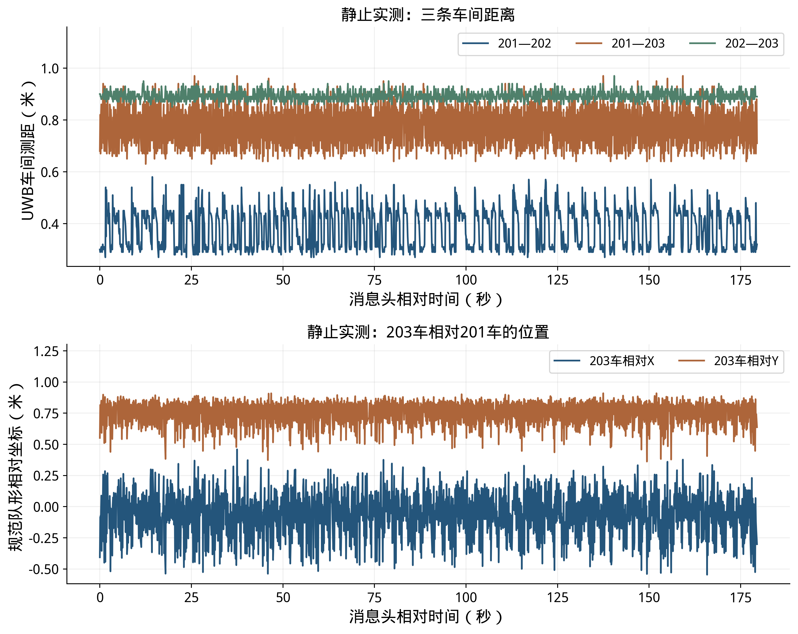
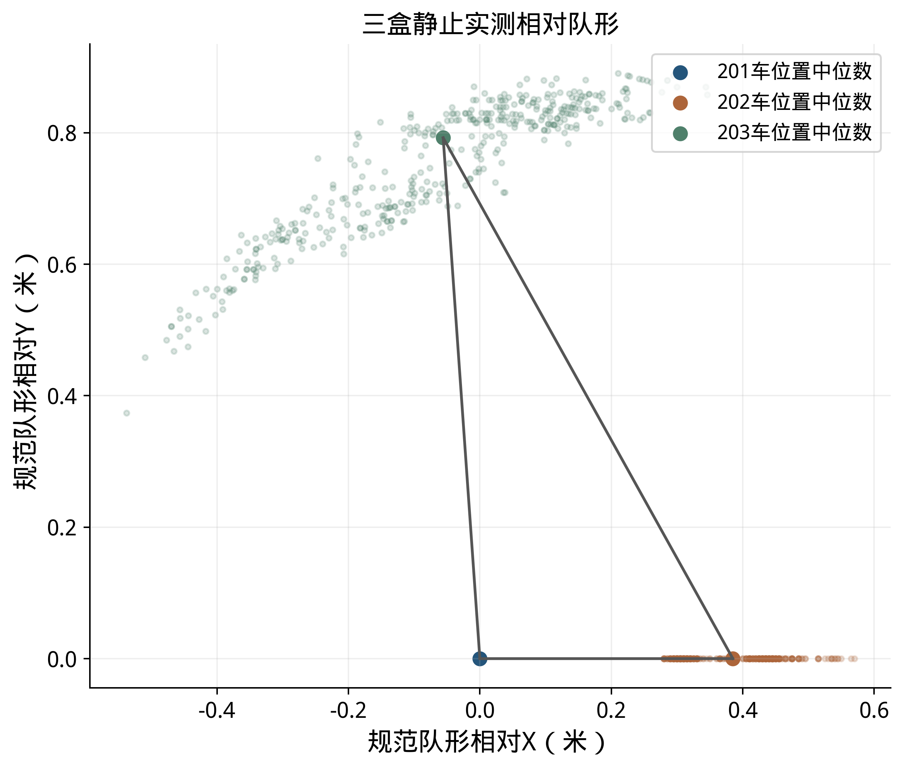
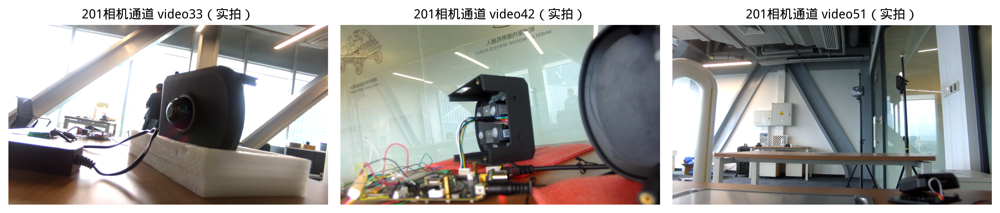
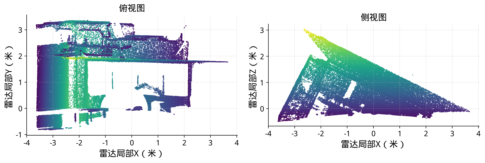

# 直线机动与结论章：改动前后对照

修改前源稿保存在内部材料/20261102_直线运动补充前/报告.md。以下按位置逐行列出报告改动：减号为原文，加号为新文。

```diff
--- 修改前/报告.md
+++ 修改后/报告.md
@@ -15,7 +15,7 @@
 | [3](#chapter_3) | [单锚点辅助与布置对比](#chapter_3) |
 | [4](#chapter_4) | [实测数据与接口应用](#chapter_4) |
 | [5](#chapter_5) | [实车采集与联调](#chapter_5) |
-| [6](#chapter_6) | [复现与阶段结论](#chapter_6) |
+| [6](#chapter_6) | [结论](#chapter_6) |
 
 <!-- pagebreak -->
 
@@ -41,7 +41,7 @@
 
 试验比较三件事：提高本车运动输入质量能降低多少误差，增加一个已知位置UWB锚点有多大作用，以及锚点的位置和测距精度怎样影响结果。三类输入各设三档，共9种运动输入。无锚点组使用车间距离和本车运动，单锚点组再加入三车到同一个锚点的距离；各组按实际可用测量求解初始关系，同编号对比使用相同运动与测距噪声样本。
 
-20次重复用于观察固定轨迹下随机误差带来的离散程度，属于噪声蒙特卡洛分析。所有重复均进入统计；单次过程图采用重复试验1，图3和图19分别展示20次结果的平均过程。仿真真值用于生成测量和评价，算法直接使用带误差的运动和距离输入输出定位结果。
+20次重复用于观察固定轨迹下随机误差带来的离散程度，属于噪声蒙特卡洛分析。所有重复均进入统计；单次过程图采用重复试验1，图3、图19、图21和图23展示20次结果的平均过程。仿真真值用于生成测量和评价，算法直接使用带误差的运动和距离输入输出定位结果。
 表1 仿真项目与分组
 
 | 试验目的 | 条件设置 | 条件数 | 重复次数 |
@@ -394,9 +394,43 @@
 
 ### 3.5 机动对相对定位的影响
 
-前面的峰值分析说明了方向误差的表现。本节比较不同相对机动幅度下的距离观测变化和位置误差。三组均使用中部单锚点、室外退化VIO增强输入、10厘米测距、20次重复和同编号随机误差样本；把202、203相对201的运动幅度分别设置为当前轨迹的0.6、1.0和1.2倍，由此形成三组距离和运动输入。图18左上轨迹以及表22、图19的误差，均以201当前位置为原点、201自身起点局部轴为固定轴。各组按各自的起步测量建立初始关系，统计60～300秒的定位结果。
-
-表22 机动条件与定位结果
+先比较三种基本直线运动：三车同向同速平行直行、同向不同速平行直行，以及方向不同的非平行直行。三车从同一组初始位置出发，前30秒静止，30～40秒平滑起步，40～300秒各自保持恒速直线。201车速度为0.600米/秒；不同速平行组中202、203车分别为0.575和0.625米/秒；非平行组中202、203车相对于201车的行驶方向分别偏转约3.34度，速度均约0.601米/秒。各组最大车间距不超过18.7米。
+
+每种运动分别计算无锚点和单锚点两种情况，各重复20次。两种情况下均使用VIO增强档和车间测距；单锚点组另使用三车到同一个中部锚点的测距。测距频率、误差和201参考坐标与前文一致，同编号试验使用对应的运动和测距误差样本。各组利用0～60秒实际具备的测量分别求初始关系，60～300秒统计位置误差。这里的无锚点结果采用运动信息与车间测距联合计算，第2.1节默认纯UWB队形采用另一种坐标定义。
+
+图18展示40秒后的三车直线轨迹。为分析这些运动是否有助于区分位置和方向，先假设各车局部位移准确，使用40～300秒、每秒一次的距离计算局部测距敏感度。无锚点时，待区分的量为202、203相对201的四个位置分量及两车的局部位移方向，共6个；单锚点时增加201相对锚点的两个位置分量，共8个。表22给出各组在本模型下能区分的独立变化数量；达到待区分数量表示真值附近的局部变化可以区分。
+
+
+
+表22 直线运动下的局部测距约束
+
+| 运动方式 | 无锚点（共6项） | 单锚点（共8项） |
+|---|---|---|
+| 同速平行直行 | 5/6 | 8/8 |
+| 不同速平行直行 | 5/6 | 8/8 |
+| 非平行直行 | 6/6 | 8/8 |
+
+无锚点的两种平行直行均为5/6，存在一个局部难以区分的方向；本次非平行直行为6/6。增加单锚点后，三种情况在这一局部分析中均为8/8。这个比较说明，运动方向和车锚距离都可能改变状态约束；局部结果不能单独保证全局只有一组解，也不等于实际定位误差。
+
+下表和图19给出实际定位仿真的结果。表中均值和范围均由每组全部20次的60～300秒相对位置RMSE计算，图线为20次逐时误差的平均值。
+
+表23 直线运动下的相对位置误差
+
+| 运动方式 | 无锚点均值（米） | 无锚点范围（米） | 单锚点均值（米） | 单锚点范围（米） |
+|---|---|---|---|---|
+| 同速平行直行 | 16.672 | 1.013～28.811 | 6.366 | 0.112～16.815 |
+| 不同速平行直行 | 18.213 | 1.099～28.157 | 5.531 | 0.113～16.942 |
+| 非平行直行 | 16.088 | 0.624～25.187 | 3.987 | 0.175～10.038 |
+
+
+
+三种直线运动中，加入锚点均降低了本组20次试验的平均误差；同时，各组误差仍有较大离散。单锚点的同速平行、不同速平行和非平行组分别有7、6和7次在60秒形成与真值镜像的队形关系。这些次数按两车相对201位置的左右方向判断，误差统计保留全部运行结果。
+
+起步阶段一直沿直线运动时，镜像位置及方向关系可能产生相近的测距结果。数值求解按测距拟合选择初始关系，部分试验因此选择了镜像解；后续测距和运动更新未必能及时改正，拉高了平均误差。局部敏感度达到满秩与镜像解同时出现并不矛盾：前者讨论某个解附近的微小变化，后者涉及相距较远的另一组候选解。后续可保留多个初始候选，并结合持续运动、车载相机或雷达的相对方位观测判断位置关系。
+
+在上述直线对照之外，进一步比较不同相对机动幅度下的距离观测变化和位置误差。三组均使用中部单锚点、室外退化VIO增强输入、10厘米测距、20次重复和同编号随机误差样本；把202、203相对201的运动幅度分别设置为当前轨迹的0.6、1.0和1.2倍，由此形成三组距离和运动输入。图20左上轨迹以及表24、图21的误差，均以201当前位置为原点、201自身起点局部轴为固定轴。各组按各自的起步测量建立初始关系，统计60～300秒的定位结果。
+
+表24 机动条件与定位结果
 
 | 机动条件 | 车间相对速度最大值（米/秒） | 距离观测最小非零敏感度中位数 | RMSE均值±标准差（米） | RMSE范围（米） |
 |---|---|---|---|---|
@@ -404,23 +438,23 @@
 | 当前相对机动 | 0.978 | 0.689 | 0.321±0.159 | 0.120～0.602 |
 | 高相对机动 | 1.173 | 0.700 | 0.377±0.187 | 0.132～0.705 |
 
-
-
-
-
-图18包含四个子图：左上是三种机动下202、203相对201的轨迹；右上是最近5秒内距离观测最小非零敏感度的最小值，左下是最近5秒内最大车间相对速度的均方根；右下是20次重复试验在60～300秒的位置RMSE分布。表22的敏感度为60～300秒逐时值的中位数。图19为20次重复的平均误差过程。距离本身对整队共同转动仍有一个不敏感方向，因此右上采用最小非零值表示其余位置变化的可区分程度；数值越大，距离变化对位置变化越敏感。
-
-从图19可见，本次单锚点对照中，较大相对机动对应的平均误差及部分峰值更高。例如在146.5秒，低、当前和高相对机动组的20次平均误差分别为0.278、0.428和0.511米。三组同时改变了相对轨迹、车间和车锚测距几何及本车运动输入，并分别求解初始关系，因此这一结果反映了本次条件下机动幅度变化与误差的关系。为进一步分辨峰值由哪些因素造成，还需分别控制测距几何、起点关系和运动输入开展对照。
+
+
+
+
+图20包含四个子图：左上是三种机动下202、203相对201的轨迹；右上是最近5秒内距离观测最小非零敏感度的最小值，左下是最近5秒内最大车间相对速度的均方根；右下是20次重复试验在60～300秒的位置RMSE分布。表24的敏感度为60～300秒逐时值的中位数。图21为20次重复的平均误差过程。距离本身对整队共同转动仍有一个不敏感方向，因此右上采用最小非零值表示其余位置变化的可区分程度；数值越大，距离变化对位置变化越敏感。
+
+从图21可见，本次单锚点对照中，较大相对机动对应的平均误差及部分峰值更高。例如在146.5秒，低、当前和高相对机动组的20次平均误差分别为0.278、0.428和0.511米。三组同时改变了相对轨迹、车间和车锚测距几何及本车运动输入，并分别求解初始关系，因此这一结果反映了本次条件下机动幅度变化与误差的关系。为进一步分辨峰值由哪些因素造成，还需分别控制测距几何、起点关系和运动输入开展对照。
 
 当前三组中，车间相对速度最大值由0.587米/秒增加到0.978和1.173米/秒，距离观测几何的最小非零敏感度中位数由0.685增加到0.689和0.700；同时60～300秒位置RMSE均值由0.214米增加到0.321和0.377米。该对照中，相对机动改变了测距几何与各车运动输入，较高机动对应的位置RMSE没有降低。后续实车可按低速直行、转弯和编队变速分别采集，在相同测距条件下比较位置误差。
 
 机动方式还包括车辆之间的加减速、转弯和行驶方向变化。为比较这些因素，在同一条201车轨迹上设置同向平行、相对加减速、转弯变队形和非平行运动四种情况，各重复20次。四组在0～60秒采用相同的三车运动、起步测量和初始关系，60～80秒平滑过渡，80秒后进入各自的运动方式；同编号试验使用相同的测距和运动误差样本。运动输入采用VIO增强档，使用同一个中部锚点，测距误差及评价坐标与本节前述条件一致。
 
-图20给出四组完整轨迹。同向平行组保持各车间的相对位置不变，三车随201车共同转弯；相对加减速组在场地X方向增加往复相对运动，非平行组在场地Y方向增加往复相对运动，转弯变队形组在201车转弯时调整队形方向。这些运动方式可能同时改变相对速度、加速度和方向，不将它们视为彼此完全独立的因素。四组最高车速为2.52米/秒，最大车间距为27.72米。
-
-
-
-表23 不同机动方式的定位结果
+图22给出四组完整轨迹。同向平行组保持各车间的相对位置不变，三车随201车共同转弯；相对加减速组在场地X方向增加往复相对运动，非平行组在场地Y方向增加往复相对运动，转弯变队形组在201车转弯时调整队形方向。这些运动方式可能同时改变相对速度、加速度和方向，不将它们视为彼此完全独立的因素。四组最高车速为2.52米/秒，最大车间距为27.72米。
+
+
+
+表25 不同机动方式的定位结果
 
 | 机动方式 | 最大相对速度（米/秒） | 最大相对加速度（米/秒²） | 最大方向差（度） | 位置RMSE范围（米） |
 |---|---|---|---|---|
@@ -429,9 +463,9 @@
 | 转弯变队形 | 0.328 | 0.090 | 6.8 | 0.117～0.592 |
 | 非平行运动 | 0.726 | 0.226 | 38.2 | 0.115～0.595 |
 
-
-
-图21上方为20次重复的平均位置误差和最大车间相对速度，下方为最大车间相对加速度和201车与其他车辆的最大运动方向差。方向差只在对应两车速度均不低于0.3米/秒时统计，以免车辆接近静止时方向角失去意义。表23的运动量取80～300秒最大值；位置RMSE按60～300秒计算，范围包括各组全部20次结果。
+
+
+图23上方为20次重复的平均位置误差和最大车间相对速度，下方为最大车间相对加速度和201车与其他车辆的最大运动方向差。方向差只在对应两车速度均不低于0.3米/秒时统计，以免车辆接近静止时方向角失去意义。表25的运动量取80～300秒最大值；位置RMSE按60～300秒计算，范围包括各组全部20次结果。
 
 四组位置RMSE均值依次为0.301、0.308、0.302和0.302米，全部80次运行的RMSE为0.115～0.610米。相同起步过程使四组在前段的误差过程一致，之后曲线有交叉；在本次设定下，不同运动方式的平均RMSE接近，不能据此认为某一种机动总能提高精度，也不能仅凭图中峰值判断由哪一种机动引起。两组往复运动的位移幅度和周期相同，因此对应的最大相对速度和加速度曲线重合，方向差则随运动方向不同而变化。
 
@@ -443,7 +477,7 @@
 
 六组静止采集共记录3,229,145帧车载IMU及48,985帧UWB测距，已用于传感器分析、默认UWB位置回放及输入检查。下表用数据编号1～6列示采集规模。消息头时间戳（Header）为消息携带的测量时间，实测曲线按其相对起点表示。
 
-表24 六组静止实测数据
+表26 六组静止实测数据
 
 | 数据编号 | 采集状态 | 车载IMU帧数 | UWB测距帧数 | 已开展的分析 |
 |---|---|---|---|---|
@@ -454,15 +488,15 @@
 | 5 | 三盒静止 | 539,229 | 9,681 | 测距统计、静止IMU特性分析 |
 | 6 | 三盒静止 | 536,078 | 8,235 | 测距统计、静止IMU特性分析 |
 
-
-
-
+
+
+
 
 两批在线输出频率约9.24～9.42赫兹。三盒均已完成三目视觉采集，雷达点云采集已完成；点云与图像后续需按特征提取、标定和甲方实车调试流程接入。已有静止数据用于输入质量分析和回放，动态位置误差按独立运动真值评价。
 
-
-
-
+
+
+
 
 点云图直接读取主盒/livox/lidar消息，累积225条消息，去除全零和非有限点后固定抽样绘制12万个点，分别给出俯视及侧视投影，颜色辅助区分点高。它展示采集场景的空间结构，与三目图像一起为后续实车视场检查、特征提取和安装标定提供数据。图中使用本盒雷达局部坐标。
 
@@ -470,7 +504,7 @@
 
 默认UWB输出话题为/cooperative_localization/poses_2d，坐标系为coop_ref_1_relative，采用瞬时队形坐标定义。RTE原始话题/cooperative_localization/rte/poses_2d的坐标标识为coop_rte_1_local，以201当前位置为原点、201本车初始局部轴为固定轴。启用坐标转换后，/cooperative_localization/rte/coordinates/poses_2d以201当前位置为原点，X轴沿首次有效结果中201指向202的方向并保持固定，坐标标识为coop_rte_1_relative_fixed。下表给出定位输入及输出，接收方按车辆编号、对应坐标系、测量时间与有效性使用位置。
 
-表25 定位输入与输出
+表27 定位输入与输出
 
 | 输入或输出 | 话题及消息类型 | 频率 |
 |---|---|---|
@@ -492,44 +526,7 @@
 
 运动试验配套独立位置测量，例如载波相位差分定位（Real-Time Kinematic，RTK）或全站仪。定位侧按统一车辆编号输出相对位置和测量时间，通信、规划与控制沿用现有消息接口接入；需要地图坐标时，将实测方向关系与任务局部系结合换算。采集命令、启动顺序和时间检查继续使用21号操作文档。
 
-## 6 复现与阶段结论
-
-### 6.1 仿真与图表重算
-
-运动与测距输入保存在data/single_anchor_outdoor_20261029，无锚点和布点原始输出保存在data/single_anchor_layout_20261029。报告统一201坐标的输出及统计保存在data/common_reference_20261030；峰值对照与RTE参数对照分别保存在data/fusion_peak_analysis_20261030和data/rte_startup_diagnostics_20261030；不同机动方式的逐次结果保存在data/maneuver_types_20261102。统一坐标目录的summary.json给出逐条件统计，全部仿真结果.csv便于查表，outputs保存全部重复的逐时位置。本版实验条件清单.json逐项列出报告采用的84个条件及输出文件；按对应输出能够复算全部1680次统计。
-
-```bash
-PYTHONPATH=tools OPENBLAS_NUM_THREADS=1 python3 tools/evaluate_single_anchor.py --trials 20
-PYTHONPATH=tools OPENBLAS_NUM_THREADS=1 python3 tools/evaluate_anchor_layout.py
-PYTHONPATH=tools python3 tools/check_anchor_layout.py
-PYTHONPATH=tools python3 tools/plot_single_anchor.py
-PYTHONPATH=tools python3 tools/plot_anchor_layout.py
-source /opt/ros/humble/setup.bash
-python3 tools/plot_report_replay.py --replay-rte
-PYTHONPATH=tools python3 tools/evaluate_common_reference.py
-PYTHONPATH=tools python3 tools/analyze_fusion_peaks.py
-PYTHONPATH=tools python3 tools/analyze_fusion_peaks.py --profiles vio_精细 --output data/fusion_peak_vio_precise_20261102
-PYTHONPATH=tools python3 tools/evaluate_rte_startup_diagnostics.py
-PYTHONPATH=tools python3 tools/plot_fusion_review.py
-PYTHONPATH=tools python3 tools/analyze_maneuver_observability.py --plot-only
-PYTHONPATH=tools python3 tools/analyze_maneuver_types.py --plot-only
-PYTHONPATH=tools python3 tools/plot_initialization_candidates.py
-python3 tools/check_report_consistency.py
-python3 tools/check_report_results.py
-python3 tools/check_fusion_review.py
-python3 tools/analyze_rte_initialization.py
-```
-
-手工修改本报告Markdown后，用以下命令更新其他格式；它们保留手工源稿：
-
-```bash
-PYTHONPATH=/tmp/cooperative_report_deps python3 tools/render_formal_report.py
-python3 tools/export_formal_pdf.py
-```
-
-图1直接使用提供的原图。误差图及统计表读取保存的算法输出与真值，点云读取原始消息，三目图像使用实际采集画面。图中文字由绘图方法按明确文字与字体排版；结果图提供PNG、SVG及矢量PDF。逐图数据和重算命令见配套复现说明，SVG可用Inkscape修改。
-
-### 6.2 阶段结论
+## 6 结论
 
 三盒采集、默认UWB相对队形、独立RTE库和消息接口已形成可运行链路。六组静止数据支持输入分析及位置回放，本轮仿真补充了三类运动输入、三档质量、三档测距误差与五个单锚点候选位置的量化对比。参数、统计、误差过程及轨迹按同一条件相邻列示。
 
```

配套新增直线运动仿真、原始输出及图表；复现命令和图表来源保留在阅读与复现说明中。报告生成器、目录、编号和核对工具同步更新。
