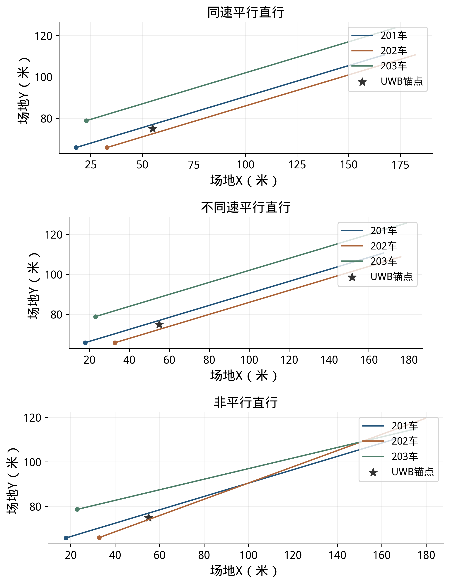
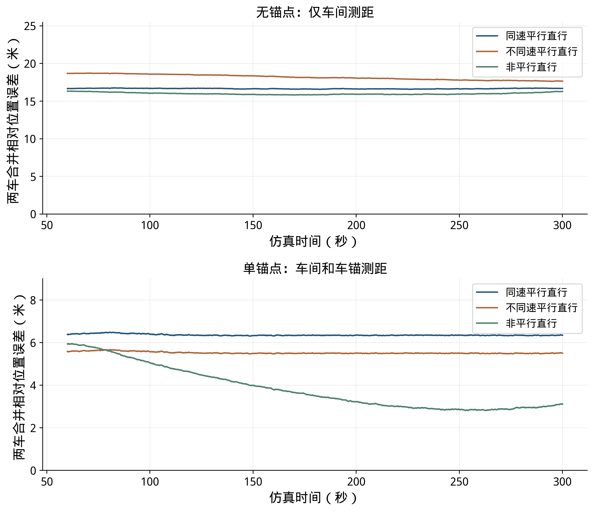
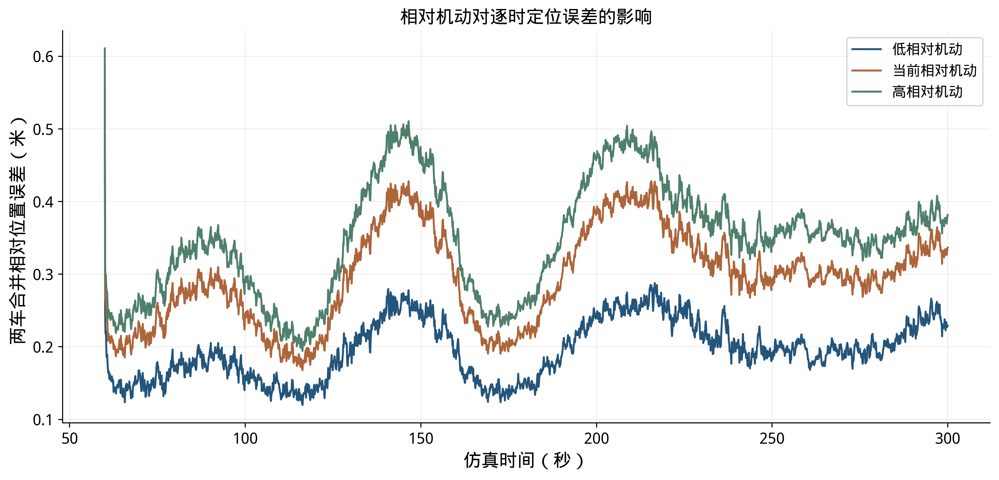
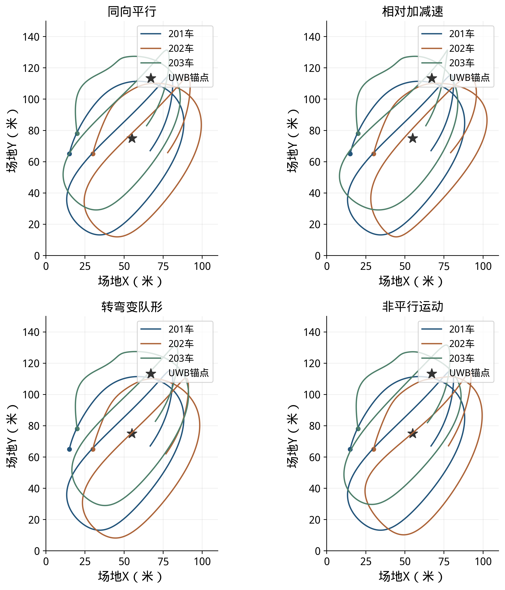
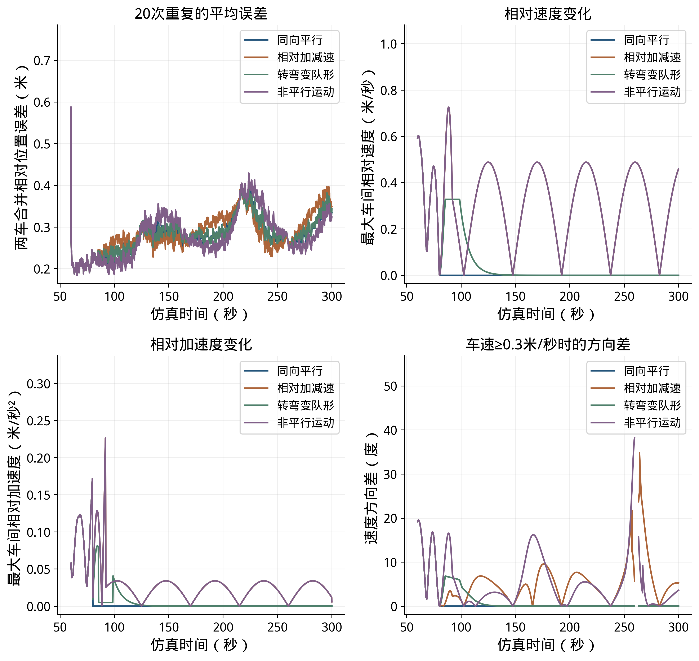

# 直线运动说明压缩：改动前后对照

修改前报告保存在内部材料/20261102_直线说明压缩前/报告.md。以下按位置逐行列示删除和新增的正文；减号为原文，加号为新文。

```diff
--- 修改前/报告.md
+++ 修改后/报告.md
@@ -394,27 +394,15 @@
 
 ### 3.5 机动对相对定位的影响
 
-先比较三种基本直线运动：三车同向同速平行直行、同向不同速平行直行，以及方向不同的非平行直行。三车从同一组初始位置出发，前30秒静止，30～40秒平滑起步，40～300秒各自保持恒速直线。201车速度为0.600米/秒；不同速平行组中202、203车分别为0.575和0.625米/秒；非平行组中202、203车相对于201车的行驶方向分别偏转约3.34度，速度均约0.601米/秒。各组最大车间距不超过18.7米。
-
-每种运动分别计算无锚点和单锚点两种情况，各重复20次。两种情况下均使用VIO增强档和车间测距；单锚点组另使用三车到同一个中部锚点的测距。测距频率、误差和201参考坐标与前文一致，同编号试验使用对应的运动和测距误差样本。各组利用0～60秒实际具备的测量分别求初始关系，60～300秒统计位置误差。这里的无锚点结果采用运动信息与车间测距联合计算，第2.1节默认纯UWB队形采用另一种坐标定义。
-
-图18展示40秒后的三车直线轨迹。为分析这些运动是否有助于区分位置和方向，先假设各车局部位移准确，使用40～300秒、每秒一次的距离计算局部测距敏感度。无锚点时，待区分的量为202、203相对201的四个位置分量及两车的局部位移方向，共6个；单锚点时增加201相对锚点的两个位置分量，共8个。表22给出各组在本模型下能区分的独立变化数量；达到待区分数量表示真值附近的局部变化可以区分。
+直线运动对照包括同速平行、不同速平行和非平行直行，如图18所示。三组试验采用相同的三车起始位置，40～300秒保持直线运动，最高车速约0.63米/秒，最大车间距不超过18.7米；不同速平行组中202、203车的速度分别为0.575和0.625米/秒，非平行组中两车的行驶方向相对201车分别偏转约3.34度。
+
+各组分别比较无锚点和单锚点情况，均使用VIO增强档和车间测距，单锚点组增加车锚测距；测距误差标准差为10厘米，每种条件重复20次，使用对应的误差样本。各组按实际可用的测距和运动信息求初始关系，以60～300秒的相对位置误差计算RMSE。这里的无锚点结果采用运动信息与车间测距联合计算，第2.1节默认纯UWB队形采用另一种坐标定义。
 
 
 
-表22 直线运动下的局部测距约束
-
-| 运动方式 | 无锚点（共6项） | 单锚点（共8项） |
-|---|---|---|
-| 同速平行直行 | 5/6 | 8/8 |
-| 不同速平行直行 | 5/6 | 8/8 |
-| 非平行直行 | 6/6 | 8/8 |
-
-无锚点的两种平行直行均为5/6，存在一个局部难以区分的方向；本次非平行直行为6/6。增加单锚点后，三种情况在这一局部分析中均为8/8。这个比较说明，运动方向和车锚距离都可能改变状态约束；局部结果不能单独保证全局只有一组解，也不等于实际定位误差。
-
-下表和图19给出实际定位仿真的结果。表中均值和范围均由每组全部20次的60～300秒相对位置RMSE计算，图线为20次逐时误差的平均值。
-
-表23 直线运动下的相对位置误差
+同速平行直行时，车间距离基本不变；非平行直行使车间位置关系发生变化；在假设局部位移准确的分析中，本组非平行直行对位置关系的局部约束有所改善。表22和图19给出20次试验的定位误差：表中列出各次RMSE的均值和范围，曲线为逐时误差的平均值。
+
+表22 直线运动下的相对位置误差
 
 | 运动方式 | 无锚点均值（米） | 无锚点范围（米） | 单锚点均值（米） | 单锚点范围（米） |
 |---|---|---|---|---|
@@ -424,13 +412,11 @@
 
 
 
-三种直线运动中，加入锚点均降低了本组20次试验的平均误差；同时，各组误差仍有较大离散。单锚点的同速平行、不同速平行和非平行组分别有7、6和7次在60秒形成与真值镜像的队形关系。这些次数按两车相对201位置的左右方向判断，误差统计保留全部运行结果。
-
-起步阶段一直沿直线运动时，镜像位置及方向关系可能产生相近的测距结果。数值求解按测距拟合选择初始关系，部分试验因此选择了镜像解；后续测距和运动更新未必能及时改正，拉高了平均误差。局部敏感度达到满秩与镜像解同时出现并不矛盾：前者讨论某个解附近的微小变化，后者涉及相距较远的另一组候选解。后续可保留多个初始候选，并结合持续运动、车载相机或雷达的相对方位观测判断位置关系。
-
-在上述直线对照之外，进一步比较不同相对机动幅度下的距离观测变化和位置误差。三组均使用中部单锚点、室外退化VIO增强输入、10厘米测距、20次重复和同编号随机误差样本；把202、203相对201的运动幅度分别设置为当前轨迹的0.6、1.0和1.2倍，由此形成三组距离和运动输入。图20左上轨迹以及表24、图21的误差，均以201当前位置为原点、201自身起点局部轴为固定轴。各组按各自的起步测量建立初始关系，统计60～300秒的定位结果。
-
-表24 机动条件与定位结果
+三种直线运动加入锚点后，20次试验的平均误差均有所降低。起步阶段持续直行时，仅凭距离和运动信息可能将左右相反的队形判断为同一种位置关系。单锚点的同速平行、不同速平行和非平行组分别有7、6和7次在60秒出现镜像队形，造成较大位置误差；表中保留了全部试验结果。后续可结合持续运动及相机或雷达提供的相对方位，进一步区分候选位置。
+
+在上述直线对照之外，进一步比较不同相对机动幅度下的距离观测变化和位置误差。三组均使用中部单锚点、室外退化VIO增强输入、10厘米测距、20次重复和同编号随机误差样本；把202、203相对201的运动幅度分别设置为当前轨迹的0.6、1.0和1.2倍，由此形成三组距离和运动输入。图20左上轨迹以及表23、图21的误差，均以201当前位置为原点、201自身起点局部轴为固定轴。各组按各自的起步测量建立初始关系，统计60～300秒的定位结果。
+
+表23 机动条件与定位结果
 
 | 机动条件 | 车间相对速度最大值（米/秒） | 距离观测最小非零敏感度中位数 | RMSE均值±标准差（米） | RMSE范围（米） |
 |---|---|---|---|---|
@@ -442,7 +428,7 @@
 
 
 
-图20包含四个子图：左上是三种机动下202、203相对201的轨迹；右上是最近5秒内距离观测最小非零敏感度的最小值，左下是最近5秒内最大车间相对速度的均方根；右下是20次重复试验在60～300秒的位置RMSE分布。表24的敏感度为60～300秒逐时值的中位数。图21为20次重复的平均误差过程。距离本身对整队共同转动仍有一个不敏感方向，因此右上采用最小非零值表示其余位置变化的可区分程度；数值越大，距离变化对位置变化越敏感。
+图20包含四个子图：左上是三种机动下202、203相对201的轨迹；右上是最近5秒内距离观测最小非零敏感度的最小值，左下是最近5秒内最大车间相对速度的均方根；右下是20次重复试验在60～300秒的位置RMSE分布。表23的敏感度为60～300秒逐时值的中位数。图21为20次重复的平均误差过程。距离本身对整队共同转动仍有一个不敏感方向，因此右上采用最小非零值表示其余位置变化的可区分程度；数值越大，距离变化对位置变化越敏感。
 
 从图21可见，本次单锚点对照中，较大相对机动对应的平均误差及部分峰值更高。例如在146.5秒，低、当前和高相对机动组的20次平均误差分别为0.278、0.428和0.511米。三组同时改变了相对轨迹、车间和车锚测距几何及本车运动输入，并分别求解初始关系，因此这一结果反映了本次条件下机动幅度变化与误差的关系。为进一步分辨峰值由哪些因素造成，还需分别控制测距几何、起点关系和运动输入开展对照。
 
@@ -454,7 +440,7 @@
 
 
 
-表25 不同机动方式的定位结果
+表24 不同机动方式的定位结果
 
 | 机动方式 | 最大相对速度（米/秒） | 最大相对加速度（米/秒²） | 最大方向差（度） | 位置RMSE范围（米） |
 |---|---|---|---|---|
@@ -465,7 +451,7 @@
 
 
 
-图23上方为20次重复的平均位置误差和最大车间相对速度，下方为最大车间相对加速度和201车与其他车辆的最大运动方向差。方向差只在对应两车速度均不低于0.3米/秒时统计，以免车辆接近静止时方向角失去意义。表25的运动量取80～300秒最大值；位置RMSE按60～300秒计算，范围包括各组全部20次结果。
+图23上方为20次重复的平均位置误差和最大车间相对速度，下方为最大车间相对加速度和201车与其他车辆的最大运动方向差。方向差只在对应两车速度均不低于0.3米/秒时统计，以免车辆接近静止时方向角失去意义。表24的运动量取80～300秒最大值；位置RMSE按60～300秒计算，范围包括各组全部20次结果。
 
 四组位置RMSE均值依次为0.301、0.308、0.302和0.302米，全部80次运行的RMSE为0.115～0.610米。相同起步过程使四组在前段的误差过程一致，之后曲线有交叉；在本次设定下，不同运动方式的平均RMSE接近，不能据此认为某一种机动总能提高精度，也不能仅凭图中峰值判断由哪一种机动引起。两组往复运动的位移幅度和周期相同，因此对应的最大相对速度和加速度曲线重合，方向差则随运动方向不同而变化。
 
@@ -477,7 +463,7 @@
 
 六组静止采集共记录3,229,145帧车载IMU及48,985帧UWB测距，已用于传感器分析、默认UWB位置回放及输入检查。下表用数据编号1～6列示采集规模。消息头时间戳（Header）为消息携带的测量时间，实测曲线按其相对起点表示。
 
-表26 六组静止实测数据
+表25 六组静止实测数据
 
 | 数据编号 | 采集状态 | 车载IMU帧数 | UWB测距帧数 | 已开展的分析 |
 |---|---|---|---|---|
@@ -504,7 +490,7 @@
 
 默认UWB输出话题为/cooperative_localization/poses_2d，坐标系为coop_ref_1_relative，采用瞬时队形坐标定义。RTE原始话题/cooperative_localization/rte/poses_2d的坐标标识为coop_rte_1_local，以201当前位置为原点、201本车初始局部轴为固定轴。启用坐标转换后，/cooperative_localization/rte/coordinates/poses_2d以201当前位置为原点，X轴沿首次有效结果中201指向202的方向并保持固定，坐标标识为coop_rte_1_relative_fixed。下表给出定位输入及输出，接收方按车辆编号、对应坐标系、测量时间与有效性使用位置。
 
-表27 定位输入与输出
+表26 定位输入与输出
 
 | 输入或输出 | 话题及消息类型 | 频率 |
 |---|---|---|
```

局部测距分析的状态定义保存在内部材料/直线运动局部测距分析补充说明.md，仿真结果、轨迹和图表均保留。报告生成器、图表目录和一致性检查同步调整。
